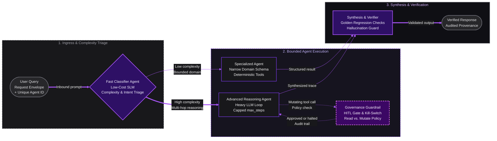

---
tags:
  - ai-engineering/agents/planning
  - ai-engineering/agents/governance
aliases:
  - LLM Agents
  - Agentic Systems
source: "What Are AI Agents?"
source-type: article
author: "Anna Gutowska"
published: 2024-07-03
url: "https://www.ibm.com/think/topics/ai-agents"
created: 2026-11-23
---
An **AI agent** is a [[Compound AI Systems|compound AI system]] in which a [[Large Language Models|large language model (LLM)]] dynamically controls execution flow—reasoning over a goal, invoking external tools, reading memory, and iterating on observations until the task is solved. **Unlike traditional pipelines with hardcoded control paths, agents delegate control logic to the model itself.**

---

## From Monolithic Models to Compound AI Systems

Standalone foundation models are bounded by their static training corpora. They cannot access private organizational data, live external state, or deterministic computation, and adapting them through fine-tuning requires substantial labeled data, compute, and iteration time.

While monolithic models handle self-contained language tasks well (summarizing documents, drafting emails or reports), production problems typically require **modular [[Software Engineering|system design]]** around the model:

- **Models:** Base LLMs, domain-tuned models, or specialized models (e.g., translation or image generation).
- **Programmatic Components:** Query decomposers, database connectors ([[SQL]] and [[NoSQL]]), API clients, calculators, and deterministic output verifiers.
- **Faster Adaptation:** Swapping a retrieval index, tool, or verifier updates system behavior immediately without retraining weights.

[[Retrieval-Augmented Generation|RAG]] is the canonical example of a compound AI system: a user query triggers a model-generated or programmatic search against a datastore, and retrieved records are injected back into the prompt to ground the final response.

---

## Programmatic vs. Agentic Control Logic

Every compound AI system has **control logic**—the decision path governing which components execute and in what order.

- **Programmatic Control Logic ("Think Fast"):** Human engineers hardcode the execution graph. A vacation-balance pipeline always queries the HR database, so an out-of-scope query (such as checking the weather) fails immediately because the control path cannot branch dynamically.
- **Agentic Control Logic ("Think Slow"):** The LLM is placed in charge of planning and routing. Instead of returning the first reactive token sequence, the model breaks complex problems into sub-steps, chooses external tools, inspects errors or partial results, and revises its plan before answering.

| Architecture | Control Logic | Adaptability | Latency & Cost Predictability | Best Fit | Senior Note |
| :--- | :--- | :--- | :--- | :--- | :--- |
| **Monolithic Model** | Single forward pass | Low (requires fine-tuning) | High (1 inference call) | Summarization, drafting, static transformations | Fails on private, real-time, or exact-math queries. |
| **Programmatic Compound AI** | Human-defined DAG / code | Medium (swap components) | High (fixed step count) | Narrow, well-defined domains (standard [[Retrieval-Augmented Generation\|RAG]]) | Prefer this default when query shapes are bounded. |
| **Agentic AI System** | LLM-driven loop | High (dynamic path discovery) | Low (variable iterations) | Open-ended, multi-hop tasks (e.g., resolving GitHub issues) | Requires step budgets, verification, and guardrails. |

---

## Core Capabilities of LLM Agents

An agent combines three foundational capabilities around the core model:

1. **Reasoning (Planning):** The LLM decomposes complex queries into ordered sub-goals, tracks progress across steps, and decides whether intermediate outputs satisfy the objective or require replanning.
2. **Acting (Tools):** External programs exposed to the model with clear invocation contracts; the model decides *when* and *how* to call them:
   - **Data Retrieval:** Web search engines or structured [[SQL]] and [[NoSQL]] database queries.
   - **Deterministic Computation:** Calculators or sandboxed code execution for arithmetic and logic.
   - **State Mutation & APIs:** Database updates, ticketing systems, or external HTTP/RPC services.
   - **Specialized Models:** Delegating focused subtasks (such as translation) to another model.
3. **Memory:** State persisted beyond a single prompt-response turn:
   - **Working / Trace Memory:** Storing internal reasoning logs and tool outputs ("thinking out loud") so prior intermediate steps can be retrieved during multi-step execution.
   - **Conversational / Long-Term Memory:** Retaining past user interactions to personalize future turns and avoid redundant lookups.

---

## Agent Architectural Taxonomy

Autonomous agents span a spectrum of complexity rooted in classical control theory. Selecting the appropriate architectural class minimizes compute cost, operational failure modes, and inference latency.

| Agent Class | State Representation | Decision Mechanism | Environment Observability | Senior Note |
| :--- | :--- | :--- | :--- | :--- |
| **Simple Reflex** | Stateless | Condition-action rules (`if/then`) | Fully observable | Do not use an LLM; implement via deterministic rules engines or lambda triggers. |
| **Model-Based Reflex** | Internal state / memory | Rules evaluated against an evolving internal world model | Partially observable | Tracks historical context (e.g., session cache) to operate under changing environments. |
| **Goal-Based** | World model + explicit objective | Forward search and planning graphs | Partially observable | Decomposes goals into dependency graphs; evaluates candidate action sequences before execution. |
| **Utility-Based** | World model + utility function | Multi-objective optimization | Partially observable | Evaluates trade-offs (latency vs. monetary cost vs. accuracy) across competing valid execution paths. |
| **Learning Agent** | Performance element + critic | Autonomous updates to experiential knowledge bases | Dynamic / Unfamiliar | Ingests runtime feedback to update external memory stores without retraining base weights. |

---

## Execution Paradigms: ReAct vs. ReWOO

Multi-step problem solving relies on different structural paradigms for planning and tool execution. For comprehensive architectures, implementation engines, and execution traces, see their dedicated reference notes:

- **[[ReAct Pattern]]**: Dynamic interleaving of reasoning traces ("thought") and tool invocations ("action/observation") in a continuous feedback loop.
- **[[ReWOO Pattern]]**: Decoupled execution paradigm generating a full tool dependency DAG upfront, executing tools concurrently, and synthesizing outputs in a single final pass.

### Architectural Summary: ReAct vs. ReWOO

| Dimension | [[ReAct Pattern]] (Reason + Act) | [[ReWOO Pattern]] (Reason Without Observation) |
| :--- | :--- | :--- |
| **Execution Flow** | Dynamic step-by-step loop (sequential) | Upfront planning DAG + batched / concurrent tool execution |
| **Token Consumption** | High (full trace context re-ingested per step) | Low (decouples reasoning prompt from tool execution traces) |
| **Latency Profile** | Variable and high (sum of all sequential round-trips) | Bounded and lower (parallelized external I/O) |
| **Failure Blast Radius** | Intermediate tool errors re-prompt model to backtrack | Upfront plan can fail if early tool output invalidates downstream schema |
| **Human Governance** | Requires continuous monitoring or per-step gating | Enables upfront inspection and single approval gate before execution |
| **Senior Note** | Choose ReAct for open-ended exploratory discovery where subsequent steps cannot be forecasted. | Choose ReWOO for deterministic DAGs, structured workflows, or when strict latency and token budgets apply. |

---

## Multi-Agent Orchestration & Failure Modes

Complex workflows benefit from multi-agent architectures that divide labor across specialized, bounded agents rather than relying on a single monolithic prompt loop.

### Hierarchical Routing & Triage

A lightweight, low-cost classifier routes incoming requests to narrow domain agents, escalating to heavy reasoning models only when task complexity warrants it:

### Multi-Agent Pitfalls & Operational Hazards

- **Correlated Foundation Model Pitfalls:** When multiple interacting agents share the same underlying base model weights, they often share identical blind spots, sycophantic tendencies, and reasoning biases—negating the diversity of multi-agent review.
- **Infinite Feedback Ping-Pong:** Agents passing conversational state or unconstrained critique loops to each other can trigger unbounded token-consuming cycles without converging on a solution.
- **Cascading Hallucination Amplification:** An early agent generating an erroneous synthetic observation can cause downstream agents to accept the hallucination as ground-truth context.

---

## Sliding Scale of Autonomy & Trade-offs

AI autonomy is a **spectrum**, not a binary architectural choice. Systems range from fully deterministic workflows with a single model call to highly autonomous agents that explore arbitrary execution paths.

### Enterprise Governance & Safety Controls

Production deployments of autonomous agents require deterministic infrastructure guardrails outside model weights:

1. **Structured Interruptibility (Kill-Switches):** Provide non-blocking cancel and pause capabilities. Handlers must terminate runaway loops gracefully while preserving working memory traces and executing transactional rollbacks on pending external side effects.
2. **Traceability & Unique Agent Identifiers (UAIDs):** Enforce cryptographic or unique system identifiers in all API and database connection headers invoked by an agent to maintain auditable provenance trails.
3. **Human Approval Gates for Destructive Actions:** Enforce a strict boundary between read-only tools (search, querying [[SQL]] or [[NoSQL]] stores) and mutating actions (financial transactions, public communications, data deletion).
4. **Agent Lifecycle Management (ALM):** Establish continuous evaluation pipelines testing agent prompt templates and tool definitions against deterministic golden regression datasets prior to production deployment.

### Notes & Pitfalls
- **Unnecessary Looping on Narrow Tasks:** Running a ReAct agent on a bounded, repetitive workflow (where every query hits the same datastore) wastes latency and tokens on redundant planning iterations compared to a programmatic pipeline.
- **Tool Failure Propagation:** External tools can return malformed data, empty results, or exceptions; agents must treat tool failures as explicit observations and enforce hard iteration caps (`max_steps`).
- **Immature Reliability & Human-in-the-Loop (HITL):** Because autonomous reasoning accuracy is still evolving, production systems typically require human approval gates before executing high-impact or state-mutating tool calls.

### When Not to Use AI Agents
- **Narrow, Well-Defined Problem Sets:** If the query space and data retrieval path are predictable, a programmatic compound system (e.g., standard [[Retrieval-Augmented Generation|RAG]] with output verifiers) is faster, cheaper, and more reliable.
- **Strict Latency or Cost Budgets:** Unbounded multi-step reasoning loops make tail latency and per-request inference spend hard to guarantee.
- **Unverified State Mutations:** Avoid granting autonomous write access to production databases or external APIs without deterministic validation and human-in-the-loop checkpoints.

> [!TIP]
> **Senior Lens:** Default to deterministic programmatic control logic when designing compound AI systems, and dial up autonomy incrementally. Introduce agentic loops only where query variance makes enumerating control paths infeasible—and always pair them with bounded step budgets, structured tool contracts, and human-in-the-loop gates for side effects.
