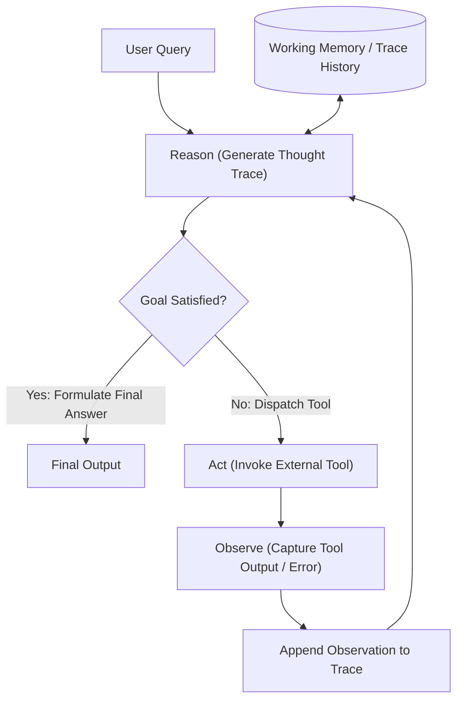

---
tags:
  - ai-engineering/agents/planning
aliases:
  - ReAct
  - Reason and Act
  - Synergizing Reasoning and Acting
source: "What Are AI Agents?"
source-type: article
author: "Anna Gutowska"
url: "https://www.ibm.com/think/topics/ai-agents"
created: 2026-11-24
---
The **ReAct (Reason + Act)** pattern is an [[AI Agents|AI agent]] execution architecture that tightly couples step-by-step reasoning ("thought traces") with external tool execution ("action" and "observation") in a continuous feedback loop. By generating reasoning traces before and after invoking external tools, ReAct enables language models to track progress, dynamically handle intermediate errors, and navigate multi-step problems without requiring upfront, static planning.

---

## Architectural Mechanics

Traditional foundation models generate direct answers in a single forward pass without verifying facts or interacting with live environments. ReAct introduces a stateful cyclic execution harness where the LLM alternates between reasoning about the current state and interacting with external systems.



### The Thought-Action-Observation Loop

Each cycle in a ReAct loop executes three distinct stages:

1. **Thought (Reasoning):** The model decomposes the current task state, identifies what information is missing, assesses prior tool results, and formulates the intent for the next action.
2. **Action (Acting):** The model emits a structured tool invocation (e.g., function name and arguments) mapped to external APIs, databases ([[SQL]] or [[NoSQL]]), web search, or calculators.
3. **Observation (Feedback):** The execution environment intercepts the action, calls the tool, and appends the raw execution result (or exception payload) back into the prompt context for the next reasoning step.

---

## Production Reference Implementation

A robust ReAct execution harness requires explicit iteration caps (`max_steps`), structured exception handling, and defensive tool boundaries to prevent infinite execution loops.

```python
from collections.abc import Callable
from dataclasses import dataclass
from typing import Any


@dataclass(frozen=True)
class AgentStep:
    thought: str
    tool_name: str | None = None
    tool_args: dict[str, Any] | None = None
    is_final: bool = False
    final_answer: str | None = None


class ReActHarness:
    """Production-grade bounded ReAct execution engine with deterministic safety gates."""

    def __init__(
        self,
        llm_client: Any,
        tools: dict[str, Callable[..., Any]],
        max_steps: int = 8,
    ):
        self.llm = llm_client
        self.tools = tools
        self.max_steps = max_steps

    def execute(self, query: str) -> str:
        trace: list[dict[str, str]] = [
            {
                "role": "system",
                "content": (
                    "Solve tasks by alternating Thought, Action, and Observation. "
                    "When finished, return final_answer."
                ),
            },
            {"role": "user", "content": query},
        ]

        for step_idx in range(1, self.max_steps + 1):
            step: AgentStep = self.llm.generate_step(
                trace=trace, available_tools=list(self.tools.keys())
            )

            # Record reasoning thought into conversational trace
            trace.append(
                {"role": "thought", "content": f"Step {step_idx}: {step.thought}"}
            )

            if step.is_final:
                return step.final_answer or "Task concluded without output."

            if not step.tool_name or step.tool_name not in self.tools:
                observation = f"ToolError: Unknown or missing tool '{step.tool_name}'"
            else:
                try:
                    tool_fn = self.tools[step.tool_name]
                    tool_args = step.tool_args or {}
                    raw_result = tool_fn(**tool_args)
                    observation = str(raw_result)
                except Exception as exc:
                    # Treat tool failures as observations so LLM can adapt or retry
                    observation = f"ToolExecutionError in '{step.tool_name}': {exc}"

            trace.append({"role": "observation", "content": observation})

        raise TimeoutError(
            f"ReAct agent exceeded max execution budget of {self.max_steps} steps."
        )
```

---

## Multi-Step Operational Trace

Consider a scenario where an engineer prompts an agent: *"Verify whether customer account 'ACC-8912' has pending charges exceeding their credit limit and summarize recent failed charges."*

```text
Thought 1: I need to query the account balance and credit limit for ACC-8912.
Action 1: query_account_ledger(account_id="ACC-8912")
Observation 1: {"credit_limit": 5000.0, "current_balance": 4650.0, "currency": "USD"}

Thought 2: The current balance is $4,650 against a $5,000 limit, leaving $350 available credit. Now I need to retrieve pending authorizations for ACC-8912.
Action 2: list_pending_transactions(account_id="ACC-8912")
Observation 2: [{"tx_id": "tx_901", "amount": 420.0, "status": "PENDING"}]

Thought 3: The pending transaction of $420 exceeds the remaining $350 credit margin. Next, I must check the audit log for any recent declined transactions.
Action 3: fetch_transaction_exceptions(account_id="ACC-8912", limit=3)
Observation 3: [{"tx_id": "tx_888", "reason": "INSUFFICIENT_FUNDS", "timestamp": "2026-11-24T08:14:00Z"}]

Thought 4: I have gathered all necessary context: available credit, pending breach amount, and recent failure logs. I can now synthesize the final response.
Action 4: Final Answer
Observation 4: Account ACC-8912 has $350 in available credit ($4,650 balance on a $5,000 limit). Pending transaction tx_901 for $420 exceeds the limit by $70. A prior transaction tx_888 failed earlier today due to INSUFFICIENT_FUNDS.
```

---

## ReAct vs. Static Planning Paradigms

| Architectural Dimension | ReAct Loop | Upfront DAG ([[ReWOO Pattern]]) |
| :--- | :--- | :--- |
| **Control Logic** | Dynamic step-by-step branching | Static dependency graph compiled upfront |
| **Observation Handling** | Immediate feedback informs subsequent steps | Observations deferred until all batch tool calls complete |
| **Error Recovery** | Dynamic back-off and self-correction upon tool error | Fails or requires re-planning if an upstream node produces an invalid schema |
| **Token Consumption** | High (full prompt history re-sent on every step) | Low (decouples task planning prompt from tool execution outputs) |
| **Inference Latency** | Sequential sum of $N$ round-trips to model + tools | Bounded; parallelizes non-dependent tool invocations |
| **Senior Note** | Ideal for exploratory investigations where the next action depends entirely on data retrieved in the current step. | Prefer upfront DAGs when tasks follow deterministic, predictable data access paths. |

---

## Architectural Pitfalls & Failure Modes

- **Token Compounding & Latency Inflation:** Because the entire historical trace (`Thought + Action + Observation`) is prepended to each subsequent model request, token usage grows quadratically with loop length, degrading inference latency.
- **Infinite Reasoning Loops (Thrashing):** When tools return uninformative errors or empty arrays, unconstrained agents often repeat identical queries with minute syntactical variations, exhausting budgets without making progress.
- **Cascading Hallucinated State:** If the model hallucinates an inaccurate conclusion in `Thought 2`, that flawed premise remains in working memory, biasing all downstream tool calls and decisions.

---

## When Not to Use ReAct

- **Predictable, Bounded Pipelines:** Standard ETL/ELT, fixed API orchestrations, and basic [[Retrieval-Augmented Generation|RAG]] queries should use deterministic code rather than stochastic agent loops.
- **Tight Latency & Cost Constraints:** In high-throughput user-facing services, multi-turn LLM inference round-trips introduce unacceptable tail latency.
- **Batch Independent Lookups:** If five database tables must be checked independently, ReAct executes them sequentially; an upfront parallel execution pattern like [[ReWOO Pattern]] is significantly faster.

> [!TIP]
> **Senior Lens:** Always enforce hard iteration limits (`max_steps <= 8`) and sanitize tool responses before appending them to the ReAct trace. Truncate verbose tool payloads to protect model context windows from being flooded by megabyte-sized JSON payloads.
