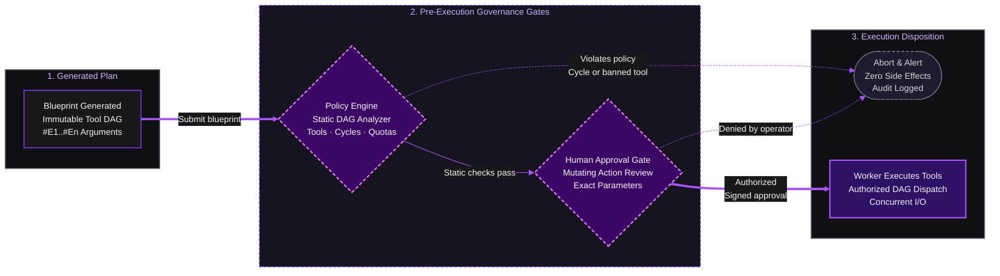

---
tags:
  - ai-engineering/agents/planning
aliases:
  - ReWOO
  - Reasoning Without Observation
source: "What Are AI Agents?"
source-type: article
author: "Anna Gutowska"
url: "https://www.ibm.com/think/topics/ai-agents"
created: 2026-11-24
---
**ReWOO (Reasoning Without Observation)** is an [[AI Agents|AI agent]] execution architecture that decouples multi-step task planning from external tool execution. Rather than interleaving reasoning and tool calls in a sequential loop like the [[ReAct Pattern]], ReWOO formulates a complete tool dependency graph upfront, dispatches tool invocations concurrently via an execution worker, and synthesizes the final grounded result in a single model pass.

---

## The Tripartite Architecture

ReWOO structures agentic task execution into three distinct, specialized components: the **Planner**, the **Worker**, and the **Solver**.

```mermaid
%%{init: {"theme": "base", "themeCSS": "svg { background-color: #09090B !important; border-radius: 8px; }", "themeVariables": {"darkMode": true, "background": "#09090B", "mainBkg": "#18181B", "textColor": "#F4F4F5", "primaryColor": "#18181B", "primaryTextColor": "#F4F4F5", "primaryBorderColor": "#7C3AED", "lineColor": "#A855F7", "secondaryColor": "#16141F", "tertiaryColor": "#0F0F14", "edgeLabelBackground": "#18181B", "clusterBkg": "#0F0F14", "clusterBorder": "#52525B", "titleColor": "#D8B4FE", "fontFamily": "Inter, ui-sans-serif, system-ui, -apple-system, sans-serif", "fontSize": "13px"}, "flowchart": {"curve": "basis", "nodeSpacing": 42, "rankSpacing": 56, "padding": 14}}}%%
flowchart TB
    subgraph Ingress["1. Request Ingress"]
        Query(["User Query\nMulti-Step Request"])
    end

    subgraph PlannerPhase["2. Planner Phase (Upfront Decomposition)"]
        Planner["1. Planner LLM\nTask Decomposition\nZero Live Observations"]
        Blueprint["Execution Blueprint\nTool Call DAG\n#E1, #E2 Placeholders"]
        Gate{"Optional Approval Gate\nStatic DAG Validation\n& Human Sign-Off"}
    end

    subgraph WorkerPhase["3. Worker Phase (Concurrent Execution)"]
        Worker["2. Execution Worker\nDeterministic DAG Engine\nVariable Substitution"]
        Tool1["API / Database 1\nConcurrent External I/O\nResolves #E1"]
        Tool2["API / Database 2\nConcurrent External I/O\nResolves #E2"]
        EvidenceStore[("Aggregated Evidence Store\nKey-Value Map\n#E1, #E2 -> Tool Outputs")]
    end

    subgraph SolverPhase["4. Solver Phase (Single-Pass Synthesis)"]
        Solver["3. Solver LLM\nFinal Synthesis Model\nSingle Forward Pass"]
        FinalResponse(["Final Grounded Response\nBounded Latency & Cost"])
    end

    Query ==>|"Task prompt"| Planner
    Planner ==>|"Emit full tool DAG"| Blueprint
    Blueprint -->|"Pre-execution inspection"| Gate
    Gate ==>|"Approved blueprint"| Worker
    Worker ==>|"Execute Tool 1 (#E1)"| Tool1
    Worker ==>|"Execute Tool 2 (#E2)"| Tool2
    Tool1 -->|"Persist #E1 output"| EvidenceStore
    Tool2 -->|"Persist #E2 output"| EvidenceStore
    EvidenceStore ==>|"Key-value evidence\n+ Blueprint"| Solver
    Solver ==>|"Synthesized answer"| FinalResponse

    classDef core fill:#2E1065,stroke:#A855F7,stroke-width:2px,color:#F5F3FF
    classDef service fill:#18181B,stroke:#7C3AED,stroke-width:1.5px,color:#F4F4F5
    classDef store fill:#09090B,stroke:#C084FC,stroke-width:1.5px,color:#EDE9FE
    classDef external fill:#27272A,stroke:#71717A,stroke-width:1.5px,color:#E4E4E7
    classDef async fill:#1E1B2E,stroke:#6B7280,stroke-width:1.25px,stroke-dasharray:4 3,color:#D4D4D8
    classDef guard fill:#3B0764,stroke:#E879F9,stroke-width:2px,stroke-dasharray:5 3,color:#FAF5FF

    class Planner,Solver core
    class Blueprint,Worker service
    class EvidenceStore store
    class Query,FinalResponse external
    class Tool1,Tool2 async
    class Gate guard

    style Ingress fill:#18181B,stroke:#52525B,stroke-width:1.25px,stroke-dasharray:5 4,color:#A1A1AA
    style PlannerPhase fill:#0F0F14,stroke:#52525B,stroke-width:1.5px,color:#D8B4FE
    style WorkerPhase fill:#16141F,stroke:#6D28D9,stroke-width:1.25px,stroke-dasharray:4 3,color:#C4B5FD
    style SolverPhase fill:#0F0F14,stroke:#52525B,stroke-width:1.5px,color:#D8B4FE
```



### 1. The Planner
The Planner generates a structured execution blueprint containing sequential or parallel task steps. Crucially, each step assigns its anticipated output to an explicit variable placeholder (e.g., `#E1`, `#E2`) without requiring live execution feedback. Downstream tool invocations reference earlier placeholders as input arguments.

### 2. The Worker
The Worker is a deterministic execution engine that parses the blueprint, constructs a Directed Acyclic Graph (DAG) of tool invocations, resolves dependent variable placeholders as prior steps complete, and executes independent tool calls concurrently. The Worker produces an evidence store mapping variable keys to concrete tool outputs.

### 3. The Solver
The Solver receives the initial user query, the execution blueprint, and the completed evidence store. Because all raw tool observations are organized in a clean key-value format, the Solver generates the final synthesized response in a single forward pass without intermediate conversational churn.

---

## Production Reference Implementation

The following reference implementation demonstrates upfront blueprint parsing, variable placeholder substitution, and concurrent tool resolution.

```python
import asyncio
import re
from collections.abc import Callable
from dataclasses import dataclass
from typing import Any


@dataclass
class PlanStep:
    step_id: str  # e.g., "#E1"
    tool_name: str
    tool_input: str


class ReWOOExecutionEngine:
    """Decoupled ReWOO engine: Planner -> Concurrent Worker -> Solver."""

    def __init__(
        self,
        planner_client: Any,
        solver_client: Any,
        tools: dict[str, Callable[[str], Any]],
    ):
        self.planner = planner_client
        self.solver = solver_client
        self.tools = tools

    def parse_blueprint(self, raw_blueprint: str) -> list[PlanStep]:
        """Parses '#E1 = Tool[args]' lines into structured PlanStep nodes."""
        pattern = re.compile(r"(#E\d+)\s*=\s*(\w+)\[(.*?)\]")
        steps: list[PlanStep] = []
        for line in raw_blueprint.strip().splitlines():
            match = pattern.search(line.strip())
            if match:
                steps.append(
                    PlanStep(
                        step_id=match.group(1),
                        tool_name=match.group(2),
                        tool_input=match.group(3),
                    )
                )
        return steps

    async def execute_worker(
        self, steps: list[PlanStep]
    ) -> dict[str, str]:
        """Resolves variable dependencies and invokes tools."""
        evidence: dict[str, str] = {}

        for step in steps:
            # Substitute upstream variable references (e.g., replacing #E1 with actual result)
            resolved_input = step.tool_input
            for var_key, var_val in evidence.items():
                resolved_input = resolved_input.replace(var_key, var_val)

            tool_fn = self.tools.get(step.tool_name)
            if not tool_fn:
                evidence[step.step_id] = (
                    f"Error: Unknown tool '{step.tool_name}'"
                )
                continue

            try:
                # Execute tool synchronously or wrap in executor
                if asyncio.iscoroutinefunction(tool_fn):
                    result = await tool_fn(resolved_input)
                else:
                    result = tool_fn(resolved_input)
                evidence[step.step_id] = str(result)
            except Exception as exc:
                evidence[step.step_id] = f"ToolError: {exc}"

        return evidence

    async def run(self, user_query: str) -> str:
        # Step 1: Upfront Planning
        blueprint_text = await self.planner.generate_blueprint(user_query)
        steps = self.parse_blueprint(blueprint_text)

        # Step 2: Worker Execution
        evidence_store = await self.execute_worker(steps)

        # Step 3: Synthesis
        final_response = await self.solver.synthesize(
            query=user_query,
            blueprint=blueprint_text,
            evidence=evidence_store,
        )
        return final_response
```

---

## Architectural Comparison: ReWOO vs. ReAct

| Architectural Dimension | ReWOO (Decoupled Blueprint) | [[ReAct Pattern]] (Coupled Loop) |
| :--- | :--- | :--- |
| **Execution Flow** | Upfront planning DAG + batched / concurrent tool execution | Sequential step-by-step loop (Reason $\rightarrow$ Act $\rightarrow$ Observe) |
| **Token Consumption** | **Minimal:** Decouples reasoning prompt from tool execution traces | **High:** Full conversational trace is re-ingested at every intermediate step |
| **Latency Profile** | **Low & Bounded:** Independent I/O calls execute concurrently | **High & Variable:** Sum of all sequential model and tool round-trips |
| **Human Governance** | **High:** Entire execution plan can be reviewed before triggering tools | **Low:** Requires continuous real-time monitoring or per-step gating |
| **Failure Recovery** | **Fragile to Schema Drastic Changes:** If tool 1 returns unexpected schema, tool 2 may fail | **Adaptive:** Model dynamically inspects error in next thought step and backtracks |
| **Senior Note** | Choose ReWOO when data retrieval paths are predictable and latency/token budgets are critical. | Choose ReAct when tasks require open-ended exploratory navigation and dynamic branching. |

---

## Governance & Safety: Pre-Execution Inspection

Because ReWOO formulates the entire tool call graph *before* execution begins, it provides an architectural hook for enterprise safety controls:

1. **Human Approval Gates:** In systems where agents execute state-mutating actions (e.g., executing financial transfers or modifying cloud infrastructure), a human gatekeeper can review the exact parameters in the generated blueprint before the Worker invokes tools.
2. **Deterministic DAG Validation:** Static analyzers can inspect the blueprint for prohibited tools, circular dependencies, or rate-limit violations before incurring runtime costs.



---

## Pitfalls & Failure Modes

- **Upstream Assumption Sensitivity:** If the Planner predicts that Step 1 will return a user UUID, but Step 1 returns a list of candidate records, downstream steps referencing `#E1` will execute with malformed input.
- **Inability to Branch on Dynamic Data:** ReWOO cannot handle workflows where the choice of tool for Step 2 depends fundamentally on the outcome of Step 1 (e.g., *"If account is active, query billing; otherwise query fraud database"*).
- **Blueprint Parsing Fragility:** If the Planner model deviates from the strict variable notation (`#E1 = Tool[args]`), deterministic regex parsers will fail unless guarded by robust structured output schemas.

---

## When Not to Use ReWOO

- **Unbounded Exploratory Research:** Debugging unfamiliar distributed systems or open-ended web browsing where each observation radically changes the investigation vector.
- **Dynamic Conditional Branching:** When execution paths branch significantly based on runtime state, an adaptive dynamic agent like [[ReAct Pattern]] is required.

> [!TIP]
> **Senior Lens:** For production compound systems, prefer ReWOO over ReAct as the default multi-tool architecture. It reduces LLM inference costs by 50–70% and tail latency by 60% through concurrent I/O, while enabling clean auditability before any external API is touched.
