---
tags:
  - ai-engineering/agent-deployment-and-development/rag
  - ai-engineering/ml-pipelines/retrieval
aliases:
  - RAG
source: "What is Retrieval-Augmented Generation (RAG)?"
source-type: youtube
url: "https://www.youtube.com/watch?v=T-D1OfcDW1M"
created: 2026-11-23
---
**Retrieval-Augmented Generation (RAG)** is an architectural framework that augments [[Large Language Models]] (LLMs) with an external content store at inference time, retrieving relevant primary source data before generating an answer. By separating mutable knowledge storage from model parameters, RAG improves factual accuracy, keeps responses current without retraining, and grounds outputs in verifiable evidence.

## Core LLM Limitations Addressed

Standalone generative models answer user prompts purely from static knowledge compressed into their parameters during training, creating two structural failure modes:

- **Stale Parametric Knowledge (Out of Date):** Model weights freeze at a training cutoff. Mutable facts (such as updated scientific counts, product policies, or operational states) become wrong over time while the model continues to answer with high confidence. Updating facts directly in model weights requires costly retraining.
- **Unverified Outputs (No Source):** Without external grounding, an LLM cannot cite primary evidence for its claims. Relying solely on memorized training data increases the risk of **hallucinations** (plausible but fabricated answers) and inadvertent **data leakage** (surfacing memorized details outside the intended scope).

---

## Architecture & Request Lifecycle

RAG inserts a retrieval step between the user query and LLM generation, backed by an external **content store**—either **open** (e.g., live web search) or **closed** (e.g., internal policy collections, enterprise document repositories, structured [[SQL]] databases, or document/vector [[NoSQL]] stores).

```mermaid
%%{init: {"theme": "base", "themeCSS": "svg { background-color: #09090B !important; border-radius: 8px; }", "themeVariables": {"darkMode": true, "background": "#09090B", "mainBkg": "#18181B", "textColor": "#F4F4F5", "primaryColor": "#18181B", "primaryTextColor": "#F4F4F5", "primaryBorderColor": "#7C3AED", "lineColor": "#A855F7", "secondaryColor": "#16141F", "tertiaryColor": "#0F0F14", "edgeLabelBackground": "#18181B", "clusterBkg": "#0F0F14", "clusterBorder": "#52525B", "titleColor": "#D8B4FE", "fontFamily": "Inter, ui-sans-serif, system-ui, -apple-system, sans-serif", "fontSize": "13px"}, "flowchart": {"curve": "basis", "nodeSpacing": 42, "rankSpacing": 56, "padding": 14}}}%%
flowchart LR
    subgraph ClientTier["1. Client Interface"]
        User(["User Query\nNatural Language Input"])
        Response(["Grounded Response\nAnswer + Source Evidence\nOr Explicit Abstention"])
    end

    subgraph RetrievalTier["2. Retrieval & Prompt Grounding"]
        Retriever["Retriever Engine\nBM25 / Hybrid / Vector\nTop-K Ranking"]
        Store[("Content Store\nOpen Web or Closed Corpus\nSQL · NoSQL · Vector DB")]
        Prompt["3-Part Augmented Prompt\nGrounding Instruction\n+ Context + User Query"]
    end

    subgraph GenerationTier["3. Inference Engine"]
        LLM["Generative Model · LLM\nContext-Constrained Pass\nCite or Abstain"]
    end

    User ==>|"1. Raw query"| Retriever
    User -->|"3. Original question"| Prompt
    Retriever ==>|"2. Query for context\nMetadata filters"| Store
    Store ==>|"Primary source passages\nWith source IDs"| Prompt
    Prompt ==>|"Grounded prompt\nStrict evidence boundary"| LLM
    LLM ==>|"Synthesized answer\nVerifiable citations"| Response

    classDef core fill:#2E1065,stroke:#A855F7,stroke-width:2px,color:#F5F3FF
    classDef service fill:#18181B,stroke:#7C3AED,stroke-width:1.5px,color:#F4F4F5
    classDef store fill:#09090B,stroke:#C084FC,stroke-width:1.5px,color:#EDE9FE
    classDef external fill:#27272A,stroke:#71717A,stroke-width:1.5px,color:#E4E4E7
    classDef guard fill:#3B0764,stroke:#E879F9,stroke-width:2px,stroke-dasharray:5 3,color:#FAF5FF

    class LLM core
    class Retriever service
    class Store store
    class User,Response external
    class Prompt guard

    style ClientTier fill:#18181B,stroke:#52525B,stroke-width:1.25px,stroke-dasharray:5 4,color:#A1A1AA
    style RetrievalTier fill:#16141F,stroke:#6D28D9,stroke-width:1.25px,stroke-dasharray:4 3,color:#C4B5FD
    style GenerationTier fill:#0F0F14,stroke:#52525B,stroke-width:1.5px,color:#D8B4FE
```



### Three-Part Augmented Prompt

Instead of passing the raw user query directly to the generator, the RAG pipeline constructs a composite prompt with three required components:

1. **Grounding Instruction:** Directs the LLM to prioritize the retrieved primary source data, cite supporting evidence, and explicitly abstain (`"I don't know"`) if the retrieved context cannot reliably answer the query.
2. **Retrieved Content:** The relevant documents, policy excerpts, or records fetched from the content store for the current request.
3. **User Query:** The original question to be answered strictly against the supplied context.

```python
# BAD: ungrounded generation relies solely on stale parametric memory
def answer_direct(llm, user_query: str) -> str:
    return llm.generate(user_query)


# GOOD: RAG retrieves primary context and assembles a grounded 3-part prompt
def answer_with_rag(retriever, llm, user_query: str) -> str:
    # 1. Fetch up-to-date primary source passages from the external content store
    retrieved_docs = retriever.search(user_query, top_k=5)
    context_block = "\n\n".join(
        f"[{doc.source_id}] {doc.content}" for doc in retrieved_docs
    )

    # 2. Combine instruction + retrieved content + user query
    augmented_prompt = (
        "Answer the user question using only the provided source context. "
        "Cite source IDs for your claims. If the context does not contain "
        "sufficient evidence to answer reliably, respond with 'I don't know'.\n\n"
        f"Context:\n{context_block}\n\n"
        f"Question:\n{user_query}"
    )

    # 3. Generate a grounded, evidence-backed response
    return llm.generate(augmented_prompt)
```

---

## Classic (Pipeline) RAG vs. Agentic (Tool-Calling) RAG

> [!IMPORTANT]
> **In both patterns, retrieved content is injected into the LLM's context window before final generation.** An LLM cannot inspect external files or databases on its own—the difference is **who decides when and what to retrieve**: deterministic application code before the LLM runs, or the LLM itself via tool calls.

| Pattern | Who Triggers Retrieval | Execution Flow | Strengths & Trade-Offs | Senior Note |
| :--- | :--- | :--- | :--- | :--- |
| **Classic (Pipeline) RAG** | Application code (before calling the LLM) | `Query → Code searches store → Inject chunks + query into prompt → LLM answers (1 call)` | Fast, predictable latency and fixed token cost; however, retrieves blindly even on trivial turns and cannot follow up if initial search misses context. | Ideal for high-throughput, low-latency Q&A over a well-indexed single corpus. |
| **Agentic (Tool-Calling) RAG** | The LLM itself (via retrieval tools) | `Query → LLM invokes search/read tool → Tool returns passages into context → (Optional follow-up reads) → LLM answers` | Skips retrieval when unnecessary, refines queries, and can traverse references (e.g., following `[[Wikilinks]]`); adds 1–2 extra LLM turns and variable latency. | Best for complex, multi-hop questions, personal knowledge vaults, or multi-source troubleshooting. |

### Retriever Agnosticism & Common Misconceptions
- **RAG Does Not Require a Vector Database:** Retrieval is a pattern, not a storage engine. Full-text/BM25 search (e.g., SQLite FTS5), metadata/tag filtering, and link traversal are valid retrievers and often outperform dense vectors on exact technical terms (`@Bean`, `varint`, error codes) or smaller corpora (< 200 documents). Add embeddings (Hybrid Search) once semantic recall gaps justify the indexing overhead.
- **Not Context Stuffing:** Pre-loading an entire corpus into every prompt skips the retrieval step altogether, diluting attention and burning tokens regardless of the query.
- **Not [[Fine-Tuning]]:** Baking knowledge into model weights offline updates parametric memory rather than retrieving external evidence at inference time.

---

## Standalone LLM vs. RAG

| Dimension | Standalone LLM (Generation Only) | RAG (Retrieval + Generation) | Senior Note |
| :--- | :--- | :--- | :--- |
| **Knowledge Freshness** | Frozen at training cutoff; requires retraining to update facts. | Reflects the latest state of the external content store immediately upon ingestion. | Shifts knowledge freshness from ML training pipelines to standard data ingestion SLAs. |
| **Source Attribution** | None; responses come from opaque parameter weights. | Grounds answers in retrieved primary sources and can surface citations/evidence. | Enables auditability and human verification in high-stakes enterprise workflows. |
| **Hallucination & Leakage Risk** | High when queried on niche, private, or post-cutoff facts. | Lower; constrains generation to supplied context rather than memorized training data. | Mitigates risk but does not eliminate it; enforce strict prompt grounding and output checks. |
| **Unknown Queries** | Tends to fabricate confident, plausible-sounding answers. | Can be instructed to abstain (`"I don't know"`) when evidence is absent. | Abstention is only as reliable as retrieval recall—missed context triggers false refusals. |

---

## Notes & Pitfalls

- **The Abstention vs. Recall Trade-Off:** Instructing an LLM to say `"I don't know"` when evidence is missing prevents misleading hallucinations, but introduces a failure mode when retrieval quality is weak: if the retriever fails to return the right source passage, an answerable query goes unanswered.
- **Dual Optimization Surface:** Production RAG quality depends on optimizing **both halves** of the architecture:
  - **Retriever Side:** Ensuring high precision and recall over the content store (e.g., via [[Embeddings]], [[Vector Databases]], metadata filtering, and fresh indexing) so the LLM receives the highest-quality grounding data.
  - **Generator Side:** Ensuring the LLM faithfully synthesizes the retrieved passages into accurate, comprehensive responses without ignoring context or falling back on stale parametric memory.
- **Content Store Hygiene:** Because knowledge updates happen by modifying the data store rather than retraining the model, stale, duplicated, or contradictory documents in the store directly degrade answer quality.

## When Not to Use RAG

- **Static Transformation Tasks:** Summarizing, reformatting, or translating text already provided in the user prompt gains nothing from external retrieval and only adds latency and operational complexity.
- **Behavioral or Style Adaptation:** Changing a model's tone, output format, or domain-specific reasoning pattern is better served by [[Fine-Tuning]] or prompt engineering rather than retrieving facts at inference time.
- **Deterministic Structured Lookups:** Queries requiring exact aggregations or strict transactional guarantees (e.g., account balances, inventory counts) should hit a [[SQL]] database or deterministic API directly rather than routing through a probabilistic generator.

> [!TIP]
> **Leadership Lens:** Treat RAG as a data-engineering and search-quality system first, not solely a prompting exercise. Evaluate retriever quality (context recall and precision) separately from generator quality (groundedness and faithfulness) so accuracy regressions are immediately attributable to either the ingestion/retrieval layer or the LLM.
