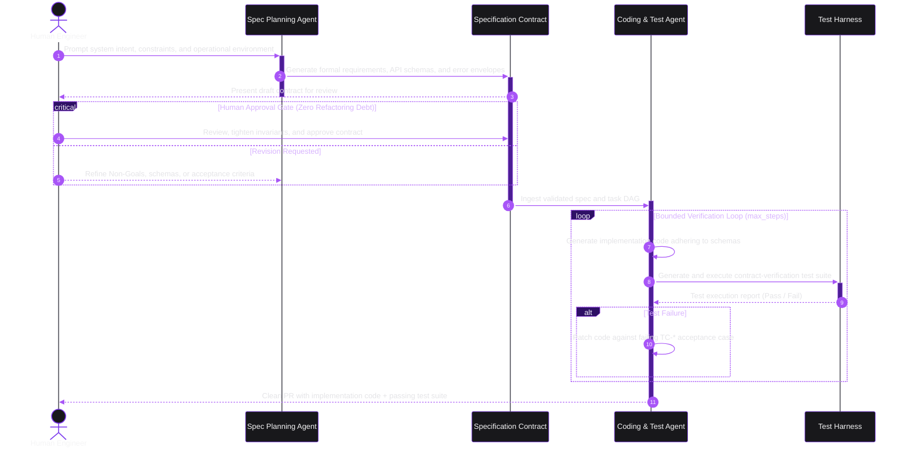
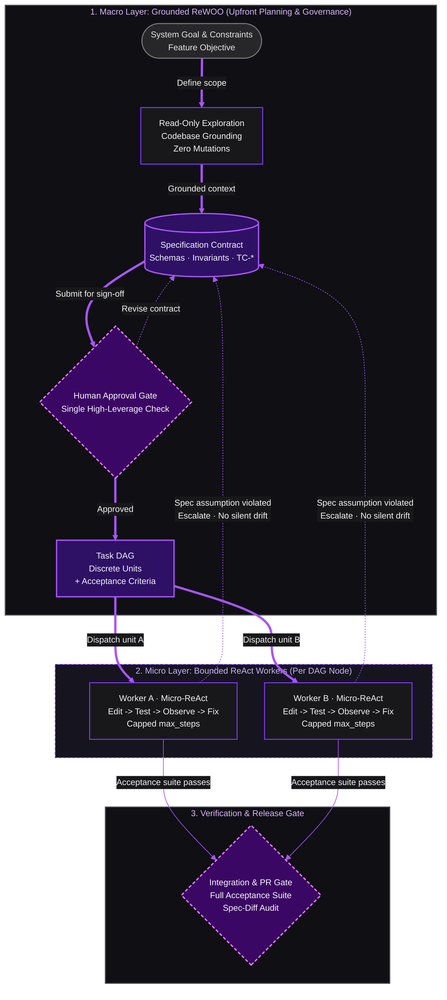
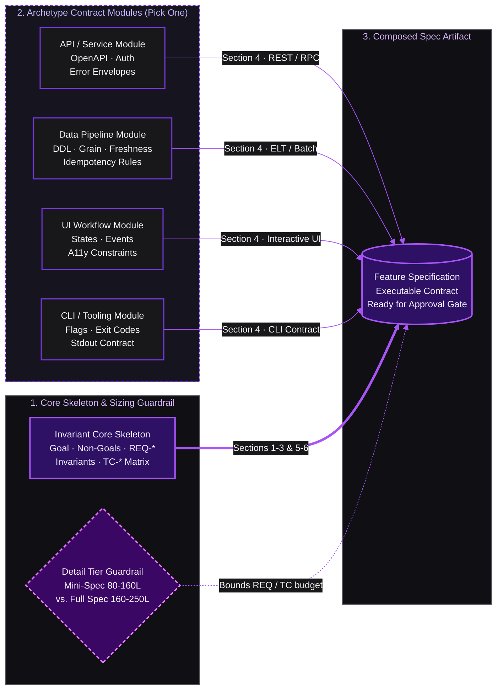

---
tags:
  - ai-engineering/agents/planning
aliases:
  - SDD
  - Spec Coding
  - Specification-Driven Development
source: "Spec-Driven Development: AI Assisted Coding Explained"
source-type: youtube
channel: IBM Technology
url: https://www.youtube.com/watch?v=mViFYTwWvcM
created: 2026-11-24
---
**Spec-Driven Development (SDD)** is an AI-assisted [[Software Engineering|software engineering]] paradigm in which formal, human-reviewed specifications—defining functional behavior, API [[Interface|contracts]], boundary conditions, and acceptance tests—serve as the primary artifact to guide [[AI Agents|coding agents]] before implementation code is written. By introducing structured requirement contracts into the generation loop, SDD bridges the traditional Software Delivery Lifecycle (SDLC) with autonomous LLM code generation, eliminating the stochastic drift and architectural churn typical of conversational "vibe coding."

---

## The Evolution of Developer Paradigms

Software delivery methodologies have continually shifted the primary driving artifact to manage system complexity and maintain software quality:

1. **Code-First (Traditional Intuitive Development):** Engineers write implementation code driven by intuition, followed retroactively by documentation and testing. In multi-agent or AI contexts, this leads to untracked architectural drift.
2. **Test-Driven Development (TDD):** Engineers write unit and integration test assertions first, then produce minimal implementation code to satisfy those tests. TDD enforces rigorous functional verification but often lacks high-level system architectural contracts.
3. **Conversational "Vibe Coding":** Developers prompt an LLM with natural language implementation requests, inspect raw output, and iteratively reprompt to patch discrepancies. While effective for rapid prototyping, it skips the SDLC, lacks deterministic verification, and produces divergent implementations across runs.
4. **Spec-Driven Development (SDD):** Developers prompt the LLM to specify *system behavior and constraints*, producing an auditable requirements contract. Once approved by human engineers, this specification compiles into a design document, task hierarchy, and test fixtures that steer the coding agent's implementation loop.

```mermaid
%%{init: {"theme": "base", "themeCSS": "svg { background-color: #09090B !important; border-radius: 8px; }", "themeVariables": {"darkMode": true, "background": "#09090B", "mainBkg": "#18181B", "textColor": "#F4F4F5", "primaryColor": "#18181B", "primaryTextColor": "#F4F4F5", "primaryBorderColor": "#7C3AED", "lineColor": "#A855F7", "secondaryColor": "#16141F", "tertiaryColor": "#0F0F14", "edgeLabelBackground": "#18181B", "clusterBkg": "#0F0F14", "clusterBorder": "#52525B", "titleColor": "#D8B4FE", "fontFamily": "Inter, ui-sans-serif, system-ui, -apple-system, sans-serif", "fontSize": "13px"}, "flowchart": {"curve": "basis", "nodeSpacing": 42, "rankSpacing": 56, "padding": 14}}}%%
flowchart TB
    subgraph VibeCoding["1. Vibe Coding (Heuristic Loop)"]
        VPrompt(["Natural Language Request\nAmbiguous Prompt"])
        VCodeGen["LLM Code Generation\nStochastic Synthesis\nNo Formal Contract"]
        VInspect{"Manual Inspection\nAd-Hoc Diff Review"}
        VReprompt["Iterative Prompt Patching\nContext Churn & Drift"]
        VDone(["Desired Implementation\nLow Repeatability"])
    end

    subgraph SDD["2. Spec-Driven Development (Contract-First Loop)"]
        SPrompt(["System Goal & Constraints\nRequirements Input"])
        SContract[("Specification Contract\nPRD · OpenAPI · Schema\nAcceptance Matrix")]
        SGate1{"Human Approval Gate\nZero Refactoring Debt\nPre-Code Sign-Off"}
        SDesign["Design Doc & Task DAG\nDiscrete Bounded Units"]
        SCodeGen["AI Coding Agent\nContract-Bound Codegen"]
        SVerify{"Automated Verification\nSpec-Derived Test Suite\nCI/CD Gate"}
        SProduction(["Deterministic Deployment\nAuditable Release"])
    end

    VPrompt -->|"Ad-hoc prompt"| VCodeGen
    VCodeGen -->|"Raw multi-file diff"| VInspect
    VInspect -.->|"Flawed / Hallucinated"| VReprompt
    VReprompt -.->|"Append debug churn"| VCodeGen
    VInspect -->|"Acceptable"| VDone

    SPrompt ==>|"Formalize intent"| SContract
    SContract ==>|"Contract review"| SGate1
    SGate1 -.->|"Revise spec"| SPrompt
    SGate1 ==>|"Approved"| SDesign
    SDesign ==>|"Scoped task + TC-*"| SCodeGen
    SCodeGen ==>|"Implementation + tests"| SVerify
    SVerify -.->|"Fail · Retry in scope"| SCodeGen
    SVerify ==>|"Pass · All TC-* green"| SProduction

    classDef core fill:#2E1065,stroke:#A855F7,stroke-width:2px,color:#F5F3FF
    classDef service fill:#18181B,stroke:#7C3AED,stroke-width:1.5px,color:#F4F4F5
    classDef external fill:#27272A,stroke:#71717A,stroke-width:1.5px,color:#E4E4E7
    classDef async fill:#1E1B2E,stroke:#6B7280,stroke-width:1.25px,stroke-dasharray:4 3,color:#D4D4D8
    classDef guard fill:#3B0764,stroke:#E879F9,stroke-width:2px,stroke-dasharray:5 3,color:#FAF5FF

    class SContract,SProduction core
    class VInspect,SDesign,SCodeGen service
    class VPrompt,VDone,SPrompt external
    class VCodeGen,VReprompt async
    class SGate1,SVerify guard

    style VibeCoding fill:#18181B,stroke:#52525B,stroke-width:1.25px,stroke-dasharray:5 4,color:#A1A1AA
    style SDD fill:#16141F,stroke:#6D28D9,stroke-width:1.25px,stroke-dasharray:4 3,color:#C4B5FD
```



---

## Vibe Coding vs. Spec-Driven Development

Conversational vibe coding treats the LLM as an unconstrained code synthesizer. Because foundation models are probabilistic token predictors, identical natural language prompts can yield vastly different architectural choices, variable names, and error handling across runs.

SDD restructures the engineering workflow so that natural language is used to construct formal contracts rather than raw code. The specification acts as a bounding box that limits model ambiguity.

| Architectural Dimension | Conversational Vibe Coding | Spec-Driven Development (SDD) | Senior Note |
| :--- | :--- | :--- | :--- |
| **Primary Driving Artifact** | Ephemeral chat prompts and uncommitted code diffs | Machine-readable specification contract (OpenAPI, JSON Schema, Markdown PRD) | In SDD, code is an ephemeral downstream derivative of the specification. |
| **Execution Determinism** | Low; 100 runs can produce 100 distinct implementations | High; bounded by strict interface definitions, types, and schema validations | Critical for enterprise compliance, auditable change management, and security. |
| **SDLC Integration** | Bypasses requirements, threat modeling, and formal testing | Integrates planning, architecture, implementation, and automated QA gates | Preserves classical engineering discipline within autonomous agent workflows. |
| **Context Window Efficiency** | Wasteful; chat history accumulates debugging churn and repeated code dumps | Optimal; context window receives compact schemas, explicit tasks, and bounded contracts | Prevents context degradation and mid-conversation attention loss in long sessions. |
| **Human Review Mechanism** | Reviewing messy, multi-file code diffs generated by the LLM | Reviewing high-level behavioral contracts and interface schemas *before* code generation | Catching architectural errors at the spec phase saves compounding debugging cycles. |
| **Verification & Testing** | Ad-hoc manual verification; "it looks like it works" | Automated test generation derived directly from the spec acceptance criteria | Enables deterministic verification gates inside [[CICD Pipelines\|CI/CD pipelines]]. |

---

## The Spec-Driven Development Lifecycle

The SDD workflow formalizes the interaction between human software architects and autonomous AI coding agents across four distinct phases.



### 1. Requirements & Constraint Specification
The human engineer prompts the model with functional objectives, environmental constraints, external dependencies, and performance targets. The model outputs a formal behavioral contract rather than executable code.

### 2. Human Approval Gate
The engineer reviews the generated specification. Because no implementation code exists yet, modifying architectural choices (e.g., swapping storage engines, altering payload schemas, or mandating specific error codes) incurs zero refactoring debt.

### 3. Design Document & Task Decomposition
Once approved, the specification is compiled into a technical design document. This document breaks the feature into a Directed Acyclic Graph (DAG) of discrete implementation tasks, each with explicit inputs, outputs, and acceptance criteria.

### 4. Bounded Agent Implementation & Automated Verification
The coding agent executes against individual tasks in the DAG. It generates code that strictly adheres to the schema and automatically writes unit/integration tests derived from the specification's test cases. The code is only presented to the developer once it passes the automated verification suite.

---

## SDD in Agentic Execution: Macro-ReWOO + Micro-ReAct

Spec-Driven Development and agent execution patterns operate at **different architectural layers**: SDD is a *software delivery methodology* (governing artifacts and human checkpoints), whereas **[[ReWOO Pattern|ReWOO]]** and **[[ReAct Pattern|ReAct]]** (see [[AI Agents#Execution Paradigms: ReAct vs. ReWOO|Execution Paradigms in AI Agents]]) are *agent runtime control loops*.

In production coding systems, SDD is neither pure [[ReWOO Pattern|ReWOO]] nor pure [[ReAct Pattern|ReAct]]—it composes both into a **two-tier hybrid architecture**: **Grounded Macro-ReWOO** for planning and governance, delegating to **Bounded Micro-ReAct** workers for code generation and verification.



### How the Execution Paradigms Map

| Paradigm | Macro Control Loop | Micro Control Loop | Human Governance | Failure & Plan-Invalidation Handling | Senior Note |
| :--- | :--- | :--- | :--- | :--- | :--- |
| **Vibe Coding** | Unbounded [[ReAct Pattern\|ReAct]] | Single monolithic chat loop | Ad-hoc inspection of raw diffs | Human reprompts iteratively; context accumulates debugging churn | High token burn and architectural drift over multi-file changes. |
| **Pure [[ReWOO Pattern\|ReWOO]]** | Blind upfront DAG | Deterministic batch tool calls | Single upfront plan approval | Fragile if early tool output invalidates downstream schema | Works for static tool pipelines, but breaks down on compiler/test feedback loops. |
| **Spec-Driven Development** | **Grounded [[ReWOO Pattern\|ReWOO]]** (Explore → Spec → DAG) | **Bounded [[ReAct Pattern\|ReAct]]** per DAG node (`max_steps` + test oracle) | Single high-leverage spec approval gate | Worker halts and escalates impossible assumptions back to Spec layer | Combines ReWOO's upfront governance and parallelism with ReAct's runtime adaptability. |

### Handling ReWOO's Core Failure Mode in SDD
Pure [[ReWOO Pattern|ReWOO]] fails when a runtime observation contradicts an upfront assumption. In SDD, a Micro-[[ReAct Pattern|ReAct]] coding worker will occasionally discover an environmental constraint not captured in the contract (e.g., an upstream API omits a required field or a database lacks a needed index). Rather than allowing the worker to silently patch around the gap—which induces **Specification Drift**—the worker must abort or pause, escalate the finding back to the **Macro Spec Layer**, amend the contract through the human gate, and re-execute the affected DAG branch.

---

## Spec Templating Strategy: Core Skeleton + Archetype Extensions

Teams adopting SDD face a structural trade-off between **over-standardization** (forcing every task into one rigid PRD, causing *Over-Specification Paralysis*) and **ad-hoc authoring** (inventing a fresh format per feature, causing *Illusion of Completeness*).

The effective pattern is a **composable spec architecture**: maintain a **single invariant Core Skeleton** across the repository, pair it with **2–4 domain-specific Contract Modules** by work archetype, and scale depth by blast radius.



### Why Composable Templates Work
- **Pre-Flight Completeness Checklist:** Fixed core headings force engineers and planning agents to specify **Non-Goals**, **Error Envelopes**, and **Acceptance Criteria** before code is generated.
- **Deterministic Agent Parsing:** Coding agents extract constraints more accurately from predictable Markdown/YAML schemas than from free-form prose.
- **Compounding Institutional Memory:** Whenever an agent misses a recurring production requirement (e.g., rate limiting, backward compatibility, or telemetry), adding one prompt line to the shared template eliminates that class of bug across all future features.

### Spec Sizing & Chunking Guardrails

Once a specification grows past ~250 lines or ~15 acceptance cases (`TC-*`), the Human Approval Gate degrades: reviewers skim instead of scrutinizing invariants, and mid-flight scope creep leaks in. Right-size every spec before writing code:

| Tier | Target Length | `REQ` / `TC` Budget | Delivery Scope | Senior Note |
| :--- | :--- | :--- | :--- | :--- |
| **Mini-Spec** | 80 – 160 lines | 5 – 10 | 1 focused feature, plugin, or bounded module change (1 PR) | Default sweet spot for iterative delivery and crisp PR reviews. |
| **Full Spec** | 160 – 250 lines | 10 – 15 | 1 cohesive new core module or multi-component subsystem (1–2 PRs) | Maximum size for a single human approval gate. |
| **Epic (Split Required)** | > 250 lines | > 15 | Cross-cutting platform or multi-module rollout | Write a 1-page `00_` architecture overview and slice into 2–4 sequential specs (`01`, `02`, `03`). |

Apply four concrete splitting heuristics when chunking a larger project:
1. **Lifecycle & Blast Radius Boundary:** Never bundle resources operated by different actors on different cadences (e.g., one-time Admin bootstrap scripts vs. continuous GitOps environment modules).
2. **Artifact / Module Boundary:** Give separate build artifacts or dependency graphs (e.g., cloud-agnostic core adapter vs. cloud-specific SPI plugin JAR) their own specs.
3. **The "And" Smell Test:** If a spec title requires two or more commas or `&` conjunctions, it almost certainly glues multiple specs together.
4. **Independent Verification Gate:** Slice at the smallest vertical boundary where `mvn test`, `pytest`, or `tofu test` verifies the deliverable end-to-end before starting the next spec.

### Spec-Level vs. Code-Level Boundaries (Spec Altitude)

The fastest way to make SDD feel tedious is putting **code-level wiring** inside a specification. Apply the **Black-Box Boundary Rule**: anything observable *across* a module, API, security, or operational boundary belongs in the **Spec**; anything strictly *inside* the implementation belongs in **Code**.

| Engineering Concern | Spec-Level (Belongs in the Spec) | Code-Level (Keep in Code — Edit Directly) | Senior Note |
| :--- | :--- | :--- | :--- |
| **Ownership & Architecture** | Resource ownership rules, ADRs, Non-Goals, module/stack dependency direction, and release-tag boundaries | Splitting code across `main.tf` / `iam.tf`, helper file layouts, or internal package sub-structures | Lock *who owns what*, not how internal files are sliced. |
| **Interfaces & Contracts** | Public types/methods, module inputs & outputs, REST/event payloads, and external manifest schemas (`domain.yaml`, `table.yaml`) | Package-private helper signatures (e.g., `resolveProperties`), internal DTOs, HCL `local.*` variable names, and literal `coalesce(try(...))` expressions | Describe behavioral derivation rules in prose, not language syntax. |
| **Tooling & Wiring** | Behavioral contracts (*"uat/prod pin immutable tags; API quota bills to env project"*) and major tool choices (*"Terragrunt wrappers"*) | Moving a value from `.tf` to Terragrunt `inputs`, `for_each` / `depends_on` wiring, shell `git config` one-liners, and third-party GitHub Action internals | Changing *how* config flows beneath the same contract needs zero spec edits. |
| **Security, Cost & Failure Modes** | Least-privilege IAM scopes, `$0/mo` idle baseline, `PREVENT` deletion policies, failure modes, and typed error/exception contracts | Exact firewall priority integers (`65534`), log/comment truncation limits (`60,000` chars), one-time `moved {}` migration shims, and formatting tweaks | One-time migration shims cause spec drift the moment they are deleted. |
| **Verification (`TC-*`)** | Observable happy-path, idempotency, negative validation, and security boundary assertions | Mock library wiring, test fixture helper methods, and assertion syntax | Tests prove the contract; how tests are structured is code-level. |

#### The 3-Second "Edit Directly vs. Update Spec" Test
Before touching a spec for a small change, ask: ***Would a downstream consumer, security auditor, or `TC-*` acceptance case notice this change?***
- **No** (e.g., moving a literal from `.tf` into Terragrunt `inputs`, refactoring `locals`, renaming a private helper) → **Code-level.** Make the edit directly and leave the spec untouched.
- **Yes** (e.g., changing a module input/output, relaxing an IAM/WIF rule, enabling a billable default, or reversing a Non-Goal like adopting Terragrunt) → **Spec-level.** Update the spec (beforehand for architectural pivots, or via diff-reconciliation right after for minor refinements).

### Example 1: Invariant Core Spec Template

Every feature—from a minor service change (1-page mini-spec) to a major subsystem—starts from the same core skeleton:

```markdown
# Feature Spec: <Feature Name>
- **Status:** Draft | Approved | Superseded
- **Archetype:** api | data-pipeline | ui | cli
- **Tier:** mini-spec | full-spec
- **Owner:** <Engineer / Team>

## 1. Goal & Context
- **Problem Statement:** What concrete user or system problem does this solve?
- **Success Metric:** How do we objectively know it worked?

## 2. Scope & Explicit Non-Goals
- **In Scope:** Bulleted boundaries of what the agent must build.
- **Non-Goals (Do Not Implement):** Explicit guardrails preventing scope creep or unrelated refactors.

## 3. Functional Requirements
- `REQ-01`: <Testable behavioral statement ("The system shall...")>
- `REQ-02`: <Testable behavioral statement>

## 4. Interface & Data Contract
<!-- Insert the Archetype Contract Module here (API, Data Pipeline, UI, or CLI) -->

## 5. Invariants, Edge Cases & Non-Functional Constraints
- **Security / Auth:** Authentication, authorization, PII handling.
- **Reliability:** Idempotency keys, retries, timeouts, rate limits.
- **Performance:** Target latency (p95/p99), throughput, or memory ceilings.
- **Failure Modes:** Expected behavior on malformed input, upstream outage, or partial failure.

## 6. Acceptance Criteria & Verification Matrix
| Case ID | Scenario | Input / Precondition | Expected Outcome |
| :--- | :--- | :--- | :--- |
| `TC-001` | Happy path | Valid payload / state | Expected output + side effects |
| `TC-002` | Invalid input | Missing required field | Deterministic error code, no state mutation |
| `TC-003` | Boundary / Security | Unauthorized actor | Rejected without leaking internal state |
```

### Example 2: Archetype Contract Modules

Instead of inventing a new template per feature, plug the matching domain contract into **Section 4** of the Core Skeleton. *(See the full API archetype in the Authentication Endpoint example below.)*

#### Data Pipeline Archetype Module

```yaml
# Contract Module: Data Pipeline (ELT / Batch Job)
pipeline_contract:
  job_name: "daily_order_revenue_agg"
  schedule: "0 2 * * *"
  execution_semantics: "idempotent_partition_overwrite"
  partition_key: "order_date"

  sources:
    - table: "raw.orders"
      freshness_sla_hours: 4
      required_columns: [order_id, customer_id, amount_cents, currency, created_at]

  target:
    table: "mart.daily_revenue"
    grain: ["order_date", "currency"]
    primary_key: ["order_date", "currency"]
    schema:
      order_date: { type: "DATE", nullable: false }
      currency: { type: "STRING", nullable: false, pattern: "^[A-Z]{3}$" }
      gross_revenue_cents: { type: "INT64", nullable: false, min: 0 }
      order_count: { type: "INT64", nullable: false, min: 0 }

  data_quality_assertions:
    - "PRIMARY KEY (order_date, currency) IS UNIQUE"
    - "gross_revenue_cents >= 0"
    - "Re-running the same order_date produces identical row count and checksum"
```

#### UI Feature Archetype Module

```yaml
# Contract Module: Interactive UI Component / Flow
ui_contract:
  component: "ApiKeyRevocationModal"
  trigger: "User clicks 'Revoke' on an active API key row"

  states:
    idle: "Modal closed; table shows active key."
    confirming: "Modal open; displays key prefix, irreversible warning, and disabled confirm button until key name is typed."
    submitting: "Confirm button shows spinner; inputs and close button disabled."
    error: "Inline error banner shown; modal remains open for retry."
    revoked: "Modal closes; toast notification shown; row removed optimistically after 200 OK."

  accessibility_constraints:
    - "Focus trapped inside modal while open; Escape closes in 'confirming' and 'error' states only."
    - "Error banner uses role='alert' for screen readers."
```

---

## Concrete Example: User Authentication Endpoint

To illustrate the contrast, consider building a user authentication endpoint (`POST /login`).

### The Specification Contract

Before writing implementation logic, the engineer and agent converge on an executable specification defining payload structures, validation rules, HTTP status codes, and security requirements.

```yaml
# specification/auth_login_spec.yaml
feature: "User Authentication"
version: "1.0.0"
endpoint: "/login"
method: "POST"
consumes: "application/json"
produces: "application/json"

request_schema:
  type: "object"
  required:
    - user
    - pass
  properties:
    user:
      type: "string"
      format: "email"
      description: "Registered user email address"
    pass:
      type: "string"
      minLength: 8
      description: "Plaintext password to be validated against argon2id hash"

response_contracts:
  - status_code: 200
    description: "Successful authentication"
    schema:
      type: "object"
      required:
        - access_token
        - token_type
        - expires_in
      properties:
        access_token:
          type: "string"
        token_type:
          type: "string"
          enum: ["Bearer"]
        expires_in:
          type: "integer"
          example: 3600

  - status_code: 400
    description: "Missing or malformed payload fields"
    schema:
      type: "object"
      required:
        - error
        - details
      properties:
        error:
          type: "string"
          example: "INVALID_REQUEST_PAYLOAD"
        details:
          type: "array"
          items:
            type: "string"

  - status_code: 401
    description: "Invalid credentials supplied"
    schema:
      type: "object"
      required:
        - error
      properties:
        error:
          type: "string"
          example: "UNAUTHORIZED"

test_acceptance_matrix:
  - case_id: "TC-001"
    name: "Valid credentials yield 200 and bearer token"
    input: { user: "engineer@platform.internal", pass: "ValidSecretPassphrase123!" }
    expected_status: 200
  - case_id: "TC-002"
    name: "Missing password yields 400 failure code"
    input: { user: "engineer@platform.internal" }
    expected_status: 400
  - case_id: "TC-003"
    name: "Non-existent user yields 401 failure code without user enumeration"
    input: { user: "missing@platform.internal", pass: "IrrelevantPassword123!" }
    expected_status: 401
```

### Spec-Bound Implementation

With the contract frozen, the [[AI Agents|coding agent]] implements the endpoint without ambiguity regarding field names (`user` vs `username`, `pass` vs `password`) or status codes.

```python
# src/auth/router.py
from datetime import timedelta
from typing import Annotated
from fastapi import APIRouter, HTTPException, status
from pydantic import BaseModel, EmailStr, Field

router = APIRouter(tags=["authentication"])


class LoginRequest(BaseModel):
    user: EmailStr = Field(..., description="Registered user email address")
    pass_: str = Field(
        ...,
        alias="pass",
        min_length=8,
        description="Password to authenticate",
    )

    model_config = {"populate_by_name": True}


class LoginSuccessResponse(BaseModel):
    access_token: str
    token_type: str = "Bearer"
    expires_in: int = 3600


class ErrorDetailResponse(BaseModel):
    error: str
    details: list[str] = []


@router.post(
    "/login",
    response_model=LoginSuccessResponse,
    status_code=status.HTTP_200_OK,
    responses={
        400: {"model": ErrorDetailResponse},
        401: {"model": ErrorDetailResponse},
    },
)
async def login(payload: LoginRequest) -> LoginSuccessResponse:
    """Spec-bounded authentication handler implementing auth_login_spec.yaml."""
    # Constant-time lookup and verification to prevent timing attacks
    authenticated_user = await verify_credentials(
        email=payload.user, raw_password=payload.pass_
    )
    if not authenticated_user:
        raise HTTPException(
            status_code=status.HTTP_401_UNAUTHORIZED,
            detail={"error": "UNAUTHORIZED"},
        )

    token = create_access_token(
        subject=authenticated_user.id,
        expires_delta=timedelta(seconds=3600),
    )
    return LoginSuccessResponse(access_token=token)
```

### Automated Spec Verification Suite

The specification directly drives deterministic test suites that the agent must satisfy before submitting code.

```python
# tests/test_auth_spec.py
import pytest
from httpx import ASGITransport, AsyncClient
from src.main import app


@pytest.mark.asyncio
async def test_tc001_valid_credentials_yields_200():
    async with AsyncClient(
        transport=ASGITransport(app=app), base_url="http://test"
    ) as client:
        response = await client.post(
            "/login",
            json={
                "user": "engineer@platform.internal",
                "pass": "ValidSecretPassphrase123!",
            },
        )
        assert response.status_code == 200
        data = response.json()
        assert "access_token" in data
        assert data["token_type"] == "Bearer"
        assert data["expires_in"] == 3600


@pytest.mark.asyncio
async def test_tc002_missing_password_yields_400():
    async with AsyncClient(
        transport=ASGITransport(app=app), base_url="http://test"
    ) as client:
        response = await client.post(
            "/login",
            json={"user": "engineer@platform.internal"},
        )
        # Validation error caught by schema binding
        assert response.status_code == 422 or response.status_code == 400


@pytest.mark.asyncio
async def test_tc003_invalid_credentials_yields_401():
    async with AsyncClient(
        transport=ASGITransport(app=app), base_url="http://test"
    ) as client:
        response = await client.post(
            "/login",
            json={
                "user": "missing@platform.internal",
                "pass": "IrrelevantPassword123!",
            },
        )
        assert response.status_code == 401
        assert response.json()["detail"]["error"] == "UNAUTHORIZED"
```

---

## Architectural Trade-offs & Failure Modes

While SDD resolves the non-determinism of generative AI in software engineering, it introduces procedural overhead that must be balanced against project requirements.

### Advantages
- **Eliminates Architectural Churn:** Shifting decisions to the specification layer avoids costly multi-file code rollbacks when requirements change.
- **Enables Autonomous Multi-Agent Execution:** Clear contracts allow multiple [[AI Agents]] to work on separate modules concurrently without breaking inter-service compatibility.
- **Long-Term Maintainability:** The specification remains in the repository as living documentation, preventing codebase drift during future agentic refactoring.

### Failure Modes & Pitfalls
- **Specification Drift:** If engineers manually patch generated code without updating the underlying spec file, subsequent agent runs will overwrite manual fixes to match the stale contract.
- **Over-Specification Paralysis:** Spending excessive cycles refining edge-case specifications for simple internal scripts negates the velocity gains of LLM-assisted development.
- **Illusion of Completeness:** A specification can be internally consistent yet omit crucial real-world constraints (e.g., rate limits, connection pooling, network timeouts), causing agents to generate brittle production code.

### Pragmatic SDD: Reverse-Syncing Specs & Spec Altitude
In day-to-day engineering—especially when hand-coding against a strict compiler—forcing a full spec edit before every minor ergonomic tweak introduces unnecessary ceremony. Use a **two-bucket rule** to balance velocity with contract discipline:

| Change Type | Recommended Flow | Examples |
| :--- | :--- | :--- |
| **Tactical / Ergonomic Refinement** | **Code → Agent reconciles spec** | Better method/parameter naming, tightening a validation rule, adding a newly discovered edge case while preserving original design intent. |
| **Architectural / Contract Pivot** | **Update spec first → Code** | Changing core abstractions, adding external dependencies, weakening thread-safety/nullability guarantees, or pulling a **Non-Goal** into scope. |

- **Guardrail Against "Documenting Bugs":** Never blindly tell an agent *"update the spec to match my code,"* which risks rationalizing accidental regressions into the contract. Instead, have the agent **diff code against the spec**, classify each divergence as an intentional refinement vs. a broken invariant/`TC-*` violation, and apply only human-approved spec updates.
- **The Spec Altitude Rule:** If the spec requires frequent edits while iterating on code, it is likely **over-specified**—describing *how* (private helpers, internal data structures) instead of *what* (public API contracts, invariants, and behavioral acceptance criteria). Keeping specs at the public boundary allows free internal refactoring without touching the spec.

### When to Use Spec-Driven Development
- Production microservices, public APIs, and enterprise data platforms where contracts must remain stable.
- Multi-engineer teams delegating multi-file features to autonomous coding agents.
- Security-critical domains (authentication, authorization, financial ledger mutations) requiring audited contracts.

### When Vibe Coding Suffices
- Disposable proof-of-concept scripts and throwaway prototypes.
- Exploratory data analysis and ad-hoc query scratchpads.
- Rapid UI layout experimentation where the visual feedback loop is immediate.

> [!TIP]
> **Senior Lens:** Treat the specification as the primary source code and generated files as compiled artifacts. When an agent produces an incorrect implementation, resist the urge to patch the code directly; instead, tighten the constraints in the specification contract and recompile. This guarantees repeatable, deterministic builds across evolving LLM model versions.
