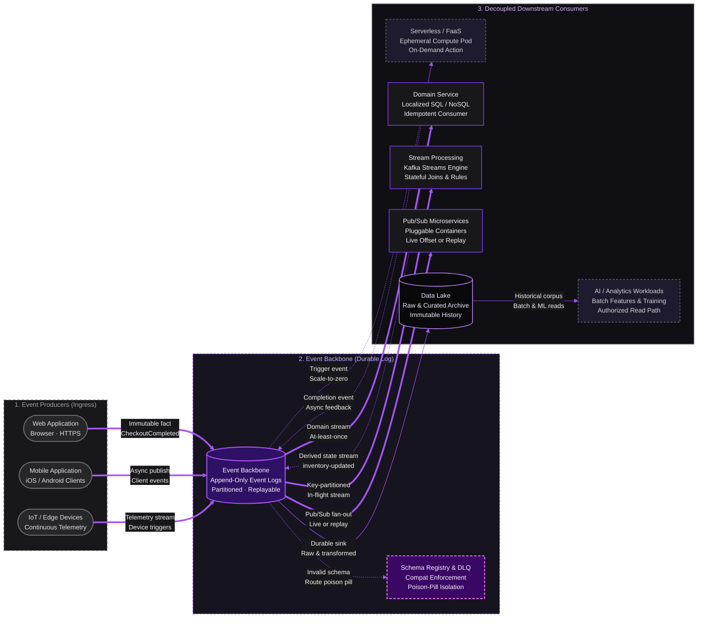

---
tags:
  - cloud-infrastructure/scalable-architecture-design/event-driven-architecture
  - data-processing/streaming-and-real-time
aliases:
  - EDA
source: "What is Event-Driven Architecture (EDA)?"
source-type: youtube
url: "https://www.youtube.com/watch?v=o2HJCGcYwoU&list=PLAZfI25B5sr0&index=3"
created: 2026-11-23
---

> [!IMPORTANT]
> **An event is an immutable statement of fact about something that happened in the past.**
> Event-Driven Architecture (EDA) decouples producers from consumers around an append-only event backbone, replacing targeted point-to-point coordination with reactive, replayable event streams.

---

## Foundation: The Reactive Manifesto

EDA implements the distributed system design principles formalized by the **Reactive Manifesto**, where asynchronous communication underpins elastic, fault-tolerant infrastructure:

- **Message-Driven (Core):** Services communicate through asynchronous messages rather than blocking synchronous calls, establishing loose coupling, fault isolation, and location transparency—acting as a distributed counterpart to [[Inversion of Control]] because producers emit facts without dictating downstream execution.
- **Scalable (Elastic):** Underlying compute (commonly orchestrated on distributed platforms like [[Kubernetes]]) expands dynamically as workload spikes and contracts when load subsides.
- **Resilient:** Eliminates single points of failure and isolates faults so component failures degrade gracefully without cascading across the system.
- **Responsive (Primary Value):** Combining elasticity and resilience delivers consistent, predictable response times under varying load and failure conditions.
- **Maintainable & Extensible (Derived Properties):** Decoupled boundaries make bug fixes, service upgrades, and plugging in new consumers straightforward without modifying upstream producers.

---

## Messaging vs. Eventing

Consider a retail checkout workflow where a Checkout service must inform Inventory, Shipping, and Contact services whenever an order completes. Traditional messaging and eventing solve this propagation very differently:

| Dimension | Point-to-Point Messaging | Eventing (Append-Only Event Log) | Senior Note |
| :--- | :--- | :--- | :--- |
| **Delivery Model** | Targeted delivery to explicit recipients; often supports bidirectional, conversational exchanges. | Broadcast via publish-subscribe; producers emit facts with zero knowledge of consumers. | Eventing decouples producer deployment cycles from consumer growth. |
| **Data Persistence** | Transient—lives on the producer, broker, or consumer only until received and acknowledged. | Durable and configurable—persisted in an append-only event log (up to permanent retention, bounded by storage). | Treat the event log as an immutable source of historical stream facts, not an ephemeral queue. |
| **Replayability** | None once consumed and removed from the queue. | Full stream history replay from any past offset or timestamp. | Enables bootstrapping new services, auditing, and reprocessing after bug fixes. |
| **Fan-Out Scalability** | Producer complexity and routing grow with every new recipient. | Constant producer work whether 3 or 100 downstream services subscribe. | Isolates consumer backpressure and lag from the write path of the producer. |

---

## Core Architecture & Event Backbone

In a production EDA topology, heterogeneous **event producers** (web applications, mobile clients, microservices, and IoT/edge devices) publish immutable records into a central **event backbone** (such as [[Apache Kafka]]). Downstream workloads attach independently to the same event logs without coordinating with producers or one another.



---

## Patterns Enabled by the Event Backbone

### 1. Triggering Ephemeral Actions (Serverless & FaaS)
Events from edge or IoT devices can invoke [[Serverless]] Function-as-a-Service (FaaS) workloads on demand:
- An incoming trigger event (e.g., an IoT device turning on) spins up an ephemeral compute pod running a modular function only when needed.
- Once execution completes, the pod powers down to avoid idle infrastructure cost and can publish a follow-up completion event back into the event backbone.

### 2. Localized Data Persistence & Polyglot Views
Rather than sharing a single monolithic database across services, consumers read domain event streams to maintain local, query-optimized data stores:
- An Inventory service consumes the checkout event stream, updates its own local [[SQL]] or [[NoSQL]] store tailored to its access patterns, and emits a derived `inventory-updated` stream back onto the backbone.
- Downstream services subscribe to that derived stream to observe the latest inventory state without querying the Inventory service's private database directly.

### 3. Data Lake Ingestion & AI Workloads
Persisting both raw and transformed event streams from the backbone into a centralized data lake builds a durable historical corpus accessible to any authorized service—fueling batch analytics, feature generation, and data-intensive AI/ML workloads.

### 4. Real-Time Stream Processing
Stateful stream processing engines built on APIs like the [[Apache Kafka]] Streams API continuously transform, join, and evaluate events in flight:
- **Dynamic personalization:** Immediately shifting music recommendations the moment a listener starts playing a new artist or genre.
- **Live operational telemetry:** Computing real-time ride-share ETAs, enforcing dynamic business rules and policies, and powering low-latency operational analytics.

### 5. Pluggable Pub/Sub Microservices & Historical Replay
Containerized microservices attach to the publish-subscribe communication layer to consume existing streams and emit to new or existing streams without touching upstream code:
- **Live consumption:** Start reading from the latest offset for real-time reactions.
- **Historical replay:** Leveraging durable stream history (a core property shared with [[Event Sourcing]]), newly deployed microservices can replay events from the beginning of retention to rebuild materialized state from scratch.

---

## Concrete Example: Immutable Events & Stream Topology

Events should model past-tense domain facts rather than imperative instructions aimed at a specific consumer.

```java
import java.time.Instant;

// GOOD: immutable past-tense fact; producer stays agnostic to subscribers
public record CheckoutCompletedEvent(
    String eventId,
    String orderId,
    String sku,
    int quantity,
    Instant occurredAt
) {}

// BAD: imperative command coupled to a single target consumer
public record DecrementInventoryCommand(
    String targetService,
    String sku,
    int delta
) {}
```

A downstream Inventory service can process the checkout stream with Kafka Streams, maintain local state, and publish an updated inventory stream back to the backbone:

```java
// Stream processor consuming checkout facts and publishing derived inventory events
StreamsBuilder builder = new StreamsBuilder();

KStream<String, CheckoutCompletedEvent> checkouts =
    builder.stream("checkout-events");

checkouts
    .selectKey((orderId, event) -> event.sku()) // partition by SKU for per-item ordering
    .mapValues(event -> new InventoryAdjustedEvent(
        event.eventId(),
        event.sku(),
        -event.quantity(),
        event.occurredAt()
    ))
    .to("inventory-updates");
```

---

## Trade-offs, Pitfalls & Anti-Patterns

| Risk / Concern | Failure Mode | Senior Note |
| :--- | :--- | :--- |
| **Eventual Consistency** | Downstream views lag behind the producer's write, causing stale reads immediately after checkout. | Design UIs and workflows for asynchronous convergence; never assume cross-service read-your-writes consistency. |
| **Duplicate Delivery** | At-least-once broker delivery replays an event after a network timeout, double-decrementing inventory. | Make every consumer idempotent by deduplicating on a deterministic `eventId` before mutating local state. |
| **Ordering Guarantees** | Events for the same entity arrive out of order across concurrent consumers. | Partition topics by entity key (e.g., `orderId` or `sku`); distributed logs guarantee strict order per partition, not globally. |
| **Schema Drift & Replay Breaks** | Changing or dropping a field breaks consumers replaying historical offsets from months ago. | Enforce backward- and forward-compatible schemas via a Schema Registry, and route unparseable poison pills to a Dead-Letter Queue (DLQ). |
| **Distributed Traceability** | Debugging failures across multi-hop pub/sub chains becomes opaque. | Propagate a `correlationId` and trace context in every event envelope so logs and metrics stitch cleanly end to end. |

### Anti-Patterns to Avoid
- **Commands Disguised as Events:** Publishing `UpdateShippingAddressCommand` instead of `ShippingAddressChanged` re-introduces tight coupling and forces producers to manage downstream workflows.
- **Event-Carried State Bloat vs. Under-Specification:** Dumping megabyte database rows bloats broker throughput and couples consumers to internal tables, while emitting only an ID triggers a thundering herd of synchronous callback queries. Include the minimal immutable fields consumers genuinely need.

---

## When Not to Use Event-Driven Architecture

- **Simple CRUD or synchronous request-response workflows:** When a single service and relational store can satisfy immediate user confirmation, introducing an event backbone adds latency and operational overhead with no ROI.
- **Small teams or early-stage monoliths:** Operating brokers, schema registries, consumer lag alerts, and DLQ replay tooling carries significant infrastructure tax compared to an in-process modular monolith.
- **Strict multi-entity ACID transactions:** When business invariants require immediate atomic rollback across multiple domains without saga or compensating-transaction complexity, synchronous transactional boundaries are simpler and safer.

> [!TIP]
> **Leadership Lens:** Standardize event envelope conventions (`eventId`, `occurredAt`, `schemaVersion`, `correlationId`), past-tense naming, CI schema-compatibility checks, and retention SLAs before teams scale topic creation—otherwise a decoupled event backbone quickly degrades into an unmaintainable distributed monolith.
