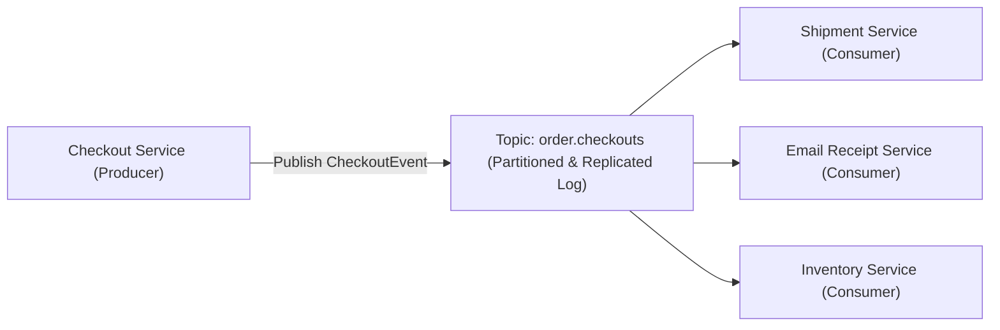

---
tags:
  - data-processing/streaming-and-real-time/kafka
  - cloud-infrastructure/scalable-architecture-design/event-driven-architecture
aliases:
  - Kafka
source: "What is Kafka?"
source-type: youtube
url: "https://www.youtube.com/watch?v=aj9CDZm0Glc&list=PLAZfI25B5sr0"
created: 2026-11-23
---
An open-source, distributed event streaming platform for building real-time, [[Event-Driven Architecture|event-driven]] applications that continuously publish, store, and process streams of data records. **Kafka decouples producers from consumers through a durable, partitioned, append-only commit log replicated across a cluster.**

## Architectural Problem: Point-to-Point vs. Event Streaming

In tightly coupled architectures, adding each downstream workflow (e.g., checkout triggering shipment, email receipts, and inventory updates) requires bespoke point-to-point integrations. Each integration forces teams to coordinate data shapes, transport protocols, and serialization formats, slowing deployments as services scale.

Kafka replaces direct service-to-service wiring with a central event log:
- **Producers broadcast events** to named topics without knowing which downstream systems subscribe.
- **Consumers subscribe independently** to relevant topics and react on their own schedule, isolating runtime failures and team release cycles.



---

## Core Architecture & Guarantees

Kafka runs as a distributed cluster spanning multiple servers or data centers across [[Cloud Infrastructure]]:
- **Topics:** Ordered, append-only streams of event records.
- **Partitioning:** Topics are split into partitions distributed across brokers, enabling horizontal throughput and high concurrency without perceptible latency degradation.
- **Replication:** Partitions are replicated across multiple brokers for durability, resilience, and fault tolerance when nodes fail.
- **Disk Persistence & Replay:** Unlike traditional transient queues that delete messages upon delivery, topics persist records to physical disk for configurable retention windows (minutes, days, or indefinitely within storage limits). Consumers can read in real time or replay historical offsets.

---

## The Four Core APIs

| API | Primary Role | Mechanics | Senior Note |
| :--- | :--- | :--- | :--- |
| **Producer API** | Publishes event records to topics. | Serializes key/value payloads and routes records to target partitions. | Partition by a stable entity key (e.g., `orderId` or `driverId`) to guarantee per-entity ordering. |
| **Consumer API** | Subscribes to topics and ingests records. | Pulls records sequentially from partitions in real time or from historical offsets. | Use consumer groups to parallelize processing; max active parallelism equals partition count. |
| **Streams API** | Transforms, enriches, and aggregates streams in real time. | Built atop Producer and Consumer APIs; reads input topic(s) and writes derived records to output topic(s). | Ideal for stateful real-time aggregations (e.g., surge pricing, top-N leaderboards) without an external cluster. |
| **Connect API** | Integrates external data stores via reusable connectors. | Configuration-driven source (ingest) and sink (export) plugins for systems like MongoDB ([[NoSQL]]) or [[SQL]] databases. | Eliminates duplicated bespoke ETL glue code across teams; prefer standard connectors before writing custom producers/consumers. |

### Producing Ordered Events (Java)

Keying records ensures all events for the same domain entity land on the same partition in order:

```java
// GOOD: Keying by orderId guarantees per-order event ordering within a partition
ProducerRecord<String, String> record = new ProducerRecord<>(
    "order.checkouts",
    orderId,          // partition key
    eventPayloadJson  // serialized CheckoutEvent
);
producer.send(record);

// BAD: Null key distributes events round-robin/sticky across partitions, breaking per-order ordering
ProducerRecord<String, String> unordered = new ProducerRecord<>(
    "order.checkouts",
    null,
    eventPayloadJson
);
```

### Reusable External Ingestion (Kafka Connect)

Instead of each team writing custom polling code to stream records from a [[NoSQL]] store such as MongoDB into Kafka, Kafka Connect standardizes ingestion through configuration:

```json
{
  "name": "mongodb-orders-source",
  "config": {
    "connector.class": "com.mongodb.kafka.connect.MongoSourceConnector",
    "tasks.max": "2",
    "connection.uri": "mongodb://orders-db:27017",
    "database": "retail",
    "collection": "checkouts",
    "topic.prefix": "raw"
  }
}
```

---

## Common Production Use Cases

- **Service Decoupling & Messaging:** Cloud-native workflows broadcast domain events (e.g., checkout completed) so fulfillment, notifications, and inventory services evolve independently.
- **Real-Time Location Tracking:** High-frequency telemetry streams (e.g., rideshare drivers emitting GPS coordinates every second) power both low-latency single-user views (ride proximity/ETA) and fleet-wide Streams aggregations (surge pricing, live availability maps).
- **Data Gathering & Real-Time Analytics:** Clickstream ingestion for site optimization, per-user real-time recommendations (e.g., music playback streams), and global cross-user aggregations (e.g., an artist's top songs).

---

## Notes, Pitfalls & When Not to Use

### Pitfalls
- **Partition-Scoped Ordering Only:** Kafka guarantees strict record ordering **within a single partition**, not globally across a multi-partition topic. Skewed partition keys create hot partitions that bottleneck throughput.
- **Unbounded Retention & Disk Exhaustion:** Persisting topics "forever" requires explicit disk capacity planning, tiered storage, or log compaction (`cleanup.policy=compact`) when only the latest state per key is needed.
- **Transport Decoupling Is Not Schema Decoupling:** Removing point-to-point HTTP calls does not prevent breaking payload changes. Enforce backward/forward compatibility with a Schema Registry using [[Apache Avro]] or [[Protocol Buffers]].

### When Not to Use Apache Kafka
- **Synchronous Request-Response Workflows:** When a caller must block for an immediate transactional response, direct RPC or HTTP APIs are simpler and lower-latency.
- **Lightweight Task Queues:** Small workloads needing per-message priority queues, complex routing exchanges, or ephemeral job distribution incur unnecessary cluster overhead compared to a traditional message broker.
- **Ad-Hoc Analytical Querying:** Kafka is a durable streaming log, not an OLAP engine; sink event streams into a [[SQL]] warehouse or lakehouse for arbitrary slicing and historical joins.

> [!TIP]
> **Leadership Lens:** Standardize topic naming (`<domain>.<entity>.<event>`), schema compatibility checks in CI, and a shared Kafka Connect catalog early—otherwise "decoupled" teams quickly accumulate undocumented topics, incompatible JSON payloads, and redundant connector code.
