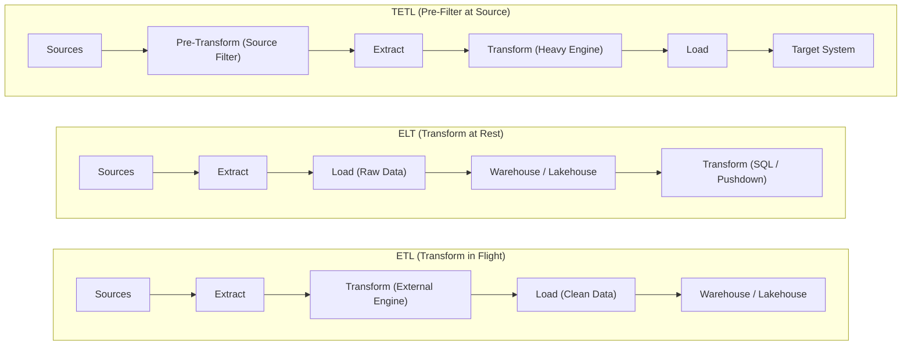

---
tags:
  - data-processing/etl-elt-pipelines
  - data-processing/data-quality-and-transformation
aliases:
  - ETL
  - ELT
  - TETL
source: "ETL vs ELT: Powering Data Pipelines for AI & Analytics"
source-type: youtube
url: "https://www.youtube.com/watch?v=KIv2Na2-u24&list=PLAZfI25B5sr0&index=4"
created: 2026-11-23
---
Data integration moves and prepares data across heterogeneous sources and targets to power reporting, analytics, and AI workloads. **ETL, ELT, and TETL all aim to deliver clean, trusted data, differing primarily in *where* transformation compute executes relative to loading into the target platform.**



---

## Pipeline Patterns

### ETL (Extract, Transform, Load)
The traditional **transform-in-flight** model processes and cleanses data outside the destination before writing structured records.

- **Extract:** Pull raw data from operational source systems—relational [[SQL]] or [[NoSQL]] databases, enterprise/cloud applications, financial systems, marketing tools, data lakes, or existing warehouses.
- **Transform:** Cleanse, join, enrich, filter, and redact sensitive fields (such as PII) using a dedicated third-party or open-source data processing engine.
- **Load:** Write the validated, structured output into the target cloud data warehouse (CDW) or [[Data Lakehouse]].
- **Best-Fit Workloads:**
  - **Compliance and sensitive data:** PII is masked or removed *before* records ever enter downstream cloud storage.
  - **Complex, high-volume transformations:** Dedicated processing engines handle heavy joins and enrichment with predictable performance.
  - **Cloud migrations:** Filtering and optimizing upstream keeps unnecessary or malformed records off expensive cloud warehouse compute.
  - **Operational domain integrations:** Processing records from SaaS apps, financial platforms, and marketing tools into clean canonical tables.

### ELT (Extract, Load, Transform)
The modern cloud-native model flips transformation and loading, landing raw data first and delegating transformations to the destination platform's elastic compute.

- **Extract & Load:** Pull raw source data and ingest it directly into a cloud data warehouse or [[Data Lakehouse]] with minimal upfront latency.
- **Transform:** Execute transformations inside the target system using built-in scalable compute—such as pushdown [[SQL]] query engines or [[dbt]] models.
- **Best-Fit Workloads:**
  - **Analytics and AI exploration:** Rapidly lands raw datasets for iterative modeling without rebuilding ingestion pipelines for every schema or metric change.
  - **[[Medallion Architecture]]:** Persists raw source payloads (Bronze) and progressively refines them in-place into cleansed and aggregated tables (Silver/Gold) on scalable [[Cloud Infrastructure]].
  - **SQL-centric teams:** Ideal for analytics engineering workflows built around [[SQL]] and [[dbt]].

### TETL (Transform, Extract, Transform, Load)
Extends ETL by introducing a lightweight **pre-transformation step at the source** prior to extraction.

- **Pre-Transform at Source:** Applies lightweight filtering, pruning, or normalization early so irrelevant or malformed data does not congest network pipes or downstream staging systems.
- **Extract, Transform, Load:** Moves the reduced dataset to a dedicated engine for heavier joins and enrichment before loading into the target system.

---

## Execution Boundary in Practice

The core operational difference between ETL and ELT is whether raw, unmasked fields cross the boundary into the target warehouse:

```sql
-- ELT pattern: raw events already landed in the warehouse (Bronze);
-- pushdown SQL / dbt transforms them in-place into a curated Silver table.
-- Requires strict access controls on raw_bronze because PII lands pre-masking.
CREATE OR REPLACE TABLE analytics_silver.customer_orders AS
SELECT
    o.order_id,
    SHA256(CAST(o.customer_email AS BYTES)) AS customer_email_hash, -- masked AFTER load
    o.order_total_usd,
    o.created_at
FROM raw_bronze.orders AS o
WHERE o.order_status IS NOT NULL
  AND o.order_total_usd >= 0;

-- ETL contrast: PII hashing and invalid-row filtering execute in an external
-- processing engine BEFORE the Load step so raw_bronze never stores unmasked PII.
```

---

## Architectural Trade-offs

| Dimension | ETL | ELT | TETL | Senior Note |
| :--- | :--- | :--- | :--- | :--- |
| **Transformation Compute** | Dedicated external/open-source engine | Target CDW or lakehouse pushdown [[SQL]] engine | Lightweight source pre-filter + external engine | Avoid paying premium cloud warehouse compute for heavy row-by-row cleansing that runs cheaper upstream. |
| **Compliance & PII Boundary** | High — PII filtered/masked *before* target load | Lower by default — raw data lands prior to cleansing | Highest — sensitive or unneeded fields dropped before extraction | For ELT with regulated data, enforce strict raw-zone RBAC, data governance, and automated quality gates from day one. |
| **Cost Predictability** | Predictable upstream compute; minimizes target storage/compute waste | Elastic and fast to start, but volume spikes can rapidly balloon cloud spend | Minimizes egress and pipeline congestion by pruning noise early | Pair ELT pipelines with warehouse resource monitors, query budgets, and partition pruning to prevent runaway bills. |
| **Ingestion Speed & Agility** | Slower initial delivery; schema/logic changes affect upstream pipelines | Fast raw ingestion; downstream teams iterate independently in [[SQL]] / [[dbt]] | Moderate; requires coordinating lightweight logic at the source | Retaining raw data in a [[Medallion Architecture]] enables deterministic backfills when business logic changes. |

---

## Pitfalls & When Not to Use

- **When Not to Use ELT:**
  - Regulatory or security boundaries prohibit unmasked PII or financial payloads from landing in a shared cloud warehouse—even in restricted staging schemas.
  - Ingestion volumes are erratic or bursty and the platform lacks strong governance, data quality frameworks, and warehouse workload optimization.
- **When Not to Use ETL:**
  - Analytics and AI teams need raw source fidelity preserved in a [[Data Lakehouse]] for reprocessing, feature engineering, or evolving downstream schemas.
  - Operating and scaling a separate external transformation cluster adds operational overhead when existing CDW compute can execute the same [[SQL]] transforms cleanly.
- **When Not to Use TETL:**
  - Source systems are latency-sensitive OLTP databases where adding pre-extraction transformation compute risks degrading production query performance.

> [!TIP]
> **Senior Lens:** Treat ETL, ELT, and TETL as composable patterns rather than a binary org-wide dogma. Anchor the choice on three invariants: where the **compliance/PII trust boundary** sits, whether **compute costs scale linearly or unpredictably** under volume spikes, and how tightly **data governance and quality checks** are enforced on raw landing zones.
