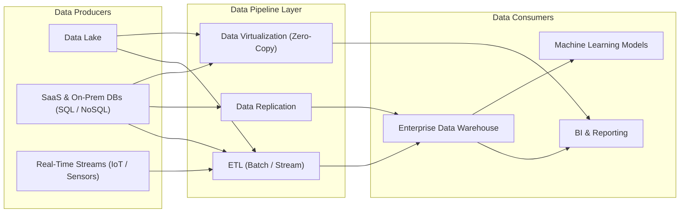

---
tags:
  - data-processing/etl-elt-pipelines
  - data-processing/streaming-and-real-time
  - data-processing/data-quality-and-transformation
source: "What Are Data Pipelines?"
source-type: youtube
url: "https://www.youtube.com/watch?v=6kEGUCrBEU0&list=PLAZfI25B5sr0&index=2"
created: 2026-11-23
---
Automated data-movement and refinement workflows that move raw records from heterogeneous **data producers** to downstream **data consumers** in a clean, reliable, and query-ready form. **Core purpose:** transform raw, fragmented, and error-prone source data into trusted datasets capable of powering analytics, operational applications, and machine learning models.

## End-to-End Architecture

Enterprise data rarely originates in a single clean repository. Pipelines bridge raw source systems and downstream analytical or operational workloads:

- **Data Producers (Sources):**
  - **[[Data Lake]] Repositories:** Raw, heterogeneous organizational datasets stored prior to curation.
  - **Application Databases:** Operational [[SQL]] and [[NoSQL]] stores backing SaaS platforms and on-premises applications across [[Cloud Infrastructure]] and local environments.
  - **Real-Time Streams:** Continuous, high-frequency event sources such as factory IoT sensors emitting telemetry every second.
- **Data Consumers (Destinations):**
  - **Enterprise [[Data Warehouse]]:** Curated analytical landing repositories optimized for structured business queries.
  - **Business Intelligence (BI) Platforms:** Dashboards and reporting layers driving operational and strategic decisions.
  - **Machine Learning (ML) Pipelines:** Training and inference workloads that depend on large volumes of clean, consistent, high-quality data.



---

## Core Data Movement Patterns

Organizations rely on three primary pipeline patterns depending on latency requirements, source-system isolation, and project maturity:

### 1. ETL (Extract, Transform, Load)
The canonical pipeline pattern for converting raw source records into curated business datasets:
- **Extract:** Pull raw records from upstream databases, lakes, or event streams.
- **Transform:** Reconcile mismatched formats and types, handle missing values, remove duplicate records, and enforce expected column projections and schemas.
- **Load:** Persist the validated, ready-to-use output into a target landing repository such as an enterprise [[Data Warehouse]].

```sql
-- Example ETL transformation stage: deduplicate, normalize mismatches,
-- handle missing values, and project required analytical columns
WITH deduplicated_readings AS (
    SELECT
        sensor_id,
        UPPER(TRIM(facility_code)) AS facility_code,
        COALESCE(temperature_c, 0.0) AS temperature_c,
        event_timestamp,
        ROW_NUMBER() OVER (
            PARTITION BY sensor_id, event_timestamp
            ORDER BY ingested_at DESC
        ) AS row_num
    FROM raw_factory_sensor_events
    WHERE sensor_id IS NOT NULL
)
SELECT
    sensor_id,
    facility_code,
    temperature_c,
    event_timestamp
FROM deduplicated_readings
WHERE row_num = 1;
```

### 2. Data Replication
Continuously copies data from a source store into an intermediate or secondary repository prior to downstream loading or application access.
- **Performance Isolation:** Serves applications or analytical workloads requiring a high-performance backend that the operational source database cannot sustain directly.
- **Backup & Disaster Recovery (DR):** Maintains an up-to-date standby copy so business processes continue running if the primary source goes offline.

### 3. Data Virtualization
Exposes a real-time federated query layer across disparate data sources **without physically copying or moving data** into a new repository.
- **Rapid Prototyping:** Ideal for validating a new data use case without committing upfront to a full data transformation engineering effort.
- **Graduation Path:** Once a virtualized prototype proves business value, replace it with a formal ETL or replication pipeline capable of sustaining production data volumes and SLAs.

### Pattern Comparison

| Pattern | Copies Data? | Primary Mechanism | Best Fit | Senior Note |
| :--- | :--- | :--- | :--- | :--- |
| **ETL** | Yes | Extracts, cleans/transforms, and loads into a target store | Curated [[Data Warehouse]] tables, BI reporting, ML feature feeds | Enforces schema and quality invariants before consumers ever see the data. |
| **Data Replication** | Yes | Continuous source-to-target copying | High-performance read backends, backup, and disaster recovery | Isolates operational source databases from read spikes and source outages; does not replace business-level cleansing. |
| **Data Virtualization** | No | On-demand real-time federated querying | Exploring and validating new use cases quickly | Avoid relying on virtualization for massive production workloads; federated queries compete directly with live sources. |

---

## Ingestion Modes: Batch Processing vs. Real-Time Stream Ingestion

ETL pipelines execute under two primary ingestion cadences:

| Dimension | Batch Processing | Real-Time Stream Ingestion ([[Stream Processing]]) |
| :--- | :--- | :--- |
| **Execution Model** | Runs on a fixed schedule over bounded datasets | Continuously ingests, transforms, and loads unbounded events |
| **Latency** | Minutes to hours (schedule-bound) | Sub-second to seconds |
| **Representative Source** | SaaS application exports, daily [[SQL]] / [[NoSQL]] snapshots | Factory IoT sensors emitting telemetry every second |
| **Operational Profile** | Simpler scheduling, backfills, and cost control | Higher operational complexity; required when freshness drives decisions |

---

## Notes, Pitfalls & When Not to Use

- **Do Not Treat Data Virtualization as a Production Scale Engine:** Virtualization avoids upfront pipeline engineering for discovery, but heavy federated queries degrade live source databases and fail to scale for massive production analytical volumes.
- **Avoid Direct Analytical Reads Against Operational Sources:** Transactional SaaS and on-premises databases are rarely tuned for analytical scans or high-concurrency downstream apps; decouple them via replication or scheduled ETL extraction.
- **Enforce Quality Gates Before ML and BI Consumption:** Mismatched types, missing values, and duplicate records silently corrupt BI metrics and degrade machine learning model accuracy. Treat cleansing and deduplication as mandatory pipeline invariants rather than optional downstream fixes.
- **Avoid Premature Full-Pipeline Builds:** Investing in a formal, production-hardened ETL pipeline before validating stakeholder demand wastes engineering cycles; prototype with data virtualization first, then harden once requirements stabilize.

> [!TIP]
> **Leadership Lens:** Establish an explicit promotion path from **data virtualization → formal pipeline**. Use virtualization to de-risk new analytical initiatives rapidly, but gate production adoption on clear thresholds (query volume, freshness SLA, source-system load protection, and automated data quality checks).
