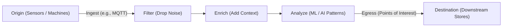

---
tags:
  - data-processing/streaming-and-real-time
  - ai-engineering/ml-pipelines
aliases:
  - Data Streaming
  - Stream Processing
source: "What Is Real-Time Data Streaming? AI & Machine Learning Applications"
source-type: youtube
url: "https://www.youtube.com/watch?v=aBIxpJ1_EyY&list=PLAZfI25B5sr0&index=5"
created: 2026-11-23
---
Continuous ingestion, transformation, and analysis of unbounded event flows at wire speed to **maximize actionable business value before data goes stale**. Rather than storing massive volumes of raw, repetitive telemetry (such as the ~20 TB/hour emitted by a commercial aircraft) for delayed batch inspection, streaming architectures evaluate events in flight and persist only decision-relevant points of interest.

## Core Value Model: Data Value Decay

Operational data exhibits a steep **value-decay curve**: its utility peaks immediately upon emission and drops sharply as processing latency grows.

- **Real-Time Value Capture:** Processing telemetry as it crosses the wire enables proactive intervention—flagging an overheating machine before hardware failure or executing a purchase during a transient price dip.
- **Anti-Data-Hoarding:** Retaining hundreds of thousands of identical nominal readings bloats storage and slows downstream queries. Filtering in flight lets systems discard benign noise and persist only anomalies, state transitions, and actionable variants.

---

## Three-Stage Streaming Architecture

A real-time streaming pipeline separates continuous telemetry delivery into three decoupled stages: **Origin**, **Processor**, and **Destination**.



### 1. Origin & Ingestion
- **Origin:** Any continuous producer emitting unbounded telemetry—industrial sensors, vehicles, aircraft subsystems, or application services.
- **Ingest Transport:** Origins pair with lightweight messaging protocols like [[MQTT]] or durable distributed logs like [[Apache Kafka]] to deliver high-velocity payloads reliably into the streaming platform.

### 2. Stream Processor (`Filter → Enrich → Analyze`)
The processing tier operates at wire speed across three sequential transformations:

- **Filter:** Eliminates redundant, nominal, or out-of-scope records immediately upon arrival to minimize downstream compute and storage overhead.
- **Enrich:** Raw sensor payloads typically contain only a timestamp and rudimentary readings (e.g., temperature, pressure). Enrichment joins each event with operational context—asset ID, vehicle or machine type, physical location, and business unit—sourced from low-latency [[NoSQL]] caches or replicated [[SQL]] reference tables.
- **Analyze:** Evaluates enriched streams over rolling time windows using rule engines, traditional ML, or generative AI to detect directional trends and anomalies (e.g., steadily rising temperature predicting equipment failure, or cost drops indicating an optimal buying window).

### 3. Destination & Egress
- **Egress:** Emits curated outputs—anomalies, alerts, and enriched aggregates—rather than raw firehose traffic.
- **Destination:** Lands points of interest into analytical [[SQL]] warehouses, operational [[NoSQL]] stores, or downstream event topics so business consumers can act asynchronously at their own pace.

---

## In-Flight Payload Transformation

```json
// 1. Raw Origin Payload (minimal sensor telemetry)
{
  "ts": "2026-11-23T12:00:01Z",
  "sensor_id": "s-409",
  "temp_c": 114.2,
  "pressure_psi": 82.5
}

// 2. Enriched & Analyzed Egress Event (persisted only on anomaly)
{
  "ts": "2026-11-23T12:00:01Z",
  "sensor_id": "s-409",
  "asset_id": "fleet-truck-88",
  "location": "us-central-hub",
  "temp_c": 114.2,
  "temp_trend_5m": "+18.4C",
  "anomaly_score": 0.94,
  "action": "TRIGGER_PREVENTIVE_MAINTENANCE"
}
```

```java
// GOOD: Filter nominal noise in flight, enrich only actionable candidates
stream
    .filter(reading -> reading.tempC() > TEMP_WARNING_THRESHOLD)
    .map(reading -> enrichWithAssetContext(reading, localAssetCache))
    .map(enriched -> mlScorer.evaluateTrend(enriched))
    .filter(EventAnalysis::isAnomaly)
    .to("maintenance-alerts");

// BAD: Hoard every raw sensor tick into an operational database before analysis
stream.forEach(reading -> operationalDb.insertRaw(reading));
```

---

## Horizontal Scaling & Elasticity

To sustain wire-speed processing during both massive steady-state throughput and unpredictable traffic spikes, distributed engines (such as [[Apache Flink]]) scale horizontally across [[Cloud Infrastructure]] compute nodes:

- **Parallel Receivers (*N* Ingestors):** Partition incoming origin connections and broker topics across multiple consumer instances.
- **Parallel Processing Sections (*N* Workers):** Shard stateful filter, enrichment, and windowed ML operators across compute nodes so throughput scales linearly with partition count.
- **Parallel Destinations (*N* Sinks):** Distribute egress writes across partitioned downstream storage or topics to prevent sink saturation from cascading upstream.

---

## Streaming vs. Batch Trade-offs

| Dimension | Real-Time Streaming | Traditional Batch | Senior Note |
| :--- | :--- | :--- | :--- |
| **Value Capture** | Milliseconds to seconds after emission. | Minutes to hours after collection. | Justify streaming with an explicit latency SLA tied to business value decay. |
| **Storage Footprint** | Selective persistence of anomalies and aggregates. | Full raw ingestion before transformation. | Keep a cheap raw cold-storage tier if ML retraining or compliance audits require replay. |
| **Context Enrichment** | Local state stores, broadcast tables, or CDC caches. | Full table joins inside a warehouse. | Avoid synchronous per-event RPCs to external [[SQL]] databases—they cap throughput at DB latency. |
| **Operational Complexity** | High (state checkpointing, out-of-order events, rebalancing). | Low (idempotent retries, simpler scheduling). | Treat stateful stream processors as Tier-1 distributed services with lag alerting. |

---

## Pitfalls & When Not to Use

### Notes & Pitfalls
- **Synchronous Enrichment Bottlenecks:** Querying an external database on every incoming record turns a wire-speed pipeline into a high-latency bottleneck. Materialize reference context into local embedded state or in-memory caches via CDC.
- **Over-Aggressive Filtering:** Dropping all nominal telemetry eliminates data hoarding, but discarding raw events irreversibly breaks downstream ML training datasets (which require negative/normal baselines) and regulatory replay.
- **Partition Skew During Scale-Out:** Adding *N* processor instances fails to scale if streams are partitioned by a skewed key (e.g., a single high-volume gateway), overloading one worker while peers sit idle.

### When Not to Use
- **Low-Urgency Analytical Reporting:** Daily financial close, executive dashboards, and retrospective BI workloads experience minimal short-term value decay; scheduled batch pipelines deliver lower cost and complexity.
- **Ad-Hoc Multi-Table Historical Joins:** Unbounded stream processors are poorly suited for arbitrary joins across months of historical records without prohibitive state sizes.
- **Low-Volume Workloads Without Latency SLAs:** Standing up distributed streaming infrastructure for modest event rates introduces unnecessary operational burden (checkpointing, schema evolution, consumer lag management) with poor ROI.

> [!TIP]
> **Leadership Lens:** Anchor streaming architecture proposals to a concrete **value-decay curve** and decision SLA rather than defaulting to real-time everywhere. Pair selective-persistence policies with a low-cost raw archive tier so teams prevent database bloat without starving future ML initiatives of baseline training data.
