# Mastery Framework
This Mastery Framework outlines my structured path to becoming a better engineer, centered on six key categories visualized in the radar chart below: [[Cloud Infrastructure]] (scalable cloud architecture and operations), [[Data Processing]] (ETL pipelines, big data tools, and data stores), [[Information Security]] (data governance, threat modeling, and compliance), [[Software Engineering]] (clean code, design patterns, and development practices), [[System Resiliency]] (fault tolerance, monitoring, and chaos engineering), and [[AI Engineering]] (ML workflows, model deployment, and MLOps). Each category will be explored in detail through notes, resources, and progress tracking.

Below is my current evaluation of my skills in each categories as of **Mar 14 2026**

```mermaid
%%{init: {"theme": "base", "themeCSS": "svg { background-color: #09090B !important; border-radius: 8px; }", "themeVariables": {"darkMode": true, "background": "#09090B", "mainBkg": "#18181B", "textColor": "#F4F4F5", "primaryColor": "#18181B", "primaryTextColor": "#F4F4F5", "primaryBorderColor": "#7C3AED", "lineColor": "#A855F7", "secondaryColor": "#16141F", "tertiaryColor": "#0F0F14", "edgeLabelBackground": "#18181B", "clusterBkg": "#0F0F14", "clusterBorder": "#52525B", "titleColor": "#D8B4FE", "fontFamily": "Inter, ui-sans-serif, system-ui, -apple-system, sans-serif", "fontSize": "13px"}, "flowchart": {"curve": "basis", "nodeSpacing": 42, "rankSpacing": 56, "padding": 14}}}%%
flowchart TB
    Profile["Competency Profile\nMar 14 2026 · Scale 0-10\n6 Engineering Mastery Pillars"]

    subgraph Developing["1. Developing Mastery (3-5 / 10)"]
        CloudInfra["Cloud Infrastructure\nRating: 5 / 10\nScalable Arch · IaC · K8s"]
        DataProc["Data Processing\nRating: 3 / 10\nETL/ELT · Streaming · Storage"]
    end

    subgraph Foundational["2. Early Foundations (1-2 / 10)"]
        SoftEng["Software Engineering\nRating: 2 / 10\nPatterns · Testing · CI/CD"]
        InfoSec["Information Security\nRating: 1 / 10\nAuthN/Z · Secrets · Compliance"]
    end

    subgraph Planned["3. Planned Horizon (0 / 10)"]
        SysRes["System Resiliency\nRating: 0 / 10\nObservability · Chaos · DR"]
        AIEng["AI Engineering\nRating: 0 / 10\nML Pipelines · Agents · MLOps"]
    end

    Profile ==>|"5 / 10 · Primary focus"| CloudInfra
    Profile ==>|"3 / 10 · Active build"| DataProc
    Profile -->|"2 / 10 · Core craft"| SoftEng
    Profile -->|"1 / 10 · Security baseline"| InfoSec
    Profile -.->|"0 / 10 · Planned horizon"| SysRes
    Profile -.->|"0 / 10 · Planned horizon"| AIEng

    classDef core fill:#2E1065,stroke:#A855F7,stroke-width:2px,color:#F5F3FF
    classDef service fill:#18181B,stroke:#7C3AED,stroke-width:1.5px,color:#F4F4F5
    classDef store fill:#09090B,stroke:#C084FC,stroke-width:1.5px,color:#EDE9FE
    classDef guard fill:#3B0764,stroke:#E879F9,stroke-width:2px,stroke-dasharray:5 3,color:#FAF5FF
    classDef async fill:#1E1B2E,stroke:#6B7280,stroke-width:1.25px,stroke-dasharray:4 3,color:#D4D4D8

    class Profile core
    class CloudInfra,DataProc service
    class SoftEng store
    class InfoSec guard
    class SysRes,AIEng async

    style Developing fill:#16141F,stroke:#6D28D9,stroke-width:1.25px,stroke-dasharray:4 3,color:#C4B5FD
    style Foundational fill:#0F0F14,stroke:#52525B,stroke-width:1.5px,color:#D8B4FE
    style Planned fill:#18181B,stroke:#52525B,stroke-width:1.25px,stroke-dasharray:5 4,color:#A1A1AA
```

<noscript></noscript>

## Focus Areas
Within each category, notes will be collected by focus area listed below. Use the table to guide where to place a note. Don't get too granular with folders, keep it simple. These focus areas will be used as tags within the notes.

| **Category**             | **Focus Areas**                                                                                                                                                                           |
| ------------------------ | ----------------------------------------------------------------------------------------------------------------------------------------------------------------------------------------- |
| **Cloud Infrastructure** | - Scalable Architecture Design - Infrastructure as Code - Container Orchestration - Networking & Load Balancing - Cloud Services                                              |
| **Data Processing**      | - ETL/ELT Pipelines - Big Data Frameworks - Databases & Storage - Streaming & Real-Time - Data Quality & Transformation                                                       |
| **Information Security** | - Secure Coding & Vulnerability Mitigation - Authentication & Authorization - Encryption & Secrets Management - Threat Modeling & Penetration Testing - Compliance & Auditing |
| **Software Engineering** | - Design Principles - Design Patterns - Frameworks & Languages - Testing Strategies - Build & CI/CD                                                                           |
| **System Resiliency**    | - Monitoring & Observability - Fault Tolerance - Chaos Engineering - Incident Response & Post-Mortems - Disaster Recovery & Backups                                           |
| **AI Engineering**       | - ML Pipelines - Model Training & Evaluation - Agent Deployment & Development - MLOps & Versioning - Ethical AI & Bias Detection                                              |
## Leadership Lens
Within each category, there will be a note specifically for addressing the leadership lens questions below to ensure leadership strategies are being actively thought about.

| **Category**         | **Leadership Lens**                                                                                          |
| -------------------- | ------------------------------------------------------------------------------------------------------------ |
| Cloud Infrastructure | How do I guide teams in designing scalable systems? How do I make architectural decisions others can follow? |
| Data Processing      | How do I set data quality standards? How do I mentor others on pipeline design?                              |
| Information Security | How do I influence org-wide security culture? How do I communicate risk to non‑technical stakeholders?       |
| Software Engineering | How do I run code reviews that teach? How do I set engineering norms?                                        |
| System Resiliency    | How do I lead incident response? How do I build a blameless culture?                                         |
| AI Engineering       | How do I evaluate ethical implications? How do I guide teams through experimentation?                        |

# Reading List
- [ ] Introducing Maven: A Build Tool for Today's Java Developers by Balaji Varanasi
- [ ] Spring Start Here
- [ ] Dependency Injection