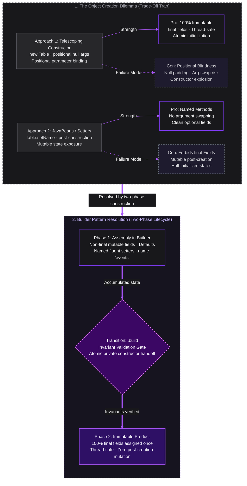

---
tags:
  - software-engineering/design-patterns/creational-patterns
---
Separates the construction of a complex object from its representation, allowing the same construction process to produce different representations or configurations. **Used for simplifying the construction of a complex object**.

### Key Components
- **Product:** The complex object being built (usually immutable).
- **Builder:** An interface or class defining the step-by-step methods to configure attributes.
- **Director (Optional in modern Java):** An orchestrator that executes building steps in a specific sequence.

```java
public final class TableConfig {
    private final String tableName;
    private final String location;       // optional
    private final int commitRetries;     // optional with default
    private final boolean purgeOnDelete; // optional with default

    private TableConfig(Builder builder) {
        this.tableName = builder.tableName;
        this.location = builder.location;
        this.commitRetries = builder.commitRetries;
        this.purgeOnDelete = builder.purgeOnDelete;
    }

    public static Builder builder(String tableName) {
        return new Builder(tableName);
    }

    public static class Builder {
        private final String tableName; // Required
        private String location;
        private int commitRetries = 3;  // Default
        private boolean purgeOnDelete = false;

        public Builder(String tableName) {
            if (tableName == null || tableName.isBlank()) {
                throw new IllegalArgumentException("tableName cannot be empty");
            }
            this.tableName = tableName;
        }

		// fluent setters
        public Builder location(String location) {
            this.location = location;
            return this; // this is to chain setters
        }

        public Builder commitRetries(int retries) {
            this.commitRetries = retries;
            return this;
        }

        public Builder purgeOnDelete(boolean purge) {
            this.purgeOnDelete = purge;
            return this;
        }

        public TableConfig build() {
            // Validation invariants before instantiation
            // occurs here in order to validate final fluent setter values.
            return new TableConfig(this);
        }
    }
}
```

### Notes & Pitfalls
- **Solves the "Telescoping Constructor" Problem:** Eliminates constructor cascades (`new Foo(a)`, `new Foo(a, b)`, `new Foo(a, b, c)`).
- **Enables Immutability:** You can build an object with 15 optional parameters and still make all fields `final` without exposing mutable setters.
- **Overhead:** Creating the builder instance incurs slight memory and CPU overhead; avoid using it for trivial objects with only 1 or 2 mandatory fields.

> [!IMPORTANT]
> Do not use records with the builder pattern unless the builder is optional as records force the constructor to be public. Use POJO for traditional builder pattern classes where the constructor of the product class must remain hidden

# Object Creation Dilemma

The builder pattern gives the important ability to make fields final in a class, while allowing for optional fields to be set. Without the builder pattern, making an object with final fields would look like:

```java
public class Table {
	final String name;
	final String schema;
	
	public Table(String name, String schema) {
		this.name = name;
		this.schema = schema;
	}
}
```

In order for the client to only set one or the other, they must pass in null to one of the values. This introduces risk of passing in the wrong value to the wrong field as nothing enforces the order.

In order to solve this, normal objects use setters, including the name of the field in the method to ensure the correct field is being set. However, this means that the fields cannot be final and makes the object mutable post instantiation.

The builder pattern addresses this by combining the power of setters to non final fields within the builder class, and doing a one time set of all the [[Design Patterns#Product Class|product]] class fields during class instantiation (cannot set final fields with setters as the fields must be populated before object is created, and setters are only available after an object is created).

