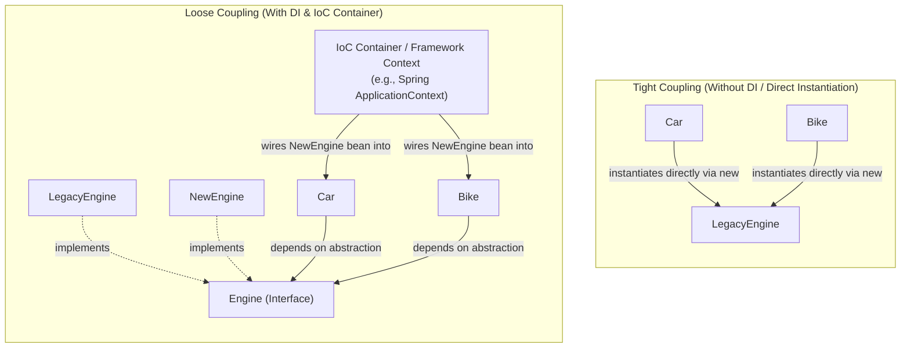
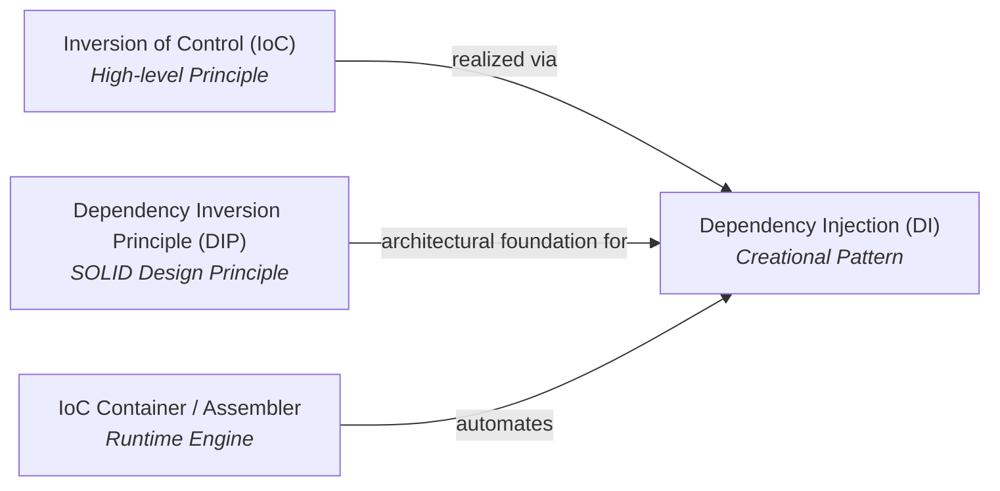

---
tags:
  - software-engineering/design-patterns/creational-patterns
  - software-engineering/design-principles
aliases:
  - DI
  - Dependency Injection Pattern
source: "Java Dependency Injection (DI) Design Pattern"
source-type: article
author: "GeeksforGeeks"
published: 2023-12-06
url: "https://www.geeksforgeeks.org/system-design/dependency-injection-di-design-pattern"
created: 2026-11-23
---
**Dependency Injection (DI)** is a creational software design pattern and concrete structural implementation of [[Inversion of Control]] (IoC) wherein an object receives its collaborators and runtime dependencies from an external assembler or framework container rather than instantiating them directly. By decoupling object creation from execution logic, DI enforces the [[Dependency Inversion Principle]], turning compile-time class dependencies into runtime interface bindings.

> [!NOTE]
> While [[Inversion of Control]] establishes the overarching architectural principle ("delegate lifecycle and execution control away from application code"), **Dependency Injection** is the primary design pattern used to realize IoC by populating an object's references from the outside.

---

## Architectural Problem: Tight Coupling vs Inversion of Control

In traditional object-oriented designs without DI, dependent classes construct their own collaborators using direct instantiation (`new ConcreteClass()`). This practice binds high-level business components tightly to low-level implementations, creating rigid codebases that resist change, complicate integration testing, and violate the [[Single Responsibility Principle]].



### Key Deficiencies of Direct Instantiation
1. **Rigid Implementation Coupling:** Changing a dependency implementation (e.g., replacing `LegacyEngine` with `NewEngine`) requires manual modifications across every caller class.
2. **Impaired Testability:** Unit tests cannot substitute simulated or mock objects for external dependencies (such as databases, messaging queues, or HTTP clients) without altering production code.
3. **Hidden Lifecycle Control:** Classes become responsible both for executing their primary domain logic and for orchestrating configuration and lifecycle management of their dependencies.

---

## Injection Varieties

Dependency Injection typically manifests across three architectural strategies:

| Injection Strategy | Primary Mechanism | Mutability / Lifecycle | Senior Note |
| :--- | :--- | :--- | :--- |
| **Constructor Injection** | Dependencies passed as constructor parameters. | Immutable (`final` fields); guaranteed non-null state at instantiation. | **Industry standard.** Prevents partially initialized objects and makes class dependencies explicit in API design. |
| **Setter Injection** | Dependencies supplied via public setter methods. | Mutable; dependencies can be reconfigured or injected optionally. | Prone to `NullPointerException` if invocations occur before setters execute; use primarily for optional configurations. |
| **Field Injection** | Container populates private fields directly via reflection (`@Autowired`). | Hidden; framework-dependent; fields cannot easily be made `final`. | **Anti-pattern in domain code.** Masks excessive dependencies, circumvents compiler verification, and complicates off-container testing. |

---

## Implementation Patterns in Java

### 1. The Anti-Pattern: Tightly Coupled Direct Creation

In this anti-pattern, `Car` directly constructs concrete class `LegacyEngine`. Introducing a new engine type forces structural changes onto `Car`.

```java
// BAD: Car manages the lifecycle and concrete binding of its dependency
public class LegacyEngine {
    public void start() {
        System.out.println("Legacy Engine Started");
    }
}

public class Car {
    private final LegacyEngine engine = new LegacyEngine();

    public void drive() {
        engine.start();
        System.out.println("Car is running");
    }
}
```

### 2. Pure Java DI: Interface Abstraction and Constructor Injection

Decoupling requires extracting a common [[Interface]] and injecting that abstraction via constructors. The caller or bootstrap layer manages instantiation.

```java
// 1. Dependency abstraction
public interface Engine {
    void start();
}

// 2. Concrete implementations
public class LegacyEngine implements Engine {
    @Override
    public void start() {
        System.out.println("Legacy Engine Started");
    }
}

public class NewEngine implements Engine {
    @Override
    public void start() {
        System.out.println("New Engine Started");
    }
}

// 3. Dependent class relying exclusively on the abstraction
// GOOD: Dependency provided externally; immutable and fully testable
public class Car {
    private final Engine engine;

    public Car(Engine engine) {
        this.engine = Objects.requireNonNull(engine, "Engine cannot be null");
    }

    public void drive() {
        engine.start();
        System.out.println("Car is running");
    }
}

// 4. External Assembler (Bootstrap / Composition Root)
public class Main {
    public static void main(String[] args) {
        Engine engine = new NewEngine();
        Car car = new Car(engine);
        car.drive();
    }
}
```

### 3. Framework-Driven DI with Spring

In enterprise JVM environments, manually wiring complex dependency graphs becomes unmaintainable. Modern enterprise systems offload composition roots to an IoC container such as [[Spring Core]] or [[Spring Boot]].

```java
import org.springframework.context.annotation.Bean;
import org.springframework.context.annotation.Configuration;
import org.springframework.stereotype.Component;

// Configuration / Container Bean Factory
@Configuration
public class EngineConfig {
    @Bean
    public Engine engine() {
        return new NewEngine();
    }
}

// Spring-managed component leveraging Constructor Injection
@Component
public class Car {
    private final Engine engine;

    // GOOD: Spring automatically autowires single-constructor parameters
    public Car(Engine engine) {
        this.engine = engine;
    }

    public void drive() {
        engine.start();
        System.out.println("Car is running via Spring IoC");
    }
}
```

---

## Interplay Between DI, IoC, and Design Principles



### Inversion of Control vs Dependency Injection
- **[[Inversion of Control]]:** A macro architectural principle where execution flow and lifecycle orchestration are transferred from custom code to an overarching framework. Other manifestations of IoC include the Template Method pattern, event-driven loops, and service locators.
- **Dependency Injection:** A targeted pattern within the IoC family specifically addressing *collaborator acquisition*. Rather than an object querying a registry (like a Service Locator), dependencies are pushed directly into the target instance.

### Dependency Inversion Principle (DIP) Alignment
DIP dictates that high-level modules must not depend on low-level modules; both must depend on abstractions. DI provides the mechanical plumbing that satisfies DIP at runtime:
1. High-level modules define and consume abstractions (`Engine`).
2. Low-level modules implement those abstractions (`NewEngine`).
3. External containers bind the two without either component sharing knowledge of the other's concrete class definition.

---

## Trade-Offs & When to Use

### Recommended Scenarios
- **Enterprise Service Layers:** Decoupling controllers, services, repositories, and message dispatchers across distributed architectures.
- **Test-Driven Architectures:** Facilitating seamless injection of in-memory mocks, stubs, and test doubles during automated unit testing.
- **Polyglot Data/Service Adapters:** Switching external connectors (e.g., swapping relational [[SQL]] repositories with [[NoSQL]] stores or local disk with object storage) via runtime profile toggles.

### Anti-Patterns and When Not to Use
- **Domain Entities & Value Objects:** Data transfer objects (DTOs), immutable records, and domain models should not be injected with dependencies; keep them pure state containers.
- **Premature Framework Coupling:** Introducing heavy reflection-based DI containers for small CLI utilities or single-purpose scripts adds startup latency and deployment baggage without architectural benefit.
- **Cyclic Dependency Graphs:** If Class A requires Class B and Class B requires Class A via constructor injection, the container cannot instantiate either. Cyclic graphs indicate a fundamental failure of component cohesion requiring architectural refactoring.
