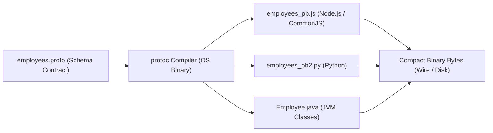

---
tags:
  - software-engineering/frameworks/protobuf
  - software-engineering/design-principles/serialization
aliases:
  - Protobuf
source: "Protocol Buffers Crash Course"
source-type: youtube
url: "https://www.youtube.com/watch?v=46O73On0gyI"
created: 2026-11-23
---
A language-neutral, schema-driven mechanism for serializing structured data into a compact binary format for network transmission (such as beneath [[gRPC]]) or on-disk storage. **Protobuf trades JSON's schemaless convenience for compile-time contract enforcement and dramatically smaller binary payloads via generated language bindings.**

## Core Mental Model & Schema Design

Unlike JSON—where arbitrary keys (`name`, `name2`, `Name`) remain syntactically valid and push schema validation onto application code—Protobuf enforces a strict contract up front, analogous to rigid [[SQL]] schemas versus schemaless [[NoSQL]] documents.

Every Protobuf contract is authored in a `.proto` file using the Interface Definition Language (IDL):

- **Syntax Version (`syntax = "proto3";`):** Declares the protocol specification version at the top of the file.
- **Messages (`message`):** Strongly typed data structures with explicit scalar field types (`int32`, `string`, `float`, etc.).
- **Field Numbers (`= 1`, `= 2`, `= 3`):** Unique positive integer tags assigned to each field. These tags—not field names—identify fields on the wire and govern backward/forward compatibility during schema evolution.
- **Collections (`repeated`):** Lists/arrays are modeled using the `repeated` modifier, typically inside a dedicated wrapper message.

```protobuf
// employees.proto
syntax = "proto3";

message Employee {
    int32 id = 1;       // Field tag 1: 32-bit integer wire identifier
    string name = 2;    // Field tag 2: UTF-8 string
    float salary = 3;   // Field tag 3: 32-bit floating-point value
}

// Wrapper message representing a typed array/collection of Employee records
message Employees {
    repeated Employee employees = 1;
}
```

> [!IMPORTANT]
> **Never renumber or reuse active field tags in an evolving schema.**
> Binary payloads encode field numbers rather than field names. Changing a field's tag number silently breaks deserialization for older or newer clients—the same wire-compatibility pitfall behind never persisting Java [[Enums]] by `ordinal()`.

---

## Code Generation Workflow (`protoc`)

Protobuf is **language-neutral, not zero-setup language-agnostic**: application runtimes cannot directly `import` or `require()` a raw `.proto` file. Instead, the OS-specific Protocol Buffer compiler (`protoc`) compiles a single `.proto` definition into native bindings (`*_pb.js`, `*_pb2.py`, Java classes, C++ headers) backed by a language-specific runtime library.



### Compiling & Using Generated Bindings (Node.js Example)

```bash
# 1. Compile the .proto schema into CommonJS binary bindings
protoc --js_out=import_style=commonjs,binary:. employees.proto

# 2. Install the Protobuf runtime required by generated JS modules
npm install google-protobuf
```

```javascript
const fs = require("fs");
const Schema = require("./employees_pb");

// Construct typed messages via generated setters
const emp1 = new Schema.Employee();
emp1.setId(1001);
emp1.setName("Hussein");
emp1.setSalary(1000);

const emp2 = new Schema.Employee();
emp2.setId(1002);
emp2.setName("Ahmed");
emp2.setSalary(9000);

const emp3 = new Schema.Employee();
emp3.setId(1003);
emp3.setName("Rick");
emp3.setSalary(5000);

// Populate the repeated collection wrapper
const employees = new Schema.Employees();
employees.addEmployees(emp1);
employees.addEmployees(emp2);
employees.addEmployees(emp3);

// Serialize to compact Uint8Array binary payload (for wire transport or disk storage)
const bytes = employees.serializeBinary();
fs.writeFileSync("employees.bin", bytes);

// Deserialize raw bytes back into typed message objects
const decoded = Schema.Employees.deserializeBinary(bytes);
console.log(decoded.toString());
```

- **Cross-Language Ergonomics:** While generated CommonJS classes expose mutable `set*`/`get*`/`add*` methods, statically typed targets like Java generate immutable message classes constructed via the [[Builder Pattern]] (e.g., `Employee.newBuilder().setId(1001).build()`), providing compile-time safety and full IDE autocompletion.

---

## Payload Efficiency: Protobuf vs. JSON

Serializing the same 3-record `Employees` dataset illustrates the structural overhead of text formats:

- **JSON (`JSON.stringify`):** `125 bytes` — repeats field names (`"id"`, `"name"`, `"salary"`) and structural delimiters (`{}`, `""`, `:`, `,`) on every record.
- **Protobuf (`serializeBinary`):** `52 bytes` — **~58% smaller (~2.4x reduction)** before any transport-layer compression.

At thousands or millions of records, compact binary payloads reduce memory allocation, disk footprint, and network bandwidth, minimizing extra TCP round trips and stacking effectively with HTTP/2 compression.

| Dimension | Protocol Buffers | JSON | Senior Note |
| :--- | :--- | :--- | :--- |
| **Schema Enforcement** | Strict `.proto` contract enforced at codegen/serialization time | Schemaless; validation deferred to application code | Prevents silent field typos and drift across polyglot teams. |
| **Payload Size** | Compact binary (`52 B` for 3 records) | Verbose text (`125 B` for 3 records); XML/SOAP is roughly 2x JSON | Savings compound at scale for both RPC traffic and disk storage. |
| **Human Readability** | Opaque binary; requires schema + deserializer to inspect | Plain text; directly readable in editors, logs, and DevTools | Debugging production Protobuf payloads requires schema-aware tooling. |
| **Cross-Language Support** | Single `.proto` compiled to JS, Python, Java, C++, Go | Native in browsers/JS; manual DTO mapping elsewhere | Foundation of [[gRPC]] polyglot service contracts. |
| **Setup & Build Cost** | High (`protoc` toolchain, build step, runtime dependency) | Near zero (built into language stdlibs) | Upfront engineering friction is roughly 3x higher for small apps. |

---

## Trade-offs, Pitfalls & Operational Overhead

- **Build Pipeline & Authoring Friction:** Creating `.proto` schemas, installing OS-specific `protoc` binaries, integrating compilation into builds, and wiring runtime packages adds meaningful boilerplate compared to native JSON objects.
- **Compiler & Generated-Code Maintenance:** Generated bindings live inside the project build lifecycle. Teams must periodically upgrade `protoc` and recompile schemas to pull in security patches, bug fixes, and encoding optimizations—introducing regression risk whenever generated behavior shifts.
- **Weak IntelliSense in Untyped Languages:** In plain JavaScript (without TypeScript declaration generation), editors frequently fail to autocomplete generated `set*`/`get*`/`add*` methods, forcing developers to inspect generated `*_pb.js` files directly.
- **Schema Governance Overhead:** Strict schemas prevent drift but require deliberate lifecycle management so schema edits do not break downstream consumers. Schema rigidity (alongside verbose XML payloads) was a primary driver behind the industry shift from SOAP to REST/JSON.
- **Opaque On-Disk & Wire Inspection:** Unlike JSON files that can be opened or `grep`ped directly, serialized binary payloads are unreadable without the matching schema.

## When Not to Use Protocol Buffers

- **Small Scripts, Prototypes, or Simple CRUD Apps:** The overhead of `.proto` maintenance, `protoc` compilation, and runtime dependencies outweighs payload savings.
- **Public Browser-First REST APIs:** When external developer ergonomics and zero-tooling inspectability (`curl`, browser DevTools) matter more than binary compactness.
- **Rapidly Churning, Unstructured Payloads:** When schemas change constantly and strict contract rigidity slows iteration more than it prevents bugs.
- **Analytical Lakehouse & Schema-Registry Streaming Pipelines:** When self-describing columnar or row formats like Apache Avro or Parquet better match batch/streaming ecosystem tooling.

> [!TIP]
> **Leadership Lens:** Treat `.proto` files as versioned, first-class API contracts—serving the same decoupling role across services that an [[Interface]] serves within a codebase. Pin `protoc` and plugin versions in CI/build tooling (avoiding ad-hoc local binary generation) and reserve Protobuf for high-throughput service boundaries or durable storage where bandwidth, latency, and cross-language contract guarantees justify the build-pipeline tax.
