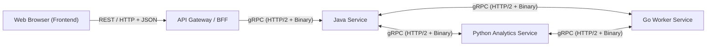

---
tags:
  - software-engineering/frameworks/grpc
  - software-engineering/design-principles/rpc
source: "What is gRPC? (Remote Procedure Calls)"
source-type: youtube
url: "https://www.youtube.com/watch?v=hVrwuMnCtok"
created: 2026-11-23
---
An open-source, Cloud Native Computing Foundation (CNCF)-governed Remote Procedure Call (RPC) framework introduced in 2015 for high-performance communication between distributed backend services. **gRPC pairs HTTP/2 transport with [[Protocol Buffers]] contracts and code generation so polyglot microservices invoke remote procedures like strongly typed local methods without maintaining custom HTTP client libraries.**

## Architecture & Microservices Scope

gRPC is designed primarily for internal, east-west backend communication rather than direct browser-to-server traffic:

- **Polyglot Service-to-Service Communication:** Connects heterogeneous backend [[Microservices]] (for example, Python analytics, Java core services, and Go workers) over a single uniform RPC layer.
- **No Native Browser Support:** Standard gRPC does not work natively out of the box in web browsers, making direct frontend-to-backend calls impractical without an intermediary gateway or translation layer.
- **Unified Transport & Client Abstraction:** Without gRPC, every language runtime relies on separate HTTP client libraries maintained by different ecosystems—multiplying boilerplate, extension effort, and maintenance drift as service count grows. gRPC manages HTTP/2 connections and client mechanics automatically across languages.



---

## Contract-First Code Generation (`.proto`)

Whereas traditional [[REST]] APIs transmit schemaless JSON key-value payloads whose structure is only validated once received, gRPC enforces a strict API contract at the protocol layer using [[Protocol Buffers]] (`.proto` files):

- **Data Schema (`message`):** Declares expected payload fields, field types (`int32`, `string`, etc.), and required/optional structure.
- **Remote Procedures (`service` / `rpc`):** Explicitly declares which procedures a service exposes for remote invocation alongside their strongly typed request and response messages.
- **Compiler-Generated Bindings:** Running the `.proto` file through the compiler generates native source code for each target language—emitting typed message classes (constructed via the [[Builder Pattern]] in Java), service stubs, and [[Interface]]-backed implementations rather than hand-written HTTP DTOs.

```protobuf
// analytics.proto
syntax = "proto3";

package platform.analytics.v1;

// Strongly typed payload contract (field tags govern wire encoding)
message MetricRequest {
    string pipeline_id = 1;
    int32 lookback_hours = 2;
}

message MetricResponse {
    string pipeline_id = 1;
    int32 processed_records = 2;
    string status = 3;
}

// Remote procedures callable across polyglot microservices
service AnalyticsService {
    rpc GetPipelineMetrics (MetricRequest) returns (MetricResponse);
}
```

```java
// GOOD: Generated gRPC stub abstracts HTTP/2 transport, serialization, and typed contract
MetricRequest request = MetricRequest.newBuilder()
        .setPipelineId("clickstream-etl")
        .setLookbackHours(24)
        .build();

MetricResponse response = analyticsStub.getPipelineMetrics(request);
int count = response.getProcessedRecords();

// BAD: Hand-rolled HTTP client + untyped JSON map deferred to runtime validation
// HttpRequest req = HttpRequest.newBuilder(uri)
//         .POST(BodyPublishers.ofString("{\"pipeline_id\":\"clickstream-etl\",\"lookback_hours\":24}"))
//         .build();
```

---

## Performance Mechanics: HTTP/2 & Binary Wire Format

gRPC improves throughput and network efficiency through two compounding layers:

- **HTTP/2 Transport:** Built directly on HTTP/2 rather than HTTP/1.1, gaining modern transport performance improvements without requiring application developers to tune low-level HTTP mechanics.
- **Compact Binary Serialization:** Messages defined in [[Protocol Buffers]] are serialized into compact binary payloads on the wire—substantially smaller than plain-text JSON key-value pairs, which repeat field names and delimiters on every message.
- **Built-In Efficiency vs. Manual Compression:** Although JSON payloads over REST can be compressed with `gzip`, doing so requires importing, configuring, and maintaining compression libraries independently in every microservice runtime. gRPC delivers compact binary wire transfer uniformly out of the box.

| Dimension | gRPC | REST / JSON | Senior Note |
| :--- | :--- | :--- | :--- |
| **API Contract** | Strict `.proto` schema + RPC definitions enforced via codegen | Schemaless by default; payloads validated at runtime by receiver | Catches contract drift at compile time across polyglot teams. |
| **Wire Payload** | Compact binary via [[Protocol Buffers]] | Verbose plain-text key-value pairs | Eliminates per-service `gzip` boilerplate for high-volume internal traffic. |
| **Transport** | HTTP/2 managed by the framework | Commonly HTTP/1.1 (or HTTP/2) via per-language HTTP clients | Removes inconsistent HTTP client library maintenance across runtimes. |
| **Client Ergonomics** | Auto-generated stubs and typed models per language | Hand-maintained client wrappers or separate OpenAPI generators | High leverage once an org spans 3+ backend languages. |
| **Browser Support** | Not natively supported out of the box | Native across all browsers and DevTools | Keep REST/JSON (or a gateway) at the browser-facing edge. |

---

## Trade-offs, Pitfalls & When Not to Use gRPC

gRPC is not a universal replacement for all service communication.

### Operational Pitfalls
- **Build & Toolchain Coupling:** Integrating `.proto` compilation and versioned language plugins adds build-pipeline complexity compared to zero-codegen JSON endpoints.
- **Schema Evolution Discipline:** Sharing strict `.proto` contracts across services requires backwards-compatible change management (never reusing or renumbering active field tags).
- **Opaque Wire Debugging:** Binary payloads are not directly human-readable in plain logs or standard network captures without schema-aware inspection tools.

### When Not to Use gRPC
- **Direct Browser-to-Backend Communication:** Web clients lack native gRPC support; exposing REST/JSON at the frontend boundary avoids extra proxy infrastructure.
- **Public External APIs Prioritizing Zero-Tooling Discoverability:** External integrators often prefer human-readable JSON payloads inspectable directly with `curl` and browser DevTools.
- **Small Services or Rapid Prototypes:** For simple CRUD apps or single-language services, `.proto` authoring and codegen overhead outweigh payload and client-library savings (see [[Protocol Buffers#When Not to Use Protocol Buffers]]).

> [!TIP]
> **Leadership Lens:** Use gRPC selectively at high-leverage east-west microservice boundaries where polyglot codegen, strict contracts, and compact HTTP/2 payloads compound across teams—while preserving REST/JSON at the browser-facing edge and managing `.proto` definitions as versioned, centrally linted API contracts.
