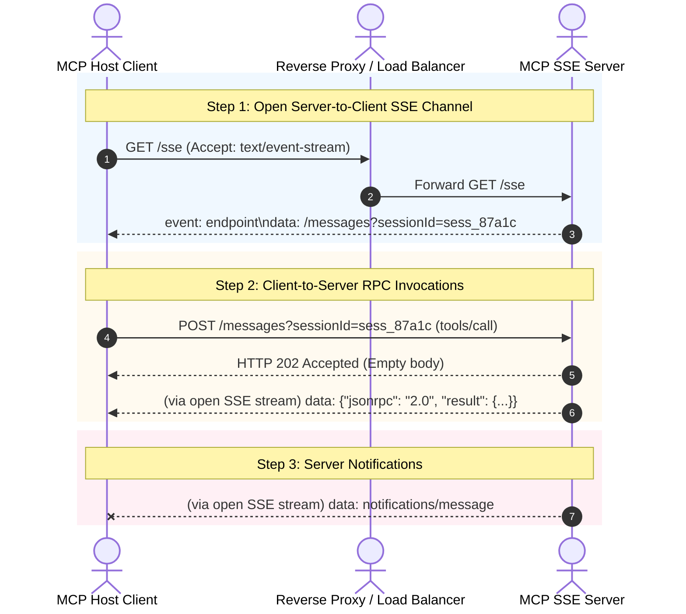

---
tags:
  - ai-engineering/agents/mcp
aliases:
  - HTTP with Server-Sent Events
  - SSE Transport
  - HTTP + SSE
source: "MCP: Architecture and Transports"
source-type: documentation
author: "DeepLearning.AI & Anthropic"
url: "https://learn.deeplearning.ai/courses/mcp-build-rich-context-ai-apps-with-anthropic/lesson/xtt6w/mcp-architecture"
created: 2026-11-24
---
The **HTTP with Server-Sent Events (SSE) Transport** is a networked communication specification established in early versions of the [[Model Context Protocol]] (MCP) for remote client-server interactions. It decouples message delivery into two asymmetric channels: a persistent, unidirectional HTTP `GET` stream (`text/event-stream`) for server-to-client notifications and responses, and discrete HTTP `POST` requests for client-to-server JSON-RPC calls.

---

## Architectural Mechanics & Channel Splitting

Unlike single-socket duplex protocols (such as WebSockets) or local process pipes (`[[Standard IO Transport]]`), the HTTP + SSE transport splits bidirectional RPC traffic into two independent HTTP connections.



### Communication Flow
1. **The SSE Handshake:** The client initiates an HTTP `GET` request to `/sse`. The server accepts the connection and holds it open with `Transfer-Encoding: chunked` and `Content-Type: text/event-stream`.
2. **Session Endpoint Binding:** The server immediately pushes an initial SSE event named `endpoint`, containing a unique session URI (e.g., `/messages?sessionId=sess_87a1c`).
3. **RPC Execution:** When the client sends JSON-RPC requests (e.g., `initialize`, `tools/call`), it issues an HTTP `POST` to the session URI. The server acknowledges receipt with HTTP `202 Accepted`, then streams the actual JSON-RPC response back through the open SSE channel.

---

## Production Reference Implementation

### 1. Server Implementation (FastMCP with SSE)

The server exposes two routes: an SSE handshake route and a POST message handler bound to an in-memory or Redis-backed session registry.

```python
# sse_server.py
from mcp.server.fastmcp import FastMCP

# Initialize server configured for SSE network hosting
mcp = FastMCP(name="Remote Analytics Service")


@mcp.tool()
def calculate_metrics(dataset: str) -> dict:
    """Computes basic analytical aggregates for a remote client."""
    return {"dataset": dataset, "mean": 42.8, "p99": 118.2}


if __name__ == "__main__":
    # Mounts SSE on /sse and message handling on /messages/
    mcp.run(transport="sse", host="0.0.0.0", port=8080)
```

### 2. Client-Side SSE Session Connection

The client establishes the persistent event source and wraps it inside an MCP session:

```python
# sse_client.py
import asyncio
from mcp import ClientSession
from mcp.client.sse import sse_client


async def run_remote_sse_client():
    server_url = "http://localhost:8080/sse"

    # Opens long-lived SSE stream and binds POST session endpoint
    async with sse_client(server_url) as (read_stream, write_stream):
        async with ClientSession(read_stream, write_stream) as session:
            # 1. Initialize protocol handshake
            await session.initialize()

            # 2. Invoke remote tool
            result = await session.call_tool(
                name="calculate_metrics",
                arguments={"dataset": "financial_q3"},
            )
            print(f"Tool Result received via SSE: {result.content}")


if __name__ == "__main__":
    asyncio.run(run_remote_sse_client())
```

---

## Operational Friction & Cloud Infrastructure Limits

While HTTP + SSE enabled the first remote MCP deployments, its stateful, asymmetric design introduces significant operational friction in cloud environments:

### 1. The Sticky Session Requirement
Because the client's `POST /messages?sessionId=...` requests must be routed to the exact server instance maintaining the open `GET /sse` stream, reverse proxies and load balancers (such as AWS ALB or NGINX) require **sticky sessions** or shared distributed backplanes (e.g., Redis pub/sub). If an ephemeral container restarts, the SSE stream breaks and the session is permanently lost.

### 2. Intermediate Proxy & Gateway Timeouts
Network middleboxes, API Gateways, and CDN layers (e.g., Cloudflare, Envoy) routinely enforce aggressive idle timeouts (typically 60 seconds). Without continuous TCP keep-alive pings (`:keepalive\n\n`), intermediate proxies silently sever the SSE connection.

### 3. Incompatibility with Ephemeral Serverless
Serverless platforms (AWS Lambda, Google Cloud Run in scale-to-zero mode) cannot maintain open, un-billed SSE event listeners. They require standard, request-response stateless cycles.

---

## Comparison: Legacy SSE vs. Modern Streamable HTTP

| Architectural Dimension | `HTTP with SSE Transport` | `[[Streamable HTTP Transport]]` |
| :--- | :--- | :--- |
| **Endpoint Topology** | Dual endpoints (`/sse` + `/messages`) | Consolidated endpoint (e.g., `/mcp`) |
| **Connection Model** | Strictly stateful (mandatory open stream) | Hybrid (Stateless HTTP POST by default; optional SSE upgrade) |
| **Load Balancing** | Requires sticky sessions / instance affinity | Standard L7 round-robin routing for stateless calls |
| **Serverless Fit** | Poor (requires continuous long-lived connections) | Native (stateless single-turn POST requests) |
| **Senior Note** | Legacy transport; maintain only for backwards compatibility with early MCP SDK versions. | Preferred transport for modern distributed production systems. |

> [!TIP]
> **Senior Lens:** Treat HTTP + SSE as an interim protocol step. When architecting new remote MCP servers, migrate directly to `[[Streamable HTTP Transport]]` to eliminate sticky-session infrastructure and enable effortless horizontal autoscaling.
