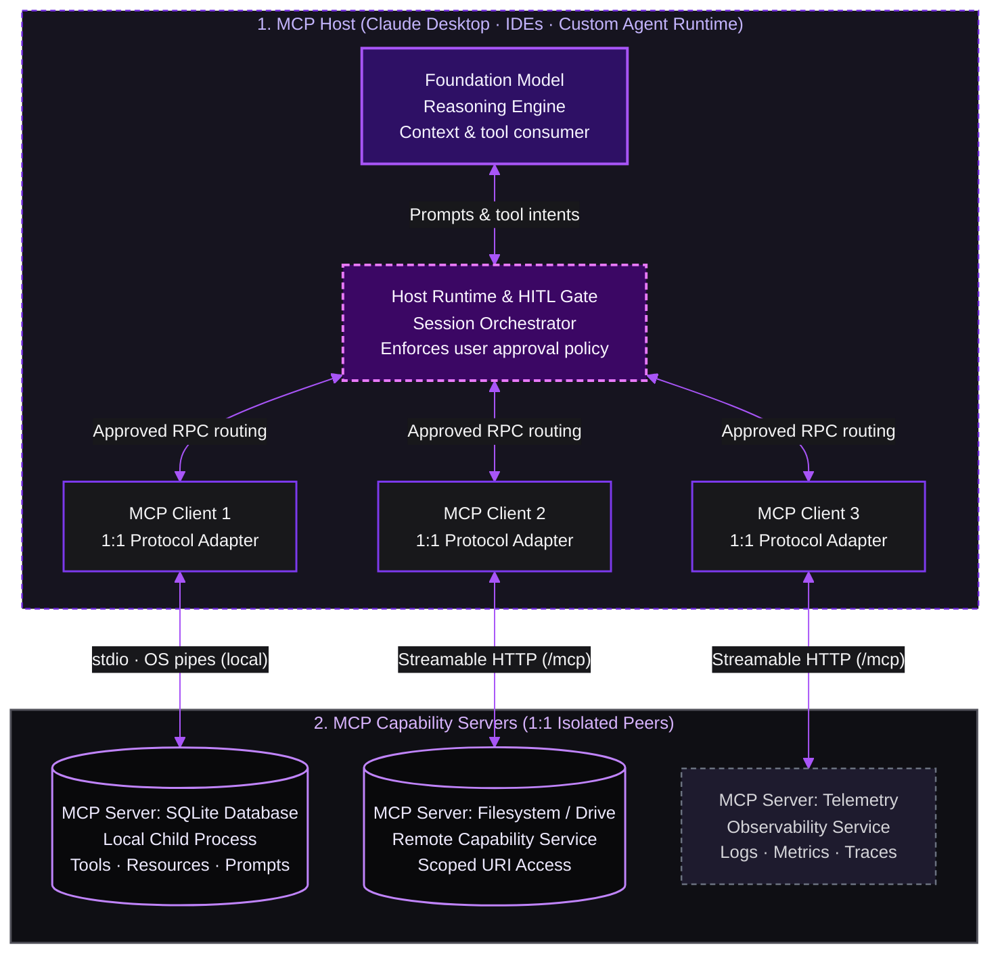
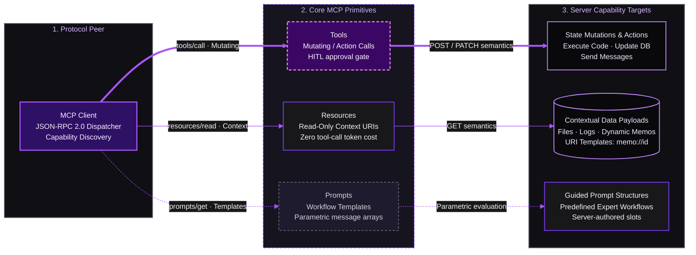

---
tags:
  - ai-engineering/agents/mcp
aliases:
  - MCP
  - Model Context Protocol Architecture
  - MCP Architecture
source: "MCP: Architecture and Transports"
source-type: documentation
author: "DeepLearning.AI & Anthropic"
url: "https://learn.deeplearning.ai/courses/mcp-build-rich-context-ai-apps-with-anthropic/lesson/xtt6w/mcp-architecture"
created: 2026-11-24
---
The **Model Context Protocol (MCP)** is an open standard client-server communication specification developed by Anthropic that standardizes how [[AI Agents|LLM applications]] discover, access, and execute external tools, resources, and prompt templates. MCP decouples reasoning models from proprietary data connectors, establishing a point-to-point [[Interface|protocol layer]] between a host environment and modular capability servers.

---

## Architectural Topology: Hosts, Clients, and Servers

MCP implements a hierarchical client-server architecture where **Hosts** manage one or more isolated **MCP Clients**, each holding an exclusive 1-to-1 connection to an **MCP Server**.



### Architectural Roles
- **Host (Agent Application):** The orchestrating software containing the LLM, system prompt, context manager, and user interface. The host manages lifecycle sessions, coordinates multiple clients, and enforces **Human-in-the-Loop (HITL)** approval policies before allowing tool execution.
- **Client (Protocol Peer):** A lightweight protocol adapter maintained inside the host. Each client establishes a 1-to-1 session with a single server, issuing capability queries, routing tool calls, and receiving asynchronous server notifications.
- **Server (Capability Provider):** A focused, lightweight service exposing domain capabilities. Servers do not contain LLMs; they expose structured schemas for functions, data URIs, and predefined prompts.

---

## The Three Core MCP Primitives

MCP standardizes tool and data access into three distinct primitives with clear operational semantics:



| Primitive | REST Analog | Semantic Intent | Ingestion Mechanics | Human-in-the-Loop (HITL) | Senior Note |
| :--- | :--- | :--- | :--- | :--- | :--- |
| **Tools** | `POST` / `PATCH` | State mutations, calculations, data searches, and external writes. | Model emits tool arguments; host intercepts and requests server execution. | Recommended: Host interface can prompt user for approval before mutation. | Scope tools narrowly to prevent unintended destructive actions. |
| **Resources** | `GET` | Read-only contextual data (files, database records, dynamic memos). | Server exposes URIs (`memo://{id}`); client retrieves payload without model invocation. | Low: Read-only data payloads do not mutate external state. | Resources provide zero-shot grounding context without consuming tool-call tokens. |
| **Prompts** | Dynamic Template | Predefined, evaluated prompt sequences with parametric slots. | Server returns structured user/assistant message arrays; client passes to LLM. | Low: Guided templates authored by server engineers. | Eliminates prompt-engineering friction for end users by exposing standardized workflows. |

---

## Communication Protocol Lifecycle

MCP exchanges JSON-RPC formatted messages across three distinct communication phases:

```mermaid
%%{init: {"theme": "base", "themeCSS": "svg { background-color: #09090B !important; border-radius: 8px; }", "themeVariables": {"darkMode": true, "background": "#09090B", "mainBkg": "#18181B", "textColor": "#F4F4F5", "primaryColor": "#18181B", "primaryTextColor": "#F4F4F5", "primaryBorderColor": "#7C3AED", "lineColor": "#A855F7", "actorBkg": "#18181B", "actorBorder": "#7C3AED", "actorTextColor": "#F4F4F5", "actorLineColor": "#52525B", "signalColor": "#A855F7", "signalTextColor": "#E4E4E7", "labelBoxBkgColor": "#2E1065", "labelBoxBorderColor": "#A855F7", "labelTextColor": "#F5F3FF", "loopTextColor": "#D8B4FE", "noteBkgColor": "#1E1B2E", "noteBorderColor": "#6D28D9", "noteTextColor": "#EDE9FE", "activationBkgColor": "#4C1D95", "activationBorderColor": "#C084FC", "sequenceNumberColor": "#FAF5FF", "fontFamily": "Inter, ui-sans-serif, system-ui, -apple-system, sans-serif", "fontSize": "13px"}}}%%
sequenceDiagram
    autonumber
    participant Host as MCP Host (Client)
    participant Server as MCP Server

    rect rgb(22, 20, 31)
        Note over Host,Server: Phase 1: Handshake & Capability Negotiation
        Host->>+Server: initialize (capabilities, protocolVersion, clientInfo)
        Server-->>Host: InitializeResult (capabilities, protocolVersion, serverInfo)
        Host->>Server: notifications/initialized
    end

    rect rgb(30, 27, 46)
        Note over Host,Server: Phase 2: Active JSON-RPC 2.0 Message Exchange
        Host->>Server: tools/list
        Server-->>Host: Tool definitions & JSON Schemas
        Host->>Server: tools/call (name="execute_sql_query", arguments={...})
        Server-->>Host: Tool result or structured JSON-RPC error
        Server--xHost: notifications/message (Resource updated)
    end

    rect rgb(15, 15, 20)
        Note over Host,Server: Phase 3: Orderly Session Termination
        Host->>Server: Close connection / Subprocess SIGTERM
        deactivate Server
    end
```



1. **Initialization Handshake:** The client sends an `initialize` request specifying client metadata and supported capabilities. The server responds with its own capability manifest (tools, resources, prompts, logging). The client confirms with a `notifications/initialized` notification.
2. **Bidirectional Message Exchange:** 
   - **Requests & Responses:** Request-response pairs with matched `id` integers.
   - **Notifications:** One-way messages (e.g., resource update alerts) sent without expecting an acknowledgement.
   - **Sampling:** Advanced capability allowing servers to request LLM completions back from the host runtime.
3. **Session Termination:** Orderly disconnection via stream closure, HTTP session release, or process termination.

---

## Transport Layer Overview

MCP decouples framing from the physical communication medium. Detailed architectures, connection lifecycles, and code implementations are maintained in their respective reference notes:

- **[[Standard IO Transport]] (`stdio`):** Local inter-process communication where the host launches the server as a child process and communicates over OS pipes (`stdin`/`stdout`). Default for local desktop applications (e.g., Claude Desktop).
- **[[HTTP with SSE Transport]] (`HTTP + SSE`):** Legacy remote transport splitting bidirectional RPC traffic across an open Server-Sent Events stream (`GET /sse`) and discrete HTTP `POST` message endpoints.
- **[[Streamable HTTP Transport]] (`Streamable HTTP`):** Modern unified production transport consolidating operations onto a single endpoint (`/mcp`), supporting both stateless HTTP `POST` requests and optional stateful streaming upgrades.

### Transport Selection Matrix

| Dimension | `[[Standard IO Transport]]` | `[[HTTP with SSE Transport]]` | `[[Streamable HTTP Transport]]` |
| :--- | :--- | :--- | :--- |
| **Topology** | Local child process (OS pipes) | Dual network endpoints (`/sse` + `/messages`) | Consolidated network endpoint (`/mcp`) |
| **State Model** | Stateful (child process lifetime) | Strictly stateful (persistent socket) | Hybrid (Stateless default + optional stream) |
| **Horizontal Autoscaling** | Unsupported (single machine) | Complex (requires sticky sessions / Redis bus) | Native (stateless L7 round-robin routing) |
| **Infrastructure Fit** | Local CLI / Desktop IDEs | Legacy remote servers | Cloud-native, Docker, Kubernetes, Serverless |
| **Senior Note** | Simplest for local development. | Avoid for new cloud architectures. | Recommended default for all networked systems. |

---

## Production Primitives Reference (Python MCP SDK)

The following reference implementation demonstrates declaring all three MCP primitives on a unified server:

```python
# server.py
import sqlite3
from mcp.server.fastmcp import FastMCP

mcp = FastMCP(name="SQLite Analytics Service")
DB_PATH = "analytics.db"


# 1. TOOL: Mutating / Data Operation
@mcp.tool()
def execute_sql_query(query: str) -> list[dict]:
    """Executes a validated read-only SQL SELECT query against analytics.db."""
    cleaned = query.strip().upper()
    if not cleaned.startswith("SELECT"):
        raise ValueError("Only read-only SELECT queries are permitted.")

    with sqlite3.connect(DB_PATH) as conn:
        conn.row_factory = sqlite3.Row
        cursor = conn.cursor()
        cursor.execute(query)
        return [dict(row) for row in cursor.fetchall()]


# 2. RESOURCE: Static & Dynamic Context URIs
@mcp.resource("memo://business-insights")
def get_static_business_memo() -> str:
    """Read-only static context resource exposed via URI."""
    return "Q4 Objective: Prioritize inventory reduction in high-cost warehouse zones."


@mcp.resource("memo://products/{product_id}")
def get_product_resource(product_id: str) -> str:
    """Dynamic templated resource returning real-time product context."""
    with sqlite3.connect(DB_PATH) as conn:
        cursor = conn.cursor()
        cursor.execute("SELECT name, stock, price FROM products WHERE id = ?", (product_id,))
        row = cursor.fetchone()
        if not row:
            return f"Product {product_id} not found."
        return f"Product: {row[0]}, Stock: {row[1]}, Price: ${row[2]:.2f}"


# 3. PROMPT: Standardized Workflow Template
@mcp.prompt()
def seed_database_prompt(topic: str) -> str:
    """Returns an evaluated prompt instructing the LLM to seed sample records."""
    return (
        f"You are a database test engineer. Generate 10 realistic SQLite INSERT statements "
        f"for the products table centered on the theme: '{topic}'. Include name, price, and stock."
    )
```

---

## Architectural Pitfalls & Security Considerations

- **Tool Execution Blast Radius:** Exposing mutating tools without host-level Human-in-the-Loop gates allows autonomous agent loops to execute destructive updates without confirmation.
- **Context Dilution via Excessive Resources:** Automatically fetching and injecting every resource URI into the LLM prompt causes context degradation; hosts must selectively fetch resources on demand.
- **Framing Corruption on Stdio:** Unbuffered `print()` statements from third-party libraries write to `stdout` and break JSON-RPC parsing. Diagnostic logs must always be routed to `stderr` (see `[[Standard IO Transport]]`).

> [!TIP]
> **Senior Lens:** Keep the MCP Server focused strictly on exposing capability schemas and domain validation. Treat transport selection as an infrastructure deployment concern: use `[[Standard IO Transport]]` for single-developer local CLI tools, and `[[Streamable HTTP Transport]]` for all containerized, multi-tenant, or production service deployments.
