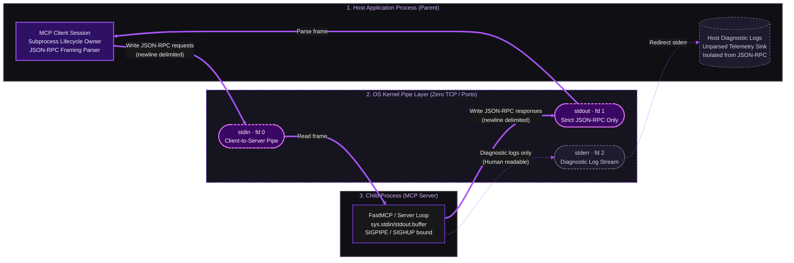

---
tags:
  - ai-engineering/agents/mcp
aliases:
  - stdio
  - Stdio Transport
  - Standard Input Output Transport
source: "MCP: Architecture and Transports"
source-type: documentation
author: "DeepLearning.AI & Anthropic"
url: "https://learn.deeplearning.ai/courses/mcp-build-rich-context-ai-apps-with-anthropic/lesson/xtt6w/mcp-architecture"
created: 2026-11-24
---
The **Standard I/O (`stdio`) Transport** is an inter-process communication (IPC) mechanism within the [[Model Context Protocol]] (MCP) where an [[AI Agents|agent host]] spawns an MCP server as a local child process and exchanges newline-delimited JSON-RPC messages over standard operating system stream pipes (`stdin` and `stdout`). It is the default transport pattern for local desktop AI applications (such as Claude Desktop and local IDE extensions).

---

## Process Topology & Stream Separation

Under `stdio`, the host application manages the entire lifecycle of the server process. Communication relies entirely on OS-level file descriptors without binding network interfaces or opening TCP sockets.



### Critical Stream Isolation Rules
1. **`stdin` (Standard Input):** Ingests incoming JSON-RPC requests, notifications, and initialization payloads sent by the host client.
2. **`stdout` (Standard Output):** Strictly reserved for protocol-compliant JSON-RPC response payloads. **No debug logging or arbitrary print statements may be emitted to `stdout`**, as non-JSON characters corrupt the host parser.
3. **`stderr` (Standard Error):** Dedicated transport for application logging, telemetry, and debugging. The host intercepts `stderr` and redirects it to local diagnostic logs without parsing it as protocol frames.

---

## Production Reference Implementation

### 1. Server-Side Execution Loop

In Python, the `stdio` transport reads from `sys.stdin.buffer` and writes responses to `sys.stdout.buffer`, ensuring clean UTF-8 byte handling.

```python
# stdio_server.py
import sys
from mcp.server.fastmcp import FastMCP

# Initialize FastMCP Server configured for stdio
mcp = FastMCP(name="Local System Inspector")


@mcp.tool()
def get_system_load() -> str:
    """Returns local host metrics."""
    # Never use print() here; print writes to stdout and breaks JSON-RPC framing!
    sys.stderr.write("DEBUG: Executing get_system_load tool call\n")
    return "Load average: 1.42, Memory available: 8.4 GB"


if __name__ == "__main__":
    # Runs the blocking stdio event loop over stdin/stdout
    mcp.run(transport="stdio")
```

### 2. Host-Side Process Management & Client Session

The host process uses asynchronous subprocess management to spawn the server and bind streaming readers and writers:

```python
# stdio_host_client.py
import asyncio
from mcp import ClientSession, StdioServerParameters
from mcp.client.stdio import stdio_client


async def run_stdio_client():
    """Launches server as a child process and communicates over stdio."""
    server_params = StdioServerParameters(
        command="python",
        args=["stdio_server.py"],
        env=None,
    )

    async with stdio_client(server_params) as (read_stream, write_stream):
        async with ClientSession(read_stream, write_stream) as session:
            # 1. Initialize session handshake
            await session.initialize()

            # 2. Invoke tool
            result = await session.call_tool(
                name="get_system_load",
                arguments={},
            )
            print(f"Server Response: {result.content}")


if __name__ == "__main__":
    asyncio.run(run_stdio_client())
```

---

## Architectural Comparison: Stdio vs. Networked Transports

| Dimension | `stdio` Transport | `[[HTTP with SSE Transport]]` | `[[Streamable HTTP Transport]]` |
| :--- | :--- | :--- | :--- |
| **Boundary** | Same machine / OS process tree | Networked (Remote host or container) | Networked (Remote host or container) |
| **Transport Medium** | OS anonymous pipes (`stdin`/`stdout`) | Long-lived SSE stream + HTTP `POST` | Single endpoint HTTP `POST` + optional SSE |
| **Port Requirements** | None (zero attack surface) | Requires open TCP port | Requires open TCP port |
| **Process Binding** | Child process lifecycle tied to host | Independent server daemon | Independent server daemon |
| **Multi-Tenancy** | Single client only (1:1 process affinity) | Multi-client capable | Highly scalable / Multi-client |
| **Senior Note** | Simplest to configure locally, but impossible to scale horizontally or run in Kubernetes sidecars without IPC sharing. | Legacy remote standard; requires sticky sessions. | Modern production standard for both remote services and localhost microservices. |

---

## Operational Trade-offs & Failure Modes

### Advantages
- **Zero Network Overhead:** Negligible transport latency since messages traverse kernel pipe buffers rather than network loopbacks.
- **Inherent Security:** Eliminates network exposure; no open TCP ports, TLS certificates, or network authentication required.
- **Automatic Lifecycle Cleanup:** When the host crashes or terminates, the operating system sends `SIGPIPE` / `SIGHUP` to the server process, minimizing orphaned zombie processes.

### Failure Modes & Pitfalls
- **Stdout Pollution (Framing Corruption):** Any third-party library that outputs unbuffered logging (e.g., `print("loaded module")`) corrupts the JSON-RPC stream, causing the host parser to crash.
- **Zombie Process Leaks:** If a host forcibly crashes (`SIGKILL`) or encounters an unhandled exception without running async context managers, orphaned child processes can linger in the background.
- **Zero Horizontal Scalability:** Cannot be shared across multiple agent hosts or dispatched across remote worker nodes.

> [!TIP]
> **Senior Lens:** Use `stdio` exclusively for local desktop development or single-tenant developer CLI tools. For cloud-native deployments, Kubernetes clusters, or multi-tenant agents, transition directly to `[[Streamable HTTP Transport]]`.
