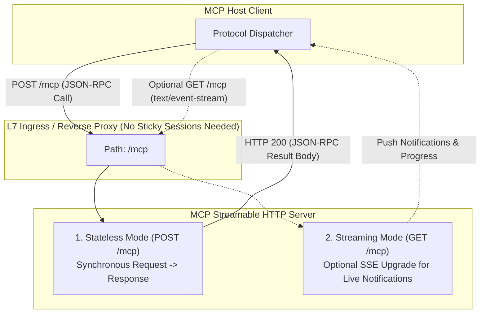

---
tags:
  - ai-engineering/agents/mcp
aliases:
  - Streamable HTTP
  - MCP Streamable HTTP
source: "MCP: Architecture and Transports"
source-type: documentation
author: "DeepLearning.AI & Anthropic"
url: "https://learn.deeplearning.ai/courses/mcp-build-rich-context-ai-apps-with-anthropic/lesson/xtt6w/mcp-architecture"
created: 2026-11-24
---
The **Streamable HTTP Transport** is the modern, unified networking specification for the [[Model Context Protocol]] (MCP). It supersedes legacy `[[HTTP with SSE Transport]]` by collapsing transport operations into a single endpoint (typically `/mcp`), supporting both stateless single-turn request-response exchanges (standard HTTP `POST`) and optional stateful streaming (HTTP `GET` with Server-Sent Events) within a single architecture.

---

## Architectural Mechanics: The Unified Endpoint

Earlier remote transports separated connection initiation (`GET /sse`) from message dispatch (`POST /messages?sessionId=...`), introducing stateful sticky-session requirements. Streamable HTTP consolidates all protocol interactions onto a single URL, permitting clients and servers to negotiate execution mode based on HTTP semantics.



### Dual Execution Modes

1. **Stateless Request-Response Mode (`POST /mcp`):**
   - The client sends an HTTP `POST` containing a standard JSON-RPC envelope (such as `tools/call`).
   - The server processes the capability invocation and returns the JSON-RPC result directly within the HTTP 200 response body.
   - **Infrastructure Impact:** Requires no long-lived open sockets, no persistent memory sessions, and zero load-balancer stickiness. Requests can be distributed across any stateless worker pool or serverless function.

2. **Stateful Streaming Mode (`GET /mcp` / SSE Upgrade):**
   - When an application requires live telemetry, progress updates during multi-step reasoning, or server-initiated notifications, the client initiates an HTTP `GET` with `Accept: text/event-stream`.
   - The server upgrades the channel to a stream, pushing events down to the client while standard requests continue over `POST`.

3. **Localhost Streamable HTTP:**
   - Instead of reading local configuration files, managing pipe descriptors, or spawning child subprocesses as in `[[Standard IO Transport]]`, local hosts connect directly to `http://localhost:8000/mcp`.
   - Decouples host applications from local execution environments, allowing servers to run inside Docker containers, virtual machines, or separate runtime virtualenvs.

---

## Production Reference Implementation

### 1. Server Implementation (FastAPI / Streamable Pattern)

The following implementation exposes a unified `/mcp` endpoint handling both synchronous tool dispatch and streaming subscription:

```python
# streamable_server.py
import json
from typing import Any
from fastapi import FastAPI, Request, Response
from fastapi.responses import StreamingResponse

app = FastAPI(title="Streamable MCP Server")


def dispatch_rpc(payload: dict[str, Any]) -> dict[str, Any]:
    """Internal RPC dispatcher handling core MCP methods."""
    method = payload.get("method")
    rpc_id = payload.get("id", 1)

    if method == "initialize":
        return {
            "jsonrpc": "2.0",
            "id": rpc_id,
            "result": {
                "protocolVersion": "2024-11-05",
                "capabilities": {"tools": {}},
                "serverInfo": {"name": "Streamable SQLite", "version": "1.0"},
            },
        }
    elif method == "tools/list":
        return {
            "jsonrpc": "2.0",
            "id": rpc_id,
            "result": {
                "tools": [
                    {
                        "name": "query_inventory",
                        "description": "Returns stock levels for a SKU",
                        "inputSchema": {
                            "type": "object",
                            "properties": {"sku": {"type": "string"}},
                            "required": ["sku"],
                        },
                    }
                ]
            },
        }
    elif method == "tools/call":
        sku = payload.get("params", {}).get("arguments", {}).get("sku", "UNKNOWN")
        return {
            "jsonrpc": "2.0",
            "id": rpc_id,
            "result": {"content": [{"type": "text", "text": f"SKU {sku}: 450 units available"}]},
        }

    return {"jsonrpc": "2.0", "id": rpc_id, "error": {"code": -32601, "message": "Method not found"}}


@app.post("/mcp")
async def handle_stateless_post(request: Request) -> Response:
    """Stateless RPC execution path: Single-turn POST -> immediate response body."""
    payload = await request.json()
    response_data = dispatch_rpc(payload)
    return Response(
        content=json.dumps(response_data),
        media_type="application/json",
        status_code=200,
    )


@app.get("/mcp")
async def handle_streaming_get(request: Request) -> StreamingResponse:
    """Stateful streaming path: SSE upgrade for real-time notifications."""
    async def event_generator():
        yield "event: ready\ndata: {\"status\": \"connected\"}\n\n"

    return StreamingResponse(event_generator(), media_type="text/event-stream")


if __name__ == "__main__":
    import uvicorn
    uvicorn.run(app, host="127.0.0.1", port=8000)
```

### 2. Host Client: Invoking MCP over Localhost Streamable HTTP

Clients call the endpoint via standard HTTP client libraries without maintaining open file descriptors or relying on local process trees:

```python
# streamable_client.py
import asyncio
import httpx


async def call_localhost_mcp_server():
    """Calls MCP over localhost Streamable HTTP without spawning child subprocesses."""
    endpoint = "http://localhost:8000/mcp"

    async with httpx.AsyncClient(base_url="http://localhost:8000") as client:
        # 1. Initialize Handshake via standard HTTP POST
        init_response = await client.post(
            "/mcp",
            json={
                "jsonrpc": "2.0",
                "id": 1,
                "method": "initialize",
                "params": {"protocolVersion": "2024-11-05", "capabilities": {}},
            },
        )
        print("Initialized:", init_response.json()["result"]["serverInfo"])

        # 2. Invoke Tool via standard HTTP POST
        call_response = await client.post(
            "/mcp",
            json={
                "jsonrpc": "2.0",
                "id": 2,
                "method": "tools/call",
                "params": {
                    "name": "query_inventory",
                    "arguments": {"sku": "WIDGET-01"},
                },
            },
        )
        print("Tool Output:", call_response.json()["result"]["content"][0]["text"])


if __name__ == "__main__":
    asyncio.run(call_localhost_mcp_server())
```

---

## Architectural Comparison Across All Transports

| Dimension | `[[Standard IO Transport]]` | `[[HTTP with SSE Transport]]` | `Streamable HTTP Transport` |
| :--- | :--- | :--- | :--- |
| **Endpoint Topology** | None (OS pipes) | Dual endpoints (`/sse` + `/messages`) | Consolidated (`/mcp`) |
| **State Requirements** | Strictly stateful (child process) | Strictly stateful (open connection) | **Hybrid:** Stateless default + optional stream |
| **Horizontal Autoscaling** | Impossible | Difficult (requires sticky sessions) | **Native:** Stateless L7 round-robin |
| **Localhost Execution** | Spawns child process; captures pipes | Binds network port with dual routes | Binds network port via clean HTTP |
| **Cloud / Serverless Fit** | Zero (local only) | Poor (idle stream timeouts) | **High:** Compatible with AWS Lambda, Cloud Run, Kube |
| **Senior Note** | Best for local desktop CLIs. | Legacy; phased out in favor of Streamable HTTP. | Recommended default for all networked and microservice MCP servers. |

---

## Operational Advantages & Governance

1. **Elimination of Sticky Sessions:** Because tool execution calls are self-contained HTTP POST operations, traffic can be freely balanced across Kubernetes pods without maintaining session affinity.
2. **Resilience to Middlebox Timeouts:** Stateless HTTP POST requests complete within hundreds of milliseconds, bypassing the 60-second idle disconnects enforced by cloud load balancers on persistent streams.
3. **Decoupled Localhost Architecture:** By invoking MCP over `http://localhost:8000/mcp`, local host applications (e.g., Cursor, Claude Desktop) can communicate with tools running inside Docker containers or remote development environments without needing direct access to host filesystem configurations.

> [!TIP]
> **Senior Lens:** Design all new production MCP servers around Streamable HTTP. Expose a single `/mcp` route that handles POST by default, reserving SSE GET streams strictly for scenarios where long-running async progress feedback is mandatory.
