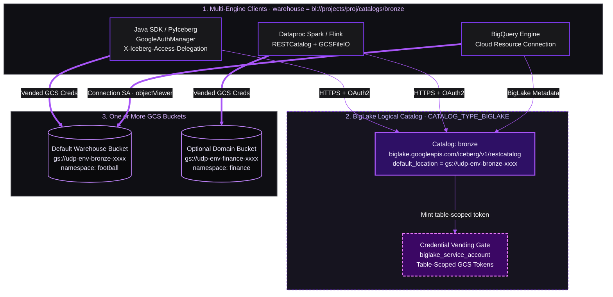
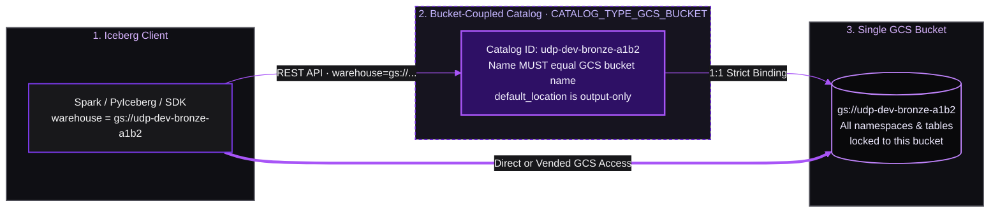
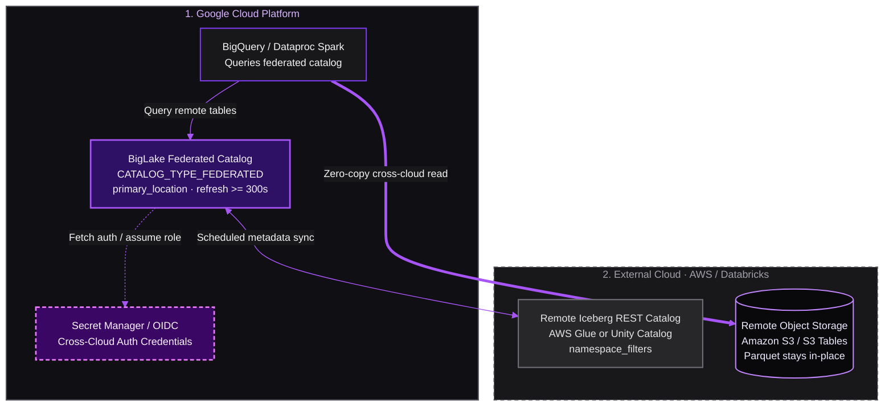

---
tags:
  - cloud-infrastructure/services/gcp
  - data-processing/storage/iceberg
aliases:
  - BigLake Iceberg REST Catalog
  - BigLake Metastore REST Catalog
source: "Google Cloud BigLake Iceberg REST Catalog Documentation"
source-type: documentation
vendor: "Google Cloud"
url: "https://cloud.google.com/biglake/docs/blms-rest-catalog"
created: 2026-11-25
---
**GCP BigLake Iceberg REST Catalog** (part of BigLake Metastore / Lakehouse runtime catalog) is Google Cloud's serverless, Spanner-backed implementation of the open [[Apache Iceberg REST Catalog]] protocol (`https://biglake.googleapis.com/iceberg/v1/restcatalog`). It lets **BigQuery, Apache Spark, Flink, Trino, PyIceberg, and custom Java Iceberg SDKs** share open [[Apache Iceberg]] tables on GCS with native **credential vending**—while preserving cloud-agnostic portability across GCP and AWS.

> [!IMPORTANT]
> In a clean platform architecture, **OpenTofu provisions the catalog resource (`google_biglake_iceberg_catalog`)**, while Iceberg clients (such as a Java `sdk-lakehouse` CLI or Spark) manage **namespaces and tables** through the BigLake REST endpoint. Choosing BigLake Iceberg REST Catalog over [[GCP BigLake Tables for Apache Iceberg]] keeps your Bronze layer decoupled from BigQuery-only DDL so porting to AWS (Glue Iceberg REST / S3 Tables) requires only swapping IaC and catalog config.

## Quick Comparison: The Three `catalog_type` Options

| `catalog_type` | Mental Model | Catalog `name` Constraint | Storage & `default_location` | Client `warehouse` URI | Best Fit |
| :--- | :--- | :--- | :--- | :--- | :--- |
| **`CATALOG_TYPE_BIGLAKE`** | **Logical multi-bucket catalog** (modern default) | Any logical ID (e.g., `bronze` across `dev`/`uat`/`prod`) | Multi-bucket capable; `default_location = "gs://<bucket>"` is **required** | `bl://projects/<project>/catalogs/<catalog>` | Greenfield GCP lakehouses, Data Mesh domains, multi-cloud parity with AWS Glue / Polaris. |
| **`CATALOG_TYPE_GCS_BUCKET`** | **1:1 bucket-locked catalog** (legacy / simple) | **Must equal the exact GCS bucket name** (`udp-dev-bronze-a1b2`) | Strictly one GCS bucket; `default_location` is output-only | `gs://<exact-bucket-name>` | Simple single-bucket setups or older BigLake integrations where bucket name = catalog name. |
| **`CATALOG_TYPE_FEDERATED`** | **Cross-cloud metadata mirror / proxy** | Logical federated catalog ID (e.g., `aws_glue_prod`) | Mirrors remote metadata in `primary_location`; data stays in AWS S3 / Databricks | Federated catalog URI (read via BigLake / BigQuery) | Querying external AWS Glue or Databricks Unity Catalog Iceberg tables from GCP without copying Parquet files. |

---

## 1. `CATALOG_TYPE_BIGLAKE` (Logical Multi-Bucket Catalog — Recommended)

`CATALOG_TYPE_BIGLAKE` decouples the **logical catalog name** from physical GCS bucket names. You name the catalog `bronze` in every environment (`dev`, `uat`, `prod`) while `default_location` points to that environment's randomized GCS bucket—and individual namespaces or domains can optionally override storage onto dedicated buckets.



- **Environment Parity:** Because the logical name `bronze` stays constant across `dev`, `uat`, and `prod`, domain table YAML/SQL never hardcodes randomized GCS bucket names.
- **Credential Vending (`CREDENTIAL_MODE_VENDED_CREDENTIALS`):** Grant `biglake_service_account` `roles/storage.objectUser` on the bucket(s); clients sending `X-Iceberg-Access-Delegation: vended-credentials` receive ephemeral, table-scoped GCS tokens without holding direct bucket IAM.
- **Fine-Grained IAM:** Supports `google_biglake_iceberg_catalog_iam_member`, `google_biglake_iceberg_namespace_iam_member`, and `google_biglake_iceberg_table_iam_member` for Data Mesh isolation.

```hcl
resource "google_biglake_iceberg_catalog" "bronze" {
  project          = var.project_id
  name             = "bronze"
  catalog_type     = "CATALOG_TYPE_BIGLAKE"
  default_location = "gs://${module.bronze_bucket.name}"
  credential_mode  = "CREDENTIAL_MODE_VENDED_CREDENTIALS"
  deletion_policy  = "PREVENT"

  depends_on = [google_project_service.lakehouse_apis, module.bronze_bucket]
}

resource "google_storage_bucket_iam_member" "biglake_vended_creds" {
  bucket = module.bronze_bucket.name
  role   = "roles/storage.objectUser"
  member = "serviceAccount:${google_biglake_iceberg_catalog.bronze.biglake_service_account}"
}
```

```properties
# Java Iceberg 1.10+ / sdk-lakehouse (CATALOG_BACKEND=gcp_biglake)
type=rest
uri=https://biglake.googleapis.com/iceberg/v1/restcatalog
warehouse=bl://projects/udp-dev-xxxx/catalogs/bronze
io-impl=org.apache.iceberg.gcp.gcs.GCSFileIO
rest.auth.type=org.apache.iceberg.gcp.auth.GoogleAuthManager
header.x-goog-user-project=udp-dev-xxxx
header.X-Iceberg-Access-Delegation=vended-credentials
```

---

## 2. `CATALOG_TYPE_GCS_BUCKET` (Single-Bucket 1:1 Catalog)

`CATALOG_TYPE_GCS_BUCKET` binds a BigLake catalog **1:1 to a single pre-existing GCS bucket**. The catalog `name` is forced to match the exact GCS bucket name, `default_location` is read-only, and every namespace and table lives strictly inside that one bucket.



- **Why `CATALOG_TYPE_BIGLAKE` usually wins:** GCS bucket names are globally unique across all of Google Cloud and typically include random suffixes (`-a1b2`). Coupling catalog identity to bucket name leaks environment-specific names into catalog identifiers and prevents placing separate domain buckets under one catalog.

```hcl
resource "google_biglake_iceberg_catalog" "single_bucket" {
  project         = var.project_id
  name            = module.bronze_bucket.name # MUST match GCS bucket name verbatim
  catalog_type    = "CATALOG_TYPE_GCS_BUCKET"
  credential_mode = "CREDENTIAL_MODE_VENDED_CREDENTIALS"
  deletion_policy = "PREVENT"

  depends_on = [google_project_service.lakehouse_apis, module.bronze_bucket]
}
```

---

## 3. `CATALOG_TYPE_FEDERATED` (Cross-Cloud External Catalog Proxy)

`CATALOG_TYPE_FEDERATED` turns BigLake into a **read/discovery mirror** over an external Iceberg REST catalog—specifically **AWS Glue / S3 Table Buckets** (`glue_catalog_info`) or **Databricks Unity Catalog** (`unity_catalog_info`). BigLake periodically refreshes remote catalog metadata into `primary_location` on a schedule (`refresh_interval >= 300s`) so BigQuery and GCP engines query remote tables without duplicating data into GCS.



```hcl
resource "google_biglake_iceberg_catalog" "aws_glue_federated" {
  project          = var.project_id
  name             = "aws_glue_prod"
  catalog_type     = "CATALOG_TYPE_FEDERATED"
  primary_location = "us-central1"

  federated_catalog_options {
    glue_catalog_info {
      aws_region   = "us-east-1"
      aws_role_arn = "arn:aws:iam::123456789012:role/BigLakeGlueReadRole"
      warehouse    = "123456789012"
    }

    refresh_options {
      refresh_schedule {
        refresh_interval = "300s"
      }
      refresh_scope {
        namespace_filters = ["football", "finance"]
      }
    }
  }
}
```

---

## Multi-Cloud Platform Parity (GCP vs. AWS)

Using `CATALOG_TYPE_BIGLAKE` over the open [[Apache Iceberg REST Catalog]] protocol keeps your application and schema code identical across clouds—only the OpenTofu module and SPI plugin properties change:

| Layer | GCP (`platform_unified_data_gcp`) | AWS (`platform_unified_data_aws`) | Shared Unchanged |
| :--- | :--- | :--- | :--- |
| **Object Storage** | GCS Bucket (`cloud-foundation-fabric//modules/gcs`) | Amazon S3 Bucket / S3 Table Bucket | Iceberg v2 Parquet layout |
| **REST Catalog** | `google_biglake_iceberg_catalog` (`CATALOG_TYPE_BIGLAKE`) | AWS Glue Iceberg REST / S3 Tables / Apache Polaris | Standard Iceberg REST API |
| **DDL / Schema Runner** | `sdk-lakehouse` (`CATALOG_BACKEND=gcp_biglake`) | `sdk-lakehouse` (`CATALOG_BACKEND=aws_glue` / `rest`) | Same domain `table.yaml` / `table.proto` |
| **Auth / Storage IO** | `GoogleAuthManager` + `GCSFileIO` + vended creds | SigV4 / STS + `S3FileIO` + vended creds | Zero business-logic changes |

## Related Notes
- **OSS Counterpart & Concepts:** [[Apache Iceberg REST Catalog]] · [[Apache Iceberg Catalogs]] · [[Apache Iceberg]]
- **Sibling GCP Iceberg Options:** [[GCP BigLake Tables for Apache Iceberg]] (BigQuery-managed DDL/DML + auto-compaction) · [[GCP Dataproc Metastore and BigLake Hive Catalog]] (managed Thrift HMS)

## When Not to Use
- When **BigQuery is the sole transactional writer** and you want zero manual Iceberg maintenance/compaction jobs (evaluate [[GCP BigLake Tables for Apache Iceberg]]).
- When you require **multi-table Git-like catalog branching** across commits (evaluate self-hosted [[Apache Iceberg Nessie Catalog]]).

## Documentation & References
- [Google Cloud BigLake Iceberg REST Catalog Docs](https://cloud.google.com/biglake/docs/blms-rest-catalog)
- [Terraform/OpenTofu `google_biglake_iceberg_catalog` Resource](https://registry.terraform.io/providers/hashicorp/google/latest/docs/resources/biglake_iceberg_catalog)
- [Apache Iceberg `GoogleAuthManager` (Iceberg 1.10+)](https://iceberg.apache.org/docs/latest/gcp/)
