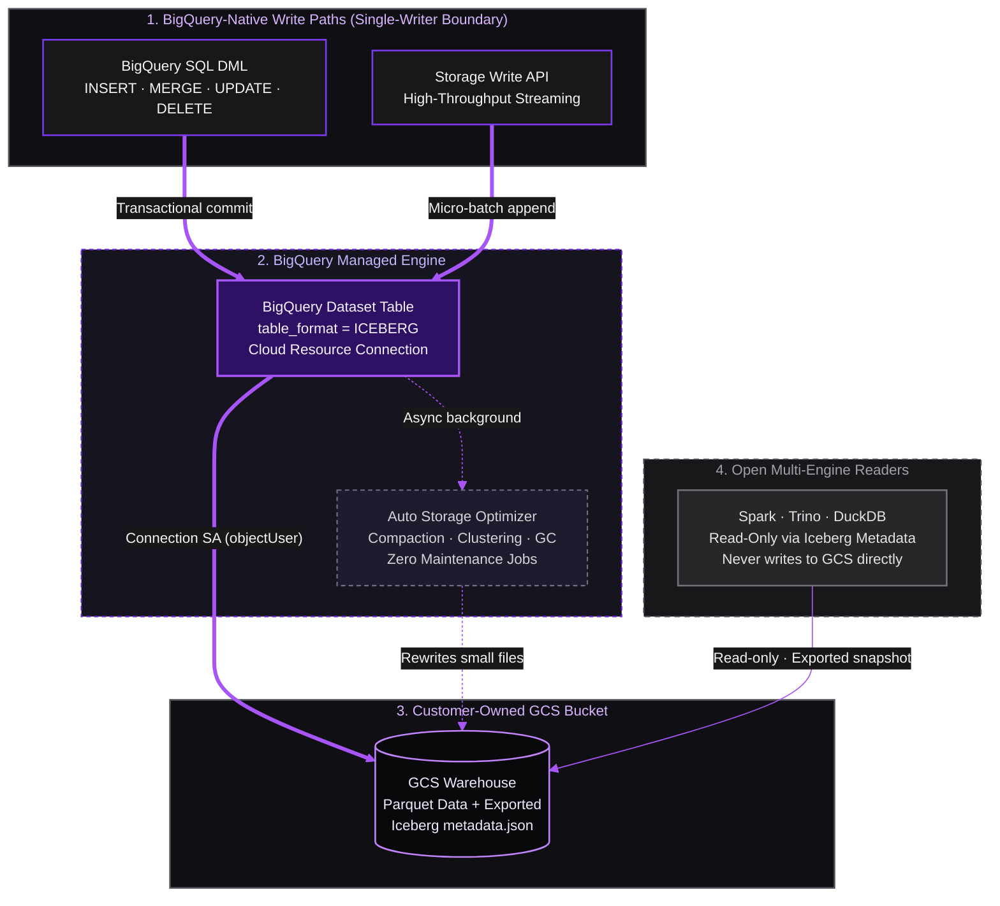

---
tags:
  - cloud-infrastructure/services/gcp
  - data-processing/storage/iceberg
aliases:
  - BigQuery Managed Iceberg
  - BigLake Tables for Apache Iceberg in BigQuery
source: "Google Cloud BigLake Tables for Apache Iceberg in BigQuery Documentation"
source-type: documentation
vendor: "Google Cloud"
url: "https://cloud.google.com/bigquery/docs/iceberg-tables"
created: 2026-11-25
---
**GCP BigLake Tables for Apache Iceberg** (often called **BigQuery-managed Iceberg**) are open-format [[Apache Iceberg]] tables stored as Parquet files in your own Google Cloud Storage bucket where **BigQuery acts as the primary transactional writer and storage optimizer**—providing BigQuery [[SQL]] DML, Storage Write API streaming, and **fully automatic background compaction and garbage collection**.

> [!IMPORTANT]
> Do not confuse this with [[GCP BigLake Iceberg REST Catalog]]. Here, tables are created via **BigQuery DDL inside a BigQuery dataset** (not via the open Iceberg REST API by external SDKs), BigQuery owns all writes and compaction, and external OSS engines (Spark, Trino, DuckDB) read exported Iceberg metadata snapshots from GCS.

## Architecture: BigQuery Writer + Open Iceberg Readers



- **Zero Small-File Operational Overhead:** BigQuery continuously merges tiny streaming Parquet fragments, applies declared clustering columns, and garbage-collects unreferenced files automatically—eliminating scheduled Spark compaction jobs.
- **Metadata Export for External Engines:** External engines read the latest committed Iceberg snapshot via `EXPORT TABLE METADATA` (or automatic metadata export configured on the table).
- **Single-Writer Boundary:** External engines must **never** write directly into a BigQuery-managed Iceberg table's GCS path; all mutations go through BigQuery.

## BigQuery-Managed Iceberg vs. BigLake Iceberg REST Catalog

| Dimension | BigLake Tables for Apache Iceberg (BQ-Managed) | [[GCP BigLake Iceberg REST Catalog]] | Senior Note |
| :--- | :--- | :--- | :--- |
| **DDL Ownership** | BigQuery SQL / OpenTofu / Dataform | Open Iceberg REST clients (`sdk-lakehouse`, Spark, PyIceberg) | Pick REST Catalog when a cloud-agnostic Iceberg SDK owns schemas. |
| **Write Engine** | BigQuery only (SQL DML, Storage Write API) | Multi-engine (Spark, Flink, Java SDK, BigQuery) | Pick BQ-Managed when BigQuery is the sole writer (e.g., materialized Gold tables). |
| **Compaction & GC** | 100% automatic by BigQuery | Standard Iceberg maintenance / BigLake optimization | Huge operational win for streaming sinks or high-churn DML tables. |
| **External Read Path** | Open Parquet + Iceberg metadata in GCS | Standard `RESTCatalog` + vended credentials | Both avoid BigQuery proprietary storage lock-in for open Parquet reads. |

## OpenTofu & BigQuery SQL Examples

### OpenTofu: Cloud Resource Connection & Bucket IAM
```hcl
resource "google_bigquery_connection" "iceberg" {
  project       = var.project_id
  connection_id = "udp-dev-iceberg-conn"
  location      = var.region
  cloud_resource {}
}

resource "google_storage_bucket_iam_member" "bq_iceberg_writer" {
  bucket = module.bronze_bucket.name
  role   = "roles/storage.objectUser"
  member = "serviceAccount:${google_bigquery_connection.iceberg.cloud_resource[0].service_account_id}"
}
```

### BigQuery SQL: Create, Mutate & Export Iceberg Metadata
```sql
-- Create a BigQuery-managed Iceberg table stored in customer GCS
CREATE TABLE `udp-dev-xxxx.gold_football.agg__matches__standings` (
  season       INT64,
  team_id      STRING,
  points       INT64,
  updated_at   TIMESTAMP
)
CLUSTER BY season, team_id
WITH CONNECTION `udp-dev-xxxx.us-central1.udp-dev-iceberg-conn`
OPTIONS (
  file_format = 'PARQUET',
  table_format = 'ICEBERG',
  storage_uri = 'gs://udp-dev-gold-a1b2/football/agg__matches__standings'
);

-- Transactional MERGE (BigQuery handles compaction automatically)
MERGE `udp-dev-xxxx.gold_football.agg__matches__standings` T
USING `udp-dev-xxxx.silver_football.matches` S
ON T.season = S.season AND T.team_id = S.home_team
WHEN MATCHED THEN UPDATE SET points = T.points + 3, updated_at = CURRENT_TIMESTAMP();

-- Refresh Iceberg metadata snapshot for external Spark/Trino/DuckDB readers
EXPORT TABLE METADATA FROM `udp-dev-xxxx.gold_football.agg__matches__standings`;
```

## Related Notes
- **Concepts:** [[Apache Iceberg]] · [[Apache Iceberg Catalogs]] · [[SQL]]
- **Sibling GCP Iceberg Options:** [[GCP BigLake Iceberg REST Catalog]] · [[GCP Dataproc Metastore and BigLake Hive Catalog]]

## When Not to Use
- When an external cloud-agnostic Iceberg SDK, Apache Spark, or Flink must create tables and commit snapshots via the standard [[Apache Iceberg REST Catalog]] protocol (use [[GCP BigLake Iceberg REST Catalog]] instead).

## Documentation & References
- [BigLake Tables for Apache Iceberg in BigQuery](https://cloud.google.com/bigquery/docs/iceberg-tables)
- [Create & Manage BigQuery Iceberg Tables](https://cloud.google.com/bigquery/docs/iceberg-tables-manage)
- [Terraform/OpenTofu `google_bigquery_connection` Resource](https://registry.terraform.io/providers/hashicorp/google/latest/docs/resources/bigquery_connection)
