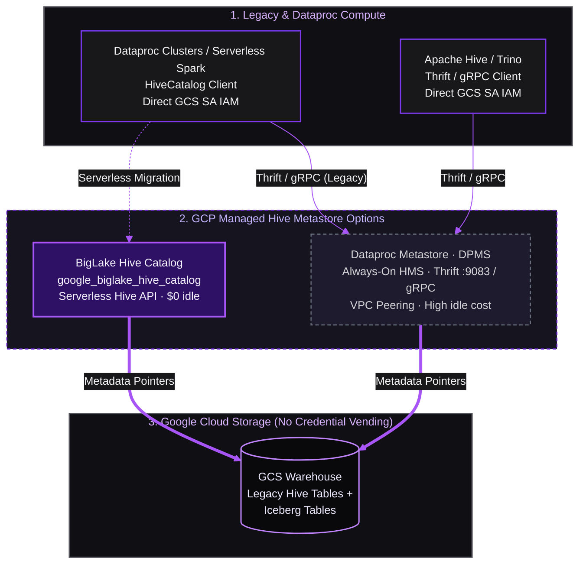

---
tags:
  - cloud-infrastructure/services/gcp
  - data-processing/storage/iceberg
aliases:
  - Dataproc Metastore
  - DPMS
  - BigLake Hive Catalog
source: "Google Cloud Dataproc Metastore & BigLake Hive Catalog Documentation"
source-type: documentation
vendor: "Google Cloud"
url: "https://cloud.google.com/dataproc-metastore/docs/overview"
created: 2026-11-25
---
**Dataproc Metastore (DPMS)** and **BigLake Hive Catalog (`google_biglake_hive_catalog`)** are Google Cloud's managed implementations of the [[Apache Iceberg Hive Metastore Catalog]] pattern, providing Thrift/gRPC Hive Metastore (HMS) compatibility for Dataproc Spark, Hive, and Presto/Trino workloads migrating from Hadoop estates onto GCS.

> [!NOTE]
> For **greenfield** GCP Iceberg lakehouses, Google Cloud recommends [[GCP BigLake Iceberg REST Catalog]] (serverless HTTP REST + credential vending) over Thrift-based HMS catalogs. Use DPMS or BigLake Hive Catalog primarily when **existing Hive tables and Spark jobs** depend on Thrift HMS APIs.

## Architecture: Managed HMS vs. Serverless BigLake Hive



- **Idle Cost Trap (DPMS):** Dataproc Metastore runs dedicated always-on managed instances (hundreds of dollars/month even when idle), breaking `$0/mo` idle-cost budgets.
- **Serverless Alternative (`google_biglake_hive_catalog`):** BigLake Hive Catalog eliminates always-on HMS VMs while preserving Hive-compatible namespace/database/table semantics for teams transitioning off DPMS.
- **No Native Iceberg Credential Vending:** Unlike [[GCP BigLake Iceberg REST Catalog]], Thrift HMS clients rely on direct GCS bucket IAM on the compute service account.

## Comparison: DPMS vs. BigLake Hive vs. BigLake Iceberg REST

| Dimension | Dataproc Metastore (DPMS) | BigLake Hive Catalog | [[GCP BigLake Iceberg REST Catalog]] | Senior Note |
| :--- | :--- | :--- | :--- | :--- |
| **Idle Cost** | High (always-on HMS service) | Serverless (`$0` idle) | Serverless (`$0` idle) | Avoid DPMS for dev/sandbox or low-budget platforms. |
| **Protocol** | Thrift `:9083` / gRPC | BigLake Hive API | Open Iceberg REST HTTP/JSON | REST works cleanly across Java, Python, Rust, Spark, and BigQuery. |
| **Credential Vending** | No | No | Yes (`CREDENTIAL_MODE_VENDED_CREDENTIALS`) | REST catalog enforces least-privilege table-scoped storage access. |
| **Best Fit** | Lift-and-shift Hadoop/Hive estates | Serverless Hive-table compatibility | Greenfield open Iceberg lakehouses | Migrate Iceberg workloads toward BigLake Iceberg REST Catalog. |

## OpenTofu & Spark Examples

### OpenTofu (`google_biglake_hive_catalog`)
```hcl
resource "google_biglake_hive_catalog" "legacy_hive" {
  project          = var.project_id
  name             = "legacy_hive_catalog"
  location_uri     = "gs://${module.bronze_bucket.name}/hive-warehouse"
  description      = "Serverless Hive-compatible catalog for legacy Dataproc migrations."
}
```

### Dataproc Spark Connecting to DPMS (`HiveCatalog`)
```bash
gcloud dataproc batches submit spark \
  --region=us-central1 \
  --metastore-service="projects/my-project/locations/us-central1/services/my-dpms" \
  --properties="\
spark.sql.catalog.bronze=org.apache.iceberg.spark.SparkCatalog,\
spark.sql.catalog.bronze.type=hive,\
spark.sql.catalog.bronze.warehouse=gs://my-lakehouse-bronze/" \
  --class=com.example.IcebergJob \
  gs://my-jars/iceberg-job.jar
```

## Related Notes
- **OSS Counterpart & Concepts:** [[Apache Iceberg Hive Metastore Catalog]] · [[Apache Iceberg Catalogs]] · [[Apache Iceberg]]
- **Recommended Modern GCP Options:** [[GCP BigLake Iceberg REST Catalog]] · [[GCP BigLake Tables for Apache Iceberg]]

## When Not to Use
- Any greenfield Iceberg architecture (use [[GCP BigLake Iceberg REST Catalog]] for multi-engine REST + credential vending, or [[GCP BigLake Tables for Apache Iceberg]] for BigQuery-managed tables).
- Budget-constrained environments where DPMS's always-on hourly cost is unacceptable.

## Documentation & References
- [Google Cloud Dataproc Metastore Overview](https://cloud.google.com/dataproc-metastore/docs/overview)
- [Use Iceberg with Dataproc Metastore](https://cloud.google.com/dataproc-metastore/docs/use-iceberg)
- [Terraform/OpenTofu `google_biglake_hive_catalog` Resource](https://registry.terraform.io/providers/hashicorp/google/latest/docs/resources/biglake_hive_catalog)
