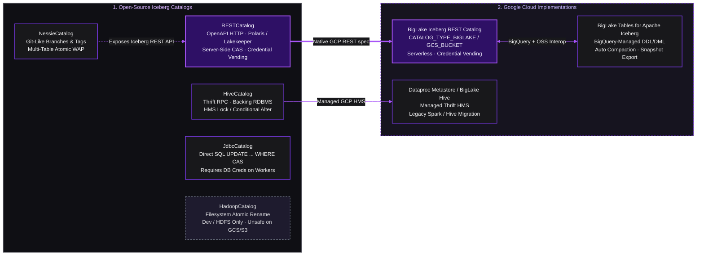

---
tags:
  - data-processing/storage/iceberg
aliases:
  - Iceberg Catalogs
  - Iceberg Metastore
source: "Apache Iceberg Catalogs & Architecture Specification"
source-type: documentation
vendor: "Apache Software Foundation"
url: "https://iceberg.apache.org/concepts/catalog/"
created: 2026-11-25
---
An **Apache Iceberg Catalog** is the minimal **consistency and discovery control plane** that maps logical table identifiers (`namespace.table`) to each table's current immutable `metadata.json` file and enforces **atomic Compare-and-Swap (CAS)** commits across concurrent writers.

> [!IMPORTANT]
> Object stores (GCS, S3, ADLS) provide high durability and throughput, **not** multi-file transactional pointers. The catalog is the single component that turns immutable files in object storage into an ACID [[Apache Iceberg]] table.

## How Optimistic Concurrency Commits Work

Every Iceberg catalog must implement one core primitive: **atomic pointer swap**. Writers optimistically stage all new Parquet, manifest, and metadata files in object storage first, then ask the catalog to atomically flip the pointer from `v1` to `v2`.

```mermaid
%%{init: {"theme": "base", "themeCSS": "svg { background-color: #09090B !important; border-radius: 8px; }", "themeVariables": {"darkMode": true, "background": "#09090B", "mainBkg": "#18181B", "textColor": "#F4F4F5", "primaryColor": "#18181B", "primaryTextColor": "#F4F4F5", "primaryBorderColor": "#7C3AED", "lineColor": "#A855F7", "actorBkg": "#18181B", "actorBorder": "#7C3AED", "actorTextColor": "#F4F4F5", "actorLineColor": "#52525B", "signalColor": "#A855F7", "signalTextColor": "#E4E4E7", "labelBoxBkgColor": "#2E1065", "labelBoxBorderColor": "#A855F7", "labelTextColor": "#F5F3FF", "loopTextColor": "#D8B4FE", "noteBkgColor": "#1E1B2E", "noteBorderColor": "#6D28D9", "noteTextColor": "#EDE9FE", "activationBkgColor": "#4C1D95", "activationBorderColor": "#C084FC", "sequenceNumberColor": "#FAF5FF", "fontFamily": "Inter, ui-sans-serif, system-ui, -apple-system, sans-serif", "fontSize": "13px"}}}%%
sequenceDiagram
    autonumber
    participant W as Writer Engine (Spark / Java SDK)
    participant Cat as Iceberg Catalog (CAS Control Plane)
    participant Obj as Object Storage (GCS / S3)

    W->>+Cat: loadTable(bronze.football.matches)
    Cat-->>-W: current pointer = v1.metadata.json (+ optional vended creds)
    W->>+Obj: Stage new Parquet data + manifest + v2.metadata.json
    Obj-->>-W: 200 OK (immutable files; invisible to concurrent readers)
    W->>+Cat: commit(expected=v1.metadata.json, new=v2.metadata.json)

    alt Pointer is still v1 (No concurrent commit)
        Cat-->>W: 200 OK (pointer atomically swapped to v2)
    else Another writer already swapped pointer to v1b
        Cat-->>W: 409 CommitFailedException
        Note over W,Cat: Reload v1b, validate no conflict, stage v2b, and retry CAS
    end
    deactivate Cat
```

- **Lock-Free Writes:** Writers never hold long-lived locks while writing gigabytes of Parquet files; contention exists only during the millisecond CAS pointer swap.
- **No Partial Visibility:** If a writer crashes before step 5, its staged Parquet files remain unreferenced (cleaned up later by `remove_orphan_files`) and readers continue reading `v1` undisturbed.
- **Credential Vending (Modern REST Catalogs):** Advanced catalogs issue short-lived, table-scoped storage tokens during `loadTable` so engines need zero broad GCS/S3 bucket IAM permissions.

## OSS Catalog Variations vs. GCP Implementations



## Decision Matrix: Picking a Catalog

| Catalog | CAS Mechanism | Credential Vending | Multi-Engine Fit | GCP Equivalent | Senior Note |
| :--- | :--- | :---: | :---: | :--- | :--- |
| [[Apache Iceberg REST Catalog]] | HTTP server CAS | Yes | Best (Java/Python/Rust/SQL) | [[GCP BigLake Iceberg REST Catalog]] | Industry default for new lakehouses; decouples clients from metastore internals. |
| [[Apache Iceberg Hive Metastore Catalog]] | HMS Thrift lock / conditional alter | No | Good (JVM-heavy) | [[GCP Dataproc Metastore and BigLake Hive Catalog]] | Best only when migrating legacy Hive/Hadoop estates. |
| [[Apache Iceberg JDBC Catalog]] | RDBMS `UPDATE ... WHERE` | No | Moderate (requires JDBC driver) | Self-managed Cloud SQL | Lightweight for small teams; exposes DB credentials to every compute node. |
| [[Apache Iceberg Nessie Catalog]] | Versioned Git-like commit log | Via REST | Strong (WAP workflows) | Self-hosted on GKE / Cloud Run | Ideal when multi-table atomic transactions or branch-per-PR WAP is required. |
| [[Apache Iceberg Hadoop Catalog]] | Filesystem atomic rename | No | Local/HDFS only | None (unsafe on GCS) | Strictly for unit tests or HDFS; causes silent corruption on S3/GCS. |
| *BigQuery-Managed Iceberg* | BigQuery native metadata | BigQuery IAM | BQ write / OSS read | [[GCP BigLake Tables for Apache Iceberg]] | Zero maintenance/compaction ops when BigQuery is the sole writer. |

## Programmatic Catalog Loading (Java)

Iceberg clients load any catalog variation through the same `CatalogUtil` factory—switching backends requires changing configuration properties, not table-management code (the exact pattern behind [[Java Service Provider Interface]] plugins).

```java
// GOOD: Load catalog through configuration properties (swappable across REST / HMS / JDBC)
Map<String, String> props = Map.of(
    "type", "rest",
    "uri", "https://biglake.googleapis.com/iceberg/v1/restcatalog",
    "warehouse", "bl://projects/my-gcp-project/catalogs/bronze",
    "io-impl", "org.apache.iceberg.gcp.gcs.GCSFileIO",
    "rest.auth.type", "org.apache.iceberg.gcp.auth.GoogleAuthManager",
    "header.x-goog-user-project", "my-gcp-project",
    "header.X-Iceberg-Access-Delegation", "vended-credentials"
);
Catalog catalog = CatalogUtil.buildIcebergCatalog("bronze", props, new Configuration());

// BAD: Hardcoding a filesystem path directly without a transactional catalog
// HadoopTables tables = new HadoopTables(conf);
// tables.load("gs://my-bucket/bronze/matches"); // Unsafe concurrent writes on GCS!
```

## Deep-Dive Catalog Notes
- **Core Format:** [[Apache Iceberg]]
- **OSS Variations:** [[Apache Iceberg REST Catalog]] · [[Apache Iceberg Hive Metastore Catalog]] · [[Apache Iceberg JDBC Catalog]] · [[Apache Iceberg Nessie Catalog]] · [[Apache Iceberg Hadoop Catalog]]
- **GCP Implementations:** [[GCP BigLake Iceberg REST Catalog]] · [[GCP BigLake Tables for Apache Iceberg]] · [[GCP Dataproc Metastore and BigLake Hive Catalog]]

## Documentation & References
- [Apache Iceberg Catalogs Concept Guide](https://iceberg.apache.org/concepts/catalog/)
- [Apache Iceberg REST Catalog OpenAPI Specification](https://github.com/apache/iceberg/blob/main/open-api/rest-catalog-open-api.yaml)
- [Google Cloud BigLake Metastore Overview](https://cloud.google.com/biglake/docs/metastore-intro)
