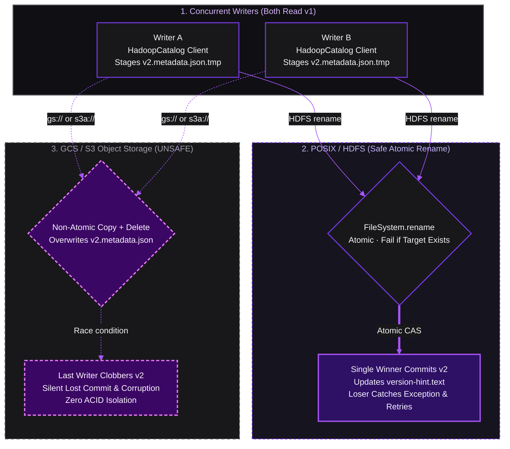

---
tags:
  - data-processing/storage/iceberg
aliases:
  - HadoopCatalog
  - Filesystem Iceberg Catalog
source: "Apache Iceberg Hadoop Catalog Documentation"
source-type: documentation
vendor: "Apache Software Foundation"
url: "https://iceberg.apache.org/docs/latest/java-api-quickstart/#creating-a-table"
created: 2026-11-25
---
The **Apache Iceberg Hadoop Catalog (`HadoopCatalog`)** is a server-less filesystem catalog that discovers tables by directory path and tracks the current metadata version in a `version-hint.text` file using filesystem **atomic rename** (`FileSystem.rename`).

> [!WARNING]
> **Never use `HadoopCatalog` in production on object storage (GCS, S3, ADLS).** Object stores do not implement atomic file rename-without-overwrite; concurrent writers will silently overwrite each other's commits and corrupt table metadata. Use `HadoopCatalog` strictly for **local unit tests** or legacy **HDFS** clusters.

## Why It Works on HDFS but Breaks on Object Storage



- **Storage Layout:** Under `<warehouse>/<namespace>/<table>/metadata/`, `HadoopCatalog` writes sequentially numbered `v1.metadata.json`, `v2.metadata.json`, and updates `version-hint.text` with the latest integer version.
- **No Central Discovery or Governance:** Listing namespaces/tables requires slow filesystem `LIST` operations, and there is no RBAC, audit log, or credential vending.
- **Deprecation Trajectory:** The Apache Iceberg community actively recommends replacing `HadoopCatalog` with [[Apache Iceberg REST Catalog]] (or `InMemoryCatalog` / `JdbcCatalog` backed by SQLite in unit tests).

## Usage Examples (Safe vs. Unsafe)

```java
// GOOD: Local JUnit integration test against a temporary directory
Path tempWarehouse = Files.createTempDirectory("iceberg-test-warehouse");
HadoopCatalog testCatalog = new HadoopCatalog(new Configuration(), tempWarehouse.toUri().toString());
testCatalog.createTable(TableIdentifier.of("football", "matches"), schema, spec);

// BAD: Production HadoopCatalog pointed at GCS or S3 (causes silent lost updates!)
// HadoopCatalog prodCatalog = new HadoopCatalog(conf, "gs://udp-prod-bronze/");
```

## Related Notes
- **Concepts:** [[Apache Iceberg]] · [[Apache Iceberg Catalogs]]
- **Production OSS Replacements:** [[Apache Iceberg REST Catalog]] · [[Apache Iceberg JDBC Catalog]] · [[Apache Iceberg Hive Metastore Catalog]] · [[Apache Iceberg Nessie Catalog]]
- **GCP Production Replacement:** [[GCP BigLake Iceberg REST Catalog]]

## When Not to Use
- Any cloud object store (GCS, S3, ADLS), any multi-writer workload, or any production environment requiring governance and safe ACID concurrency.

## Documentation & References
- [Apache Iceberg Catalogs Overview (HadoopCatalog Warning)](https://iceberg.apache.org/concepts/catalog/)
- [Apache Iceberg Java API Quickstart](https://iceberg.apache.org/docs/latest/java-api-quickstart/)
