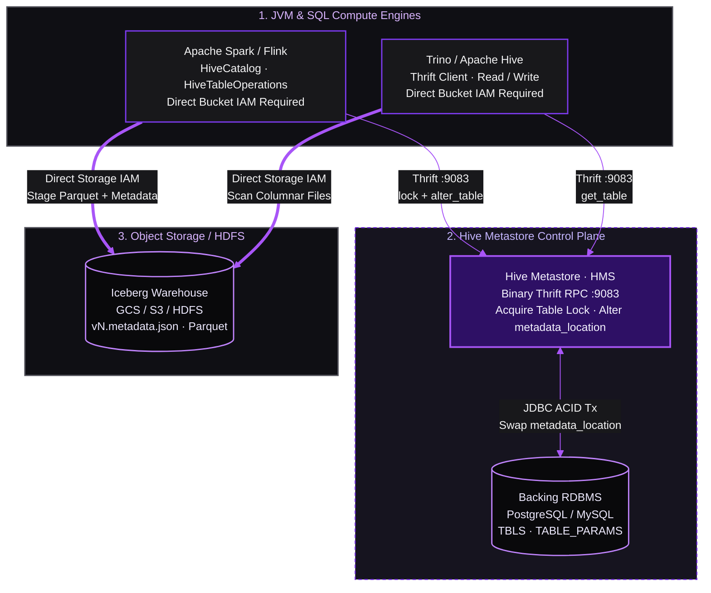

---
tags:
  - data-processing/storage/iceberg
aliases:
  - HiveCatalog
  - HMS Iceberg Catalog
source: "Apache Iceberg Hive Integration Documentation"
source-type: documentation
vendor: "Apache Software Foundation"
url: "https://iceberg.apache.org/docs/latest/hive/"
created: 2026-11-25
---
The **Apache Iceberg Hive Metastore Catalog (`HiveCatalog`)** stores each Iceberg table's current `metadata_location` pointer inside an **Apache Hive Metastore (HMS)** Thrift service backed by a relational database, using HMS table locks to guarantee atomic commits.

> [!NOTE]
> `HiveCatalog` was the original enterprise Iceberg catalog because most Hadoop/Spark shops already ran HMS. In greenfield cloud lakehouses it is largely superseded by [[Apache Iceberg REST Catalog]], while on Google Cloud its managed equivalent is [[GCP Dataproc Metastore and BigLake Hive Catalog]].

## Architecture & Commit Mechanics



- **Pointer Storage:** Iceberg registers a table entry in HMS with `table_type = ICEBERG` and stores the current pointer in HMS `TABLE_PARAMS` under key `metadata_location` (plus `previous_metadata_location`).
- **Lock-Based Atomicity:** Before swapping `metadata_location`, `HiveTableOperations` acquires an HMS lock (or relies on HMS `EnvironmentContext` conditional checks) to prevent two concurrent writers from clobbering each other.
- **No Credential Vending:** Every compute engine communicating with `HiveCatalog` must hold direct GCS/S3 IAM permissions on the warehouse bucket.

## Configuration Examples

### Apache Spark
```bash
spark-sql \
  --conf spark.sql.catalog.bronze=org.apache.iceberg.spark.SparkCatalog \
  --conf spark.sql.catalog.bronze.type=hive \
  --conf spark.sql.catalog.bronze.uri=thrift://hms.internal:9083 \
  --conf spark.sql.catalog.bronze.warehouse=gs://my-lakehouse-bronze/
```

### Java (`iceberg-hive-metastore`)
```java
Map<String, String> props = Map.of(
    "type", "hive",
    "uri", "thrift://hms.internal:9083",
    "warehouse", "gs://my-lakehouse-bronze/",
    "io-impl", "org.apache.iceberg.gcp.gcs.GCSFileIO"
);
Catalog catalog = CatalogUtil.buildIcebergCatalog("bronze", props, new Configuration());
```

## Trade-Offs

| Dimension | Behavior | Senior Note |
| :--- | :--- | :--- |
| **Legacy Compatibility** | Coexists with Hive external tables in one metastore | Simplifies gradual Hive-to-Iceberg migrations (`CALL system.migrate`). |
| **Protocol Overhead** | Binary Apache Thrift RPC (`:9083`) | Harder to secure across VPCs/clouds and poorly supported in lightweight non-JVM clients compared to HTTP/JSON. |
| **Operational Burden** | Requires HA HMS servers + managed PostgreSQL/MySQL + Kerberos/mTLS | Always prefer a managed service or [[Apache Iceberg REST Catalog]] over self-hosting HMS. |

## Related Notes
- **Concepts:** [[Apache Iceberg]] · [[Apache Iceberg Catalogs]]
- **GCP Implementation:** [[GCP Dataproc Metastore and BigLake Hive Catalog]]
- **Alternative OSS Catalogs:** [[Apache Iceberg REST Catalog]] · [[Apache Iceberg JDBC Catalog]] · [[Apache Iceberg Nessie Catalog]] · [[Apache Iceberg Hadoop Catalog]]

## When Not to Use
- Greenfield cloud lakehouses where no legacy Hive tables exist (use [[Apache Iceberg REST Catalog]] or [[GCP BigLake Iceberg REST Catalog]] instead).
- Multi-tenant environments requiring table-level credential vending rather than bucket-wide IAM.

## Documentation & References
- [Apache Iceberg Hive Integration Docs](https://iceberg.apache.org/docs/latest/hive/)
- [Apache Hive Metastore Administration](https://hive.apache.org/docs/latest/)
