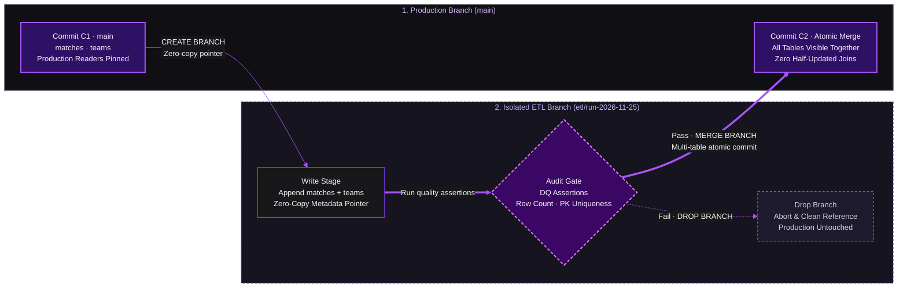

---
tags:
  - data-processing/storage/iceberg
aliases:
  - NessieCatalog
  - Project Nessie
source: "Project Nessie & Apache Iceberg Integration Documentation"
source-type: documentation
vendor: "Project Nessie"
url: "https://projectnessie.org/iceberg/"
created: 2026-11-25
---
The **Apache Iceberg Nessie Catalog (`NessieCatalog`)** is a transactional catalog built on **Project Nessie** that brings **Git-like version control (`branch`, `tag`, `commit`, `merge`)** to the entire catalog—enabling zero-copy **Write-Audit-Publish (WAP)** pipelines and **multi-table atomic transactions** across [[Apache Iceberg]] tables.

> [!IMPORTANT]
> Standard Iceberg catalogs give you single-table snapshots. Nessie elevates versioning to the **catalog level**, so you can modify five related tables on an isolated branch, run data quality checks, and merge all five into `main` in one atomic commit. Modern Nessie deployments also expose an [[Apache Iceberg REST Catalog]] endpoint (`/iceberg`).

## Git-Like Write-Audit-Publish (WAP) Lifecycle



- **Zero-Copy Branching:** Creating a branch only creates a lightweight metadata pointer in Nessie's commit log—no Parquet files are copied in GCS/S3.
- **Multi-Table Atomicity:** Analysts querying `main` never observe a half-updated join where `matches` has today's rows but `teams` still has yesterday's rows.
- **Native REST Support:** Nessie can be accessed either via `NessieCatalog` (legacy Nessie client) or via the standard Iceberg `RESTCatalog` endpoint (`uri = https://nessie.internal/iceberg/main`), including credential vending for GCS/S3.

## Configuration & WAP SQL Example (Spark)

```bash
spark-sql \
  --conf spark.sql.catalog.nessie=org.apache.iceberg.spark.SparkCatalog \
  --conf spark.sql.catalog.nessie.catalog-impl=org.apache.iceberg.nessie.NessieCatalog \
  --conf spark.sql.catalog.nessie.uri=https://nessie.internal/api/v2 \
  --conf spark.sql.catalog.nessie.ref=main \
  --conf spark.sql.catalog.nessie.warehouse=gs://my-lakehouse-bronze/ \
  --conf spark.sql.extensions=org.apache.iceberg.spark.extensions.IcebergSparkSessionExtensions,org.projectnessie.spark.extensions.NessieSparkSessionExtensions
```

```sql
-- 1. Create an isolated zero-copy branch for tonight's ETL run
CREATE BRANCH etl_2026_11_25 IN nessie FROM main;
USE REFERENCE etl_2026_11_25 IN nessie;

-- 2. Write multiple related tables on the branch (invisible to main)
INSERT INTO nessie.football.matches SELECT * FROM staging_matches;
INSERT INTO nessie.football.teams   SELECT * FROM staging_teams;

-- 3. Audit on the branch (fail pipeline before merging if count > 0)
SELECT match_id FROM nessie.football.matches GROUP BY match_id HAVING COUNT(*) > 1;

-- 4. Publish atomically across both tables & clean up
MERGE BRANCH etl_2026_11_25 INTO main IN nessie;
DROP BRANCH etl_2026_11_25 IN nessie;
```

## Trade-Offs

| Dimension | Behavior | Senior Note |
| :--- | :--- | :--- |
| **Multi-Table WAP** | First-class catalog branches, tags, and atomic merges | Solves cross-table consistency cleanly; single-table Iceberg branches cannot atomically publish multiple tables together. |
| **Garbage Collection** | Requires Nessie GC (`nessie-gc`) across all live branches/tags | Stale forgotten branches pin old snapshots and prevent Parquet file cleanup in object storage—enforce branch TTLs. |
| **GCP Managed Support** | Self-hosted only (GKE / Cloud Run + PostgreSQL) | Google Cloud does not offer a managed Nessie service; compare against serverless [[GCP BigLake Iceberg REST Catalog]]. |

## Related Notes
- **Concepts:** [[Apache Iceberg]] · [[Apache Iceberg Catalogs]] · [[Data Pipeline Patterns]]
- **Alternative OSS Catalogs:** [[Apache Iceberg REST Catalog]] · [[Apache Iceberg Hive Metastore Catalog]] · [[Apache Iceberg JDBC Catalog]] · [[Apache Iceberg Hadoop Catalog]]
- **GCP Serverless Alternative:** [[GCP BigLake Iceberg REST Catalog]]

## When Not to Use
- When you want a 100% serverless, zero-ops cloud catalog without hosting Nessie + GC jobs, and single-table snapshots (or Iceberg's built-in table branches) meet your data quality needs.

## Documentation & References
- [Project Nessie Iceberg Integration Guide](https://projectnessie.org/iceberg/)
- [Project Nessie Iceberg REST Catalog Endpoint](https://projectnessie.org/nessie-latest/iceberg_rest/)
- [Nessie Garbage Collection Docs](https://projectnessie.org/nessie-latest/gc/)
