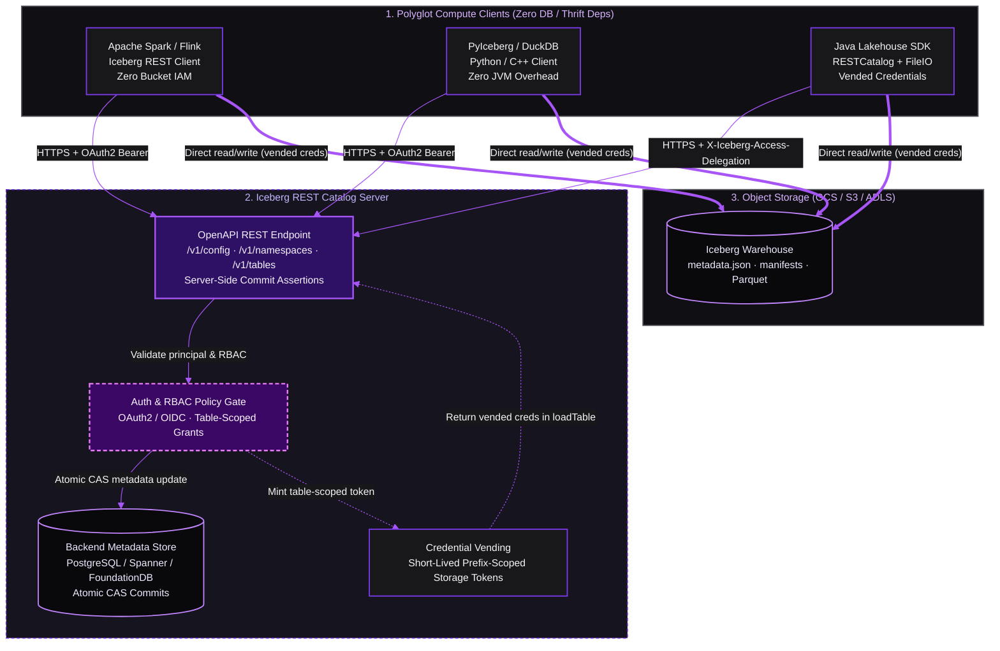

---
tags:
  - data-processing/storage/iceberg
aliases:
  - Iceberg REST Catalog
  - RESTCatalog
  - Apache Polaris
source: "Apache Iceberg REST Catalog Specification & Apache Polaris Docs"
source-type: documentation
vendor: "Apache Software Foundation"
url: "https://iceberg.apache.org/concepts/catalog/"
created: 2026-11-25
---
The **Apache Iceberg REST Catalog (`RESTCatalog`)** is the open-standard **HTTP/JSON control plane** defined by an OpenAPI specification that decouples compute engines from underlying metastore storage, enabling cross-language interoperability, server-side commit resolution, and **storage credential vending**.

> [!IMPORTANT]
> Unlike legacy catalogs that require every client to bundle backend-specific JVM libraries (Hive Thrift, JDBC drivers, AWS SDKs), `RESTCatalog` pushes catalog implementation behind a standard HTTP API. Open-source servers implementing this spec include **Apache Polaris**, **Lakekeeper**, and **Project Nessie (REST mode)**; on Google Cloud, it maps directly to [[GCP BigLake Iceberg REST Catalog]].

## Protocol & Credential Vending Architecture



- **Single Endpoint, Any Engine:** Non-JVM engines (PyIceberg, DuckDB, Polars, Rust) get first-class catalog access without running a JVM or Thrift bridge.
- **Server-Side Commit Optimization:** Instead of clients downloading/rewriting `metadata.json` blindly on contention, clients send granular **metadata updates + requirements** (`POST /v1/namespaces/{ns}/tables/{table}`), allowing the server to validate assertions cleanly.
- **Credential Vending (`X-Iceberg-Access-Delegation: vended-credentials`):** The catalog checks RBAC per namespace/table and returns ephemeral GCS/S3 credentials scoped to that table's prefix—eliminating broad bucket IAM grants on every worker node.

## Notable Open-Source REST Catalog Servers

| Server | Backing Store | Key Differentiator | Senior Note |
| :--- | :--- | :--- | :--- |
| **Apache Polaris** | PostgreSQL / EclipseLink / In-Memory | Native RBAC (`principal -> role -> catalog role`), credential vending, Snowflake-contributed ASF project | Strongest open-source default for self-hosted multi-engine governance. |
| **Lakekeeper** | PostgreSQL | Lightweight Rust binary, OpenFGA fine-grained authZ, low memory footprint | Fast to deploy on Kubernetes/Cloud Run with minimal ops overhead. |
| **Project Nessie (REST)** | RocksDB / PostgreSQL / DynamoDB | Exposes Iceberg REST API backed by Git-like branching & tagging | Combines standard `RESTCatalog` clients with [[Apache Iceberg Nessie Catalog]] WAP workflows. |
| **Iceberg REST Fixture** | SQLite / In-Memory (`tabulario/iceberg-rest`) | Zero-setup Docker container for local integration tests | Strictly for CI/local testing (never production). |

## Configuration Examples

### PyIceberg (OSS Polaris / Lakekeeper)
```python
from pyiceberg.catalog import load_catalog

catalog = load_catalog(
    "bronze",
    **{
        "type": "rest",
        "uri": "https://polaris.internal/api/catalog",
        "warehouse": "bronze",
        "credential": "<client_id>:<client_secret>",
        "scope": "PRINCIPAL_ROLE:ALL",
        "header.X-Iceberg-Access-Delegation": "vended-credentials",
    },
)
```

### Apache Spark
```bash
spark-sql \
  --conf spark.sql.catalog.bronze=org.apache.iceberg.spark.SparkCatalog \
  --conf spark.sql.catalog.bronze.type=rest \
  --conf spark.sql.catalog.bronze.uri=https://polaris.internal/api/catalog \
  --conf spark.sql.catalog.bronze.warehouse=bronze \
  --conf spark.sql.catalog.bronze.header.X-Iceberg-Access-Delegation=vended-credentials
```

## Related Notes
- **Concepts:** [[Apache Iceberg]] · [[Apache Iceberg Catalogs]]
- **GCP Implementation:** [[GCP BigLake Iceberg REST Catalog]]
- **Alternative OSS Catalogs:** [[Apache Iceberg Hive Metastore Catalog]] · [[Apache Iceberg JDBC Catalog]] · [[Apache Iceberg Nessie Catalog]] · [[Apache Iceberg Hadoop Catalog]]

## When Not to Use Self-Hosted OSS REST Servers
- When your cloud provider already supplies a serverless, IAM-integrated Iceberg REST endpoint (e.g., [[GCP BigLake Iceberg REST Catalog]] or AWS Glue Iceberg REST) and you do not need custom self-hosted multi-cloud RBAC.

## Documentation & References
- [Apache Iceberg REST Catalog OpenAPI Spec](https://github.com/apache/iceberg/blob/main/open-api/rest-catalog-open-api.yaml)
- [Apache Polaris Documentation](https://polaris.apache.org/)
- [Lakekeeper Documentation](https://docs.lakekeeper.io/)
