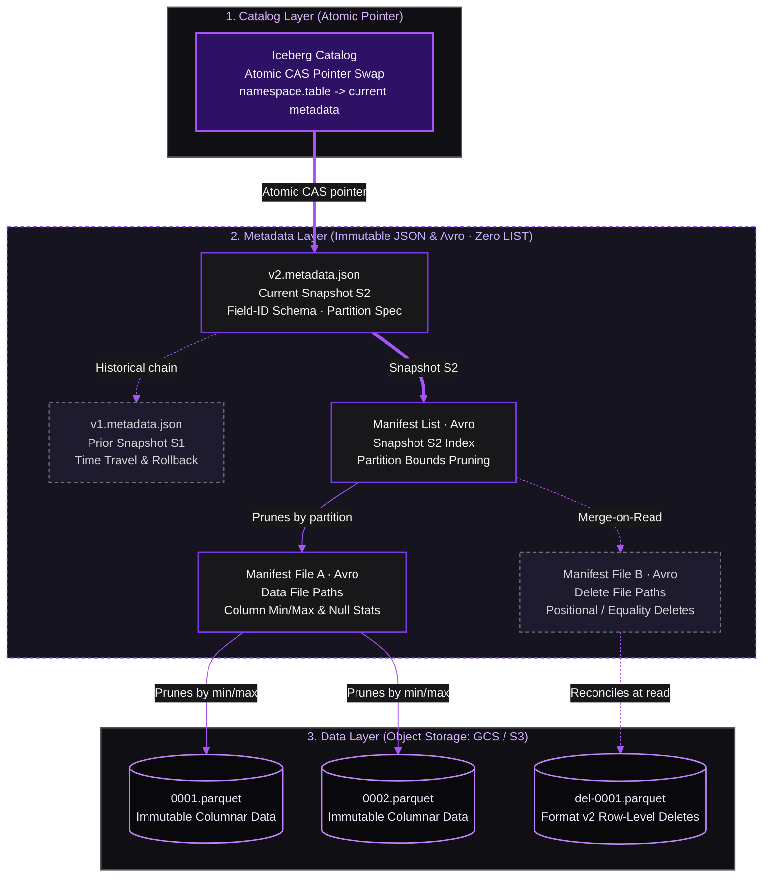

---
tags:
  - data-processing/storage/iceberg
aliases:
  - Iceberg
  - Iceberg Table Format
source: "Apache Iceberg Official Documentation"
source-type: documentation
vendor: "Apache Software Foundation"
url: "https://iceberg.apache.org/docs/latest/"
created: 2026-11-25
---
**Apache Iceberg** is an open-source, high-performance **table format** for huge analytic datasets on object storage (GCS, S3, ADLS) that brings full **ACID transactions**, **schema evolution**, **hidden partitioning**, and **time travel** to multi-engine lakehouses without locking data into a single query engine.

> [!IMPORTANT]
> Iceberg is **not** a storage engine or a query engine. It is a deterministic **metadata specification** layered on top of open columnar files (Parquet, ORC, Avro) so engines like Spark, Trino, Flink, BigQuery, and DuckDB can read and write the same tables safely in parallel.

## 3-Tier Immutable Metadata Architecture

Iceberg replaces expensive directory listing (`LIST` calls on object storage) with a versioned tree of immutable metadata files rooted at a single atomic pointer maintained by an [[Apache Iceberg Catalogs|Iceberg Catalog]].



- **Zero Directory Listings:** Query planners read `metadata.json` -> Manifest List -> Manifest Files and prune entire files using column-level min/max and null counts before touching Parquet data.
- **Snapshot Isolation:** Readers pinned to Snapshot `S1` never see half-written files from Snapshot `S2`; every commit creates a new immutable metadata file and swaps the pointer atomically via the catalog.
- **Format v2 Row-Level Deletes:** Supports both **Copy-on-Write (CoW)** (rewrite affected Parquet files on update/delete for fastest reads) and **Merge-on-Read (MoR)** (emit lightweight delete files reconciled at read time for fast streaming/CDC writes).

## Core Capabilities

| Capability | Under-the-Hood Mechanism | Senior Note |
| :--- | :--- | :--- |
| **Schema Evolution** | Every column carries a unique integer **Field ID** (not position or name) | Renaming, reordering, or dropping columns never resurrects old data or requires rewriting Parquet files. |
| **Hidden Partitioning** | Partition transforms (`days(ts)`, `bucket(16, id)`, `truncate(4, code)`) stored in metadata | Analysts query `WHERE ts >= '2026-01-01'` directly without knowing physical partition columns; partition layouts can evolve in-place without table rewrites. |
| **Time Travel & Rollback** | Previous snapshots remain referenced in `metadata.json` until expired | Enables reproducible ML training sets, point-in-time audits, and instant rollback to a known-good snapshot. |
| **Table Maintenance** | `expire_snapshots`, `remove_orphan_files`, `rewrite_data_files` (compaction), `rewrite_manifests` | Unmaintained streaming tables suffer from small-file bloat; always keep orphan-file retention `>= 72h` to avoid deleting in-flight writer files. |

## Concrete Examples (Spark SQL)

```sql
-- Hidden partitioning + Format v2 properties (no manual partition column needed)
CREATE TABLE bronze.football.matches (
  match_id     STRING,
  event_ts     TIMESTAMP,
  home_team    STRING,
  away_team    STRING,
  _ingested_at TIMESTAMP
)
USING iceberg
PARTITIONED BY (days(_ingested_at))
TBLPROPERTIES (
  'format-version' = '2',
  'write.delete.mode' = 'merge-on-read',
  'write.update.mode' = 'merge-on-read'
);

-- Partition evolution without rewriting historical data
ALTER TABLE bronze.football.matches ADD PARTITION FIELD bucket(16, match_id);

-- Time travel query & snapshot rollback
SELECT * FROM bronze.football.matches TIMESTAMP AS OF '2026-11-24 00:00:00';
CALL bronze.system.rollback_to_snapshot('football.matches', 84729104829104);

-- Production maintenance: compact small files, expire old snapshots, clean orphans
CALL bronze.system.rewrite_data_files(table => 'football.matches');
CALL bronze.system.expire_snapshots(
  table => 'football.matches',
  older_than => TIMESTAMP '2026-11-18 00:00:00',
  retain_last => 5
);
```

## Ecosystem Navigation
- **Catalog Mechanics & Comparisons:** [[Apache Iceberg Catalogs]]
- **OSS Catalog Variations:** [[Apache Iceberg REST Catalog]], [[Apache Iceberg Hive Metastore Catalog]], [[Apache Iceberg JDBC Catalog]], [[Apache Iceberg Nessie Catalog]], [[Apache Iceberg Hadoop Catalog]]
- **GCP Implementations:** [[GCP BigLake Iceberg REST Catalog]], [[GCP BigLake Tables for Apache Iceberg]], [[GCP Dataproc Metastore and BigLake Hive Catalog]]
- **Related Vault Concepts:** [[SQL]], [[Data Pipeline Patterns]]

## When Not to Use
- **Sub-100ms OLTP point lookups or high-frequency single-row mutations:** Use Cloud Spanner, PostgreSQL, or [[NoSQL]] stores instead.
- **Tiny scratch tables (< 100 MB) queried exclusively inside BigQuery:** Native BigQuery tables avoid external metadata/compaction complexity when multi-engine openness is unnecessary.

## Documentation & References
- [Apache Iceberg Documentation](https://iceberg.apache.org/docs/latest/)
- [Apache Iceberg Table Specification (v2 & v3)](https://iceberg.apache.org/spec/)
- [Apache Iceberg Maintenance Procedures](https://iceberg.apache.org/docs/latest/maintenance/)
