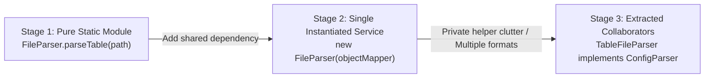

---
tags:
  - software-engineering/principles
  - software-engineering/languages/java
aliases:
  - Class vs. Static Methods in Java
  - When to Create a Class vs. Static Methods
  - OOP Cohesion and Premature Abstraction
  - Premature Class Extraction
source: "Effective Java & JVM Platform Architecture Principles"
source-type: article
author: "Data Platform Architecture Guidelines"
created: 2026-11-24
---
In the JVM ecosystem, **a cohesive class containing static methods is Java's syntactic equivalent of a module**. Because Java lacks top-level standalone functions (unlike Go, Python, or Kotlin), developers often mistakenly assume that every operation requires an instantiated object. Extracting stateless classes that expose only a single public method is **premature abstraction**—procedural logic masquerading as object-oriented design.

> [!NOTE]
> **Core Rule of Thumb:** Start with cohesive static methods in a domain-scoped module class. Promote to an instantiated class or separate dedicated classes only when driven by concrete design friction (stateful invariants, injected collaborators, polymorphic interfaces, or private-helper clutter). Splitting an established class later is cheap; maintaining premature fragmentation degrades cognitive clarity immediately.

---

## The False SRP Trap: Premature Class Fragmentation

Premature abstraction typically emerges from a mechanical misapplication of the **Single Responsibility Principle (SRP)**, interpreting "one responsibility" as "one class per method or noun." In enterprise codebases, developers also reflexively imitate [[Spring Boot|Spring]] or [[Dependency Injection|DI]] bean patterns inside standalone libraries and SDKs where dependency management frameworks provide zero value.

When transformations are stateless ($Path \rightarrow Config$, $String \rightarrow DTO$), creating single-method classes introduces indirection without encapsulation.

### Anti-Pattern: Single-Method Stateless Sprawl

```java
// BAD: Premature fragmentation — procedural code disguised as OOP
// Each class has zero internal state, zero dependencies, and exactly one method.
public final class NamespaceFileParser {
    public NamespaceConfig parse(Path path) throws IOException {
        String raw = Files.readString(path);
        return parseNamespaceContent(raw);
    }

    private NamespaceConfig parseNamespaceContent(String content) {
        // parsing logic...
        return new NamespaceConfig("default");
    }
}

public final class TableFileParser {
    public TableConfig parse(Path path) throws IOException {
        String raw = Files.readString(path);
        return parseTableContent(raw);
    }

    private TableConfig parseTableContent(String content) {
        // parsing logic...
        return new TableConfig("users");
    }
}

// Call site: Caller must instantiate throwaway objects to call pure functions
NamespaceConfig ns = new NamespaceFileParser().parse(nsPath);
TableConfig table = new TableFileParser().parse(tablePath);
```

### Clean Alternative: Cohesive Domain Module

Grouping pure functions into a final, non-instantiable class with a private constructor organizes related logic under a clear semantic namespace without lifecycle overhead.

```java
// GOOD: Cohesive static methods acting as a module
public final class FileParser {

    private FileParser() {
        // Enforce non-instantiability
        throw new UnsupportedOperationException("Utility module cannot be instantiated");
    }

    public static NamespaceConfig parseNamespace(Path path) throws IOException {
        String raw = Files.readString(path);
        return parseNamespaceContent(raw);
    }

    public static TableConfig parseTable(Path path) throws IOException {
        String raw = Files.readString(path);
        return parseTableContent(raw);
    }

    private static NamespaceConfig parseNamespaceContent(String content) {
        return new NamespaceConfig("default");
    }

    private static TableConfig parseTableContent(String content) {
        return new TableConfig("users");
    }
}

// Call site: Direct, readable, zero allocations, no lifecycle baggage
NamespaceConfig ns = FileParser.parseNamespace(nsPath);
TableConfig table = FileParser.parseTable(tablePath);
```

---

## The 4 Signals That a Class Earns Its Existence

Do not create an instantiated class until at least one of four architectural pressures forces the transition:

```mermaid
flowchart TD
    Start["Stateless Pure Function"] --> S1{"1. Owns Mutable/Immutable State\n& Enforces Invariants?"}
    S1 -->|"Yes"| ExtractClass["Create Dedicated Class / Record\n(e.g., TableSchema, DataBuffer)"]
    S1 -->|"No"| S2{"2. Requires External Collaborators\n(Clients, ObjectMappers, Config)?"}
    S2 -->|"Yes"| DIClass["Instantiate Service Class\nwith Injected Dependencies"]
    S2 -->|"No"| S3{"3. Needs Polymorphic Swapping\nBehind an Interface?"}
    S3 -->|"Yes"| PolyClass["Implement Common Interface\n(e.g., YamlParser implements FormatParser)"]
    S3 -->|"No"| S4{"4. Helper Clutter &\nCohesion Breakdown?"}
    S4 -->|"Yes"| SplitModule["Extract Cohesive Sub-Module\nor Dedicated Worker"]
    S4 -->|"No"| KeepStatic["Retain Cohesive Static Method\nin Domain Module"]
```



### Signal 1: State & Invariants (Data + Rules)
A class earns its existence when it encapsulates state and enforces boundaries ensuring that fields cannot enter an invalid state.
- **Example:** A `TableSchema` class that validates column name uniqueness, enforces non-empty partition keys, and computes lookup indexes.
- **Static vs Class:** A static method transforms input to output; a class defends invariants over time.

### Signal 2: Injected Dependencies & Testability
When logic requires external collaborators (e.g., Jackson `ObjectMapper`, [[SQL]] database pools, schema registries, or S3 storage clients), passing these dependencies into every static method signature creates noisy, fragile APIs.
- **Static Pitfall:** Static methods depending on global state or hidden singletons prevent isolated, concurrent unit testing.
- **Class Role:** An instantiated class captures dependencies once via its constructor, enabling callers (and tests) to pass mocks or stubs via [[Dependency Injection]].

### Signal 3: Polymorphism & Interface Realization
Static methods belong to a specific compile-time class and **cannot implement an [[Interface]]** or participate in runtime polymorphism.
- **Example:** If callers must process input files uniformly regardless of format (`FormatParser`), you cannot use static methods. Implementations like `JsonFormatParser`, `YamlFormatParser`, and `AvroFormatParser` require separate classes bound by a common contract.

### Signal 4: Cohesion Degradation & Private-Helper Clutter
When a single static module grows so large that independent operations accumulate deep private helper sub-trees, cohesion collapses into file-level bloat.
- **Example:** If `parseTable` requires 10 private helper methods (`parseColumns`, `parsePartitions`, `resolveTypes`) and `parseNamespace` requires 8 completely unrelated helpers, the module becomes a junk drawer. Extracting `TableFileParser` is now justified by encapsulation, not dogma.

---

## The Refactoring Path: From Static Method to Extracted Service

Architecture evolves through three discrete stages as complexity grows. Avoid jumping straight to Stage 3 before the problem demands it.



### Stage 1: Pure Functions (Static Methods)
Zero dependencies, zero state, direct data transformation.

```java
public final class FileParser {
    private FileParser() {}

    public static TableConfig parseTable(Path path) throws IOException {
        String content = Files.readString(path);
        return new TableConfig(content.trim());
    }
}
```

### Stage 2: The Middle Ground (Single Instantiated Service)
When both `parseTable` and `parseNamespace` require an expensive or configured collaborator (such as an `ObjectMapper` or custom deserializer), introduce **one instantiated class** before fragmenting into multiple files.

```java
// GOOD: Middle ground — captures shared dependency without class proliferation
public class FileParser {
    private final ObjectMapper mapper;
    private final SchemaValidator validator;

    public FileParser(ObjectMapper mapper, SchemaValidator validator) {
        this.mapper = Objects.requireNonNull(mapper, "mapper must not be null");
        this.validator = Objects.requireNonNull(validator, "validator must not be null");
    }

    public NamespaceConfig parseNamespace(Path path) throws IOException {
        JsonNode node = mapper.readTree(path.toFile());
        validator.validateNamespace(node);
        return mapper.treeToValue(node, NamespaceConfig.class);
    }

    public TableConfig parseTable(Path path) throws IOException {
        JsonNode node = mapper.readTree(path.toFile());
        validator.validateTable(node);
        return mapper.treeToValue(node, TableConfig.class);
    }
}
```

### Stage 3: Dedicated Extracted Classes (Interface & Helper Growth)
When format variants emerge or helper logic expands significantly, extract dedicated implementations implementing a common contract.

```java
// GOOD: Full extraction earned through polymorphism and helper isolation
public interface ConfigParser<T> {
    T parse(Path path) throws IOException;
}

public class TableConfigParser implements ConfigParser<TableConfig> {
    private final ObjectMapper mapper;
    private final TypeResolver typeResolver;

    public TableConfigParser(ObjectMapper mapper, TypeResolver typeResolver) {
        this.mapper = mapper;
        this.typeResolver = typeResolver;
    }

    @Override
    public TableConfig parse(Path path) throws IOException {
        JsonNode node = mapper.readTree(path.toFile());
        List<ColumnSpec> columns = parseColumnDefinitions(node.get("columns"));
        List<PartitionSpec> partitions = parsePartitionKeys(node.get("partitioning"));
        return new TableConfig(node.get("name").asText(), columns, partitions);
    }

    // Isolated private helpers relevant ONLY to table schema mechanics
    private List<ColumnSpec> parseColumnDefinitions(JsonNode columnNode) {
        // complex type resolution using typeResolver...
        return List.of();
    }

    private List<PartitionSpec> parsePartitionKeys(JsonNode partNode) {
        // complex partition tree validation...
        return List.of();
    }
}
```

---

## Architectural Decision Matrix

| Dimension | Cohesive Static Methods | Single Instantiated Service | Separate Dedicated Classes | Senior Note |
| :--- | :--- | :--- | :--- | :--- |
| **Internal State** | Stateless ($f(x) \rightarrow y$) | Stateless logic, but holds reference to immutable collaborators | Encapsulates state, configuration, and internal invariants | If you need fields that mutate or represent state, static methods are prohibited. |
| **Dependencies** | Zero or pure passed-in arguments | Injected once via constructor (`final` fields) | Injected per specialized domain worker | Static methods taking 4+ dependencies indicate an uninstantiated service waiting to happen. |
| **Testability & Mocking** | Tested directly with input/output assertions; cannot mock | Easy to test; mock collaborators injected in unit test constructors | Highly isolated; granular testing of specialized sub-trees | Static methods that make network or I/O calls resist standard mocking libraries. |
| **Polymorphism** | None; compile-time binding only | None; single concrete service | Full; classes implement `[[Interface]]` contracts | You cannot pass a static method to an API expecting an interface. |
| **Cognitive Overhead** | **Lowest:** 1 file, discoverable via IDE autocomplete | **Low:** 1 file, clear dependency graph | **Medium-High:** Multiple files, navigation indirection | Beware "class explosion" that forces developers to open 10 tabs to trace a 40-line flow. |

---

## The Opposite Pitfall: The "Utils" Junk Drawer

While premature fragmentation harms readability, the opposite failure mode is equally toxic: the **Unbounded God Utility Class**.

```java
// BAD: The "Utils" junk drawer anti-pattern
public final class CommonUtils {
    public static String formatTimestamp(long ts) { ... }
    public static TableConfig parseTable(Path p) { ... }
    public static boolean checkS3Connection(String bucket) { ... }
    public static byte[] compressGzip(byte[] data) { ... }
    public static String sanitizeSqlIdentifier(String id) { ... }
}
```

### Remediation Principles
1. **Domain-Bound Namespaces:** Never create `CommonUtils`, `GeneralHelper`, or `MiscFunctions`. Anchor modules to a bounded domain: `TableFileParser`, `SqlSanitizer`, or `GzipCompression`.
2. **Package-Private Encapsulation:** If a helper method is only used within three classes in the same package, mark it `package-private` (no access modifier) rather than `public static`. Keep the public surface area minimal.
3. **Co-locate with Domain Entities:** If a static transformation operates exclusively on a domain object, place it as a static factory or conversion method directly on that domain class (e.g., `TableSchema.fromPath(path)`).

> [!TIP]
> **Senior Lens:** Start every stateless algorithm as a private static helper method inside the calling class. When a second caller requires it, promote it to `package-private static` within a domain-scoped module (e.g., `FileParser`). Only when you need swappable behavior, collaborator injection for unit tests, or stateful invariants should you promote it to an instantiated class. Premature abstraction is technical debt paid up front for flexibility you rarely need.
