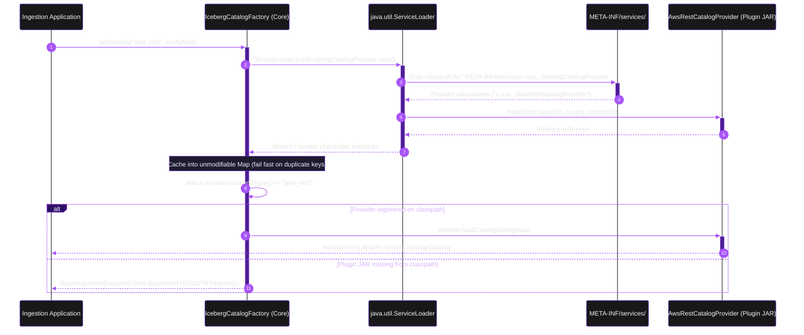

---
tags:
  - software-engineering/languages/java
  - software-engineering/principles
aliases:
  - Java SPI
  - ServiceLoader
  - Service Provider Interface
  - Java ServiceLoader
source: "JDK ServiceLoader & JVM Multi-Module Plugin Architecture"
source-type: documentation
author: "Java SE Platform & Data Platform Architecture"
url: "https://docs.oracle.com/en/java/javase/17/docs/api/java.base/java/util/ServiceLoader.html"
created: 2026-11-24
---
The **Java Service Provider Interface (SPI)**—powered by `java.util.ServiceLoader`—is the standard JDK mechanism for decoupling a core API contract from its runtime implementations. By loading provider classes discovered dynamically on the classpath (or module path) via configuration files under `META-INF/services/`, SPI enables applications to remain completely agnostic of concrete vendors, drivers, or cloud SDKs until runtime assembly.

---

## Mental Model: Decoupling Pipelines from Cloud SDKs

In enterprise data platforms and distributed compute engines (e.g., Apache Spark, Flink, and Trino), pipelines often need to run across diverse environments: local development (MinIO / LocalStack), AWS (S3 / Glue / REST Catalog), and GCP (GCS / BigLake).

Hardcoding provider selection or packing all cloud SDKs into a single monolithic JAR creates severe maintenance and operational hazards:

```mermaid
%%{init: {"theme": "base", "themeCSS": "svg { background-color: #09090B !important; border-radius: 8px; }", "themeVariables": {"darkMode": true, "background": "#09090B", "mainBkg": "#18181B", "textColor": "#F4F4F5", "primaryColor": "#18181B", "primaryTextColor": "#F4F4F5", "primaryBorderColor": "#7C3AED", "lineColor": "#A855F7", "secondaryColor": "#16141F", "tertiaryColor": "#0F0F14", "edgeLabelBackground": "#18181B", "clusterBkg": "#0F0F14", "clusterBorder": "#52525B", "titleColor": "#D8B4FE", "fontFamily": "Inter, ui-sans-serif, system-ui, -apple-system, sans-serif", "fontSize": "13px"}, "flowchart": {"curve": "basis", "nodeSpacing": 42, "rankSpacing": 56, "padding": 14}}}%%
flowchart TB
    subgraph Monolith["1. Anti-Pattern: Monolithic Fat Pipeline (All SDKs Bundled)"]
        Core1["Core Ingestion Pipeline\nSingle Fat JAR\nTight Compile-Time Coupling"]
        HardcodedSwitch{"Hardcoded Switch on cloudType\nClosed to Extension\nGuava / Netty / Protobuf Collisions"}
        AWS_SDK["AWS SDK v2 + S3 Client\nBundled on Shared Classpath"]
        GCP_SDK["GCP SDK + BigLake Client\nBundled on Shared Classpath"]
        Azure_SDK["Azure SDK + ADLS Client\nBundled on Shared Classpath"]
    end

    subgraph SPI_Pattern["2. Clean SPI Architecture: Swappable Plugin Modules"]
        Core2["Core Pipeline Engine\nlakehouse-iceberg\nZero Cloud SDK Imports"]
        SPI["IcebergCatalogProvider\nSPI Contract · java.util.ServiceLoader\nOpen / Closed Boundary"]
        PluginAWS[["lakehouse-iceberg-aws.jar\nProvides AWS / MinIO Catalog\nIsolated Runtime Classpath"]]
        PluginGCP[["lakehouse-iceberg-gcp.jar\nProvides BigLake Catalog\nIsolated Runtime Classpath"]]
    end

    Core1 -->|"Direct call"| HardcodedSwitch
    HardcodedSwitch -.->|"Compile-time import"| AWS_SDK
    HardcodedSwitch -.->|"Compile-time import"| GCP_SDK
    HardcodedSwitch -.->|"Compile-time import"| Azure_SDK

    Core2 ==>|"Discovers via ServiceLoader"| SPI
    SPI -.->|"Runtime META-INF/services"| PluginAWS
    SPI -.->|"Runtime META-INF/services"| PluginGCP

    classDef core fill:#2E1065,stroke:#A855F7,stroke-width:2px,color:#F5F3FF
    classDef service fill:#18181B,stroke:#7C3AED,stroke-width:1.5px,color:#F4F4F5
    classDef external fill:#27272A,stroke:#71717A,stroke-width:1.5px,color:#E4E4E7
    classDef guard fill:#3B0764,stroke:#E879F9,stroke-width:2px,stroke-dasharray:5 3,color:#FAF5FF

    class Core2,SPI core
    class PluginAWS,PluginGCP service
    class Core1,AWS_SDK,GCP_SDK,Azure_SDK external
    class HardcodedSwitch guard
    style Monolith fill:#18181B,stroke:#52525B,stroke-width:1.25px,stroke-dasharray:5 4,color:#A1A1AA
    style SPI_Pattern fill:#16141F,stroke:#6D28D9,stroke-width:1.25px,stroke-dasharray:4 3,color:#C4B5FD
```



### The USB Plug-and-Play Analogy
Think of Java SPI like a computer's **USB host controller**:
- The operating system defines the universal USB port specification (the **SPI Interface** in `lakehouse-iceberg`).
- Hardware vendors manufacture USB mice, keyboards, and thumb drives (the **Plugin JARs** like `lakehouse-iceberg-aws`).
- When a user plugs in a flash drive (dropping the JAR onto the runtime classpath), the OS scans the bus (`ServiceLoader.load(IcebergCatalogProvider.class)`) and binds the driver dynamically.
- The core operating system never imports or compiles vendor-specific firmware classes. In our data platform, `lakehouse-iceberg` **never imports AWS, GCP, or Azure packages**.

### Why SPI Trumps Hardcoded Switches and Heavy DI
1. **Zero Framework Overhead:** Unlike [[Dependency Injection|Spring]] or Guice, `ServiceLoader` is built directly into the standard Java runtime (`java.base`). It introduces zero third-party dependencies into lightweight SDKs or worker nodes.
2. **Elimination of Transitive Dependency Hell:** Monolithic JARs that bundle both AWS and GCP SDKs frequently suffer from intractable binary incompatibilities—colliding on transitive dependencies such as `Guava`, `Netty`, `Jackson`, and `[[Protocol Buffers|Protobuf]]`. With SPI, the AWS plugin JAR never touches the GCP runtime classpath.
3. **Pluggable Extensibility:** Third parties or downstream platform teams can supply custom internal catalog providers without forking or recompiling the core ingestion framework.

### Ubiquitous Real-World SPI Implementations
- **JDBC Driver Discovery (`java.sql.DriverManager`):** Since Java 6, callers never invoke `Class.forName("org.postgresql.Driver")`. The JDBC driver JAR registers its `java.sql.Driver` implementation under `META-INF/services/java.sql.Driver`, and `DriverManager` discovers it automatically on the classpath.
- **Apache Spark Data Sources (`DataSourceRegister`):** File format plugins (e.g., Iceberg, Delta Lake, Parquet) implement Spark's `DataSourceRegister` SPI, registering their short names (`FORMAT("iceberg")`) to bind table readers dynamically.
- **Logging Backends (SLF4J / Log4j2):** The SLF4J 2.0+ API binds to `SLF4JServiceProvider` implementations discovered via `ServiceLoader`.
- **Jackson Module Registration:** `ObjectMapper.findAndRegisterModules()` leverages `ServiceLoader.load(Module.class)` to dynamically activate date/time (JSR-310) and language extensions.

---

## Multi-Module Maven Layout

A production-grade SPI project is physically organized into decoupled Maven modules to enforce dependency isolation:

```text
lakehouse-parent/
├── pom.xml                                      # Enforces dependencyManagement & versions
├── lakehouse-iceberg/                            # CORE MODULE (Zero cloud SDK dependencies)
│   ├── pom.xml                                  # Imports ONLY iceberg-core, slf4j-api
│   └── src/main/java/x/ruiz/playground/data/engineering/lakehouse/iceberg/catalog/
│       ├── IcebergCatalogProvider.java          # The Service Interface (SPI)
│       └── IcebergCatalogFactory.java           # The ServiceLoader discovery engine
├── lakehouse-iceberg-aws/                        # PLUGIN MODULE A (AWS & LocalStack)
│   ├── pom.xml                                  # Imports lakehouse-iceberg + aws-sdk-v2, s3, glue
│   └── src/
│       ├── main/java/x/ruiz/.../catalog/aws/
│       │   ├── AwsRestCatalogProvider.java      # Concrete SPI Implementation
│       │   └── LocalMinioCatalogProvider.java   # Concrete SPI Implementation
│       └── main/resources/
│           └── META-INF/services/
│               └── x.ruiz.playground.data.engineering.lakehouse.iceberg.catalog.IcebergCatalogProvider
└── lakehouse-iceberg-gcp/                        # PLUGIN MODULE B (GCP BigLake)
    ├── pom.xml                                  # Imports lakehouse-iceberg + google-cloud-biglake
    └── src/
        ├── main/java/x/ruiz/.../catalog/gcp/
        │   └── GcpBigLakeCatalogProvider.java   # Concrete SPI Implementation
        └── main/resources/
            └── META-INF/services/
                └── x.ruiz.playground.data.engineering.lakehouse.iceberg.catalog.IcebergCatalogProvider
```

---

## Exact Mechanics: The 4 Moving Parts

A production SPI system consists of four strictly separated components across distinct Maven modules.



### 1. The Service Interface (Core Module)
Defined in `lakehouse-iceberg`, this interface represents the SPI contract:

```java
package x.ruiz.playground.data.engineering.lakehouse.iceberg.catalog;

import java.util.Map;
import org.apache.iceberg.catalog.Catalog;

public interface IcebergCatalogProvider {
    /**
     * Unique identifier matching the configuration key (e.g., "local_minio", "aws_rest", "gcp_biglake").
     */
    String backendType();

    /**
     * Instantiates and configures the target Iceberg catalog.
     */
    Catalog loadCatalog(Map<String, String> properties);
}
```

### 2. Concrete Provider Implementations (Separate Plugin Modules)
Created in separate Maven modules (`lakehouse-iceberg-aws`, `lakehouse-iceberg-gcp`):

```java
package x.ruiz.playground.data.engineering.lakehouse.iceberg.catalog.aws;

import java.util.Map;
import org.apache.iceberg.catalog.Catalog;
import org.apache.iceberg.rest.RESTCatalog;
import x.ruiz.playground.data.engineering.lakehouse.iceberg.catalog.IcebergCatalogProvider;

public final class AwsRestCatalogProvider implements IcebergCatalogProvider {

    // MANDATORY: Public no-arg constructor
    public AwsRestCatalogProvider() {}

    @Override
    public String backendType() {
        return "aws_rest";
    }

    @Override
    public Catalog loadCatalog(Map<String, String> properties) {
        RESTCatalog catalog = new RESTCatalog();
        catalog.initialize("aws_rest_catalog", properties);
        return catalog;
    }
}
```

### 3. Provider Registration File
In the plugin module (`lakehouse-iceberg-aws`), create a plain-text configuration file located strictly at:
`src/main/resources/META-INF/services/x.ruiz.playground.data.engineering.lakehouse.iceberg.catalog.IcebergCatalogProvider`

Content (one fully-qualified class name per line, `#` denotes comments):
```text
# AWS & LocalStack Iceberg Catalog Providers
x.ruiz.playground.data.engineering.lakehouse.iceberg.catalog.aws.AwsRestCatalogProvider
x.ruiz.playground.data.engineering.lakehouse.iceberg.catalog.aws.LocalMinioCatalogProvider
```

### 4. Discovery & Factory Lookup
The core module consumes `ServiceLoader` to resolve the requested provider based on environment settings:

```java
package x.ruiz.playground.data.engineering.lakehouse.iceberg.catalog;

import java.util.Collections;
import java.util.HashMap;
import java.util.Locale;
import java.util.Map;
import java.util.Objects;
import java.util.ServiceLoader;
import org.apache.iceberg.catalog.Catalog;

public final class IcebergCatalogFactory {

    private static final Map<String, IcebergCatalogProvider> REGISTRY = loadProviders();

    private IcebergCatalogFactory() {}

    private static Map<String, IcebergCatalogProvider> loadProviders() {
        Map<String, IcebergCatalogProvider> map = new HashMap<>();
        ServiceLoader<IcebergCatalogProvider> loader = ServiceLoader.load(IcebergCatalogProvider.class);

        // Alternatively in Java 9+: loader.stream() inspects provider types without eager instantiation
        for (IcebergCatalogProvider provider : loader) {
            String key = normalizeKey(provider.backendType());
            IcebergCatalogProvider existing = map.putIfAbsent(key, provider);
            if (existing != null) {
                throw new IllegalStateException(String.format(
                    "Duplicate SPI provider registration for backendType '%s': [%s] and [%s]",
                    key, existing.getClass().getName(), provider.getClass().getName()
                ));
            }
        }
        return Collections.unmodifiableMap(map);
    }

    public static Catalog createCatalog(String backendType, Map<String, String> properties) {
        Objects.requireNonNull(backendType, "backendType must not be null");
        String normalized = normalizeKey(backendType);

        IcebergCatalogProvider provider = REGISTRY.get(normalized);
        if (provider == null) {
            throw new IllegalArgumentException(String.format(
                "Unsupported catalog backend '%s'. Discovered backends on classpath: %s. "
                + "Ensure the appropriate plugin JAR (e.g. lakehouse-iceberg-aws or lakehouse-iceberg-gcp) is provided on the runtime classpath.",
                backendType, REGISTRY.keySet()
            ));
        }

        return provider.loadCatalog(properties);
    }

    private static String normalizeKey(String key) {
        return key.trim().toLowerCase(Locale.ROOT);
    }
}
```

---

## Critical Implementation Rules & Gotchas

### 1. Instantiation Mechanics: No-Arg Constructor vs. `provider()` Factory
Every class listed in `META-INF/services/` must provide a way for `ServiceLoader` to instantiate it:
- **Classic Rule (Java 6+):** The provider class must be `public` and possess a `public` zero-argument constructor. If the constructor is package-private, private, or parameterized, `ServiceLoader` fails with a runtime `java.util.ServiceConfigurationError`.
- **Modern Alternative (Java 9+):** A provider class may define a `public static provider()` method returning an instance of the service interface or subclass. This enables singleton reuse or factory delegation without exposing a public constructor.

### 2. Lazy Loading vs. `stream()` Inspection
- **Lazy Evaluation:** `ServiceLoader` instantiates providers lazily during iteration. If a classpath contains 10 providers, calling `iterator().next()` instantiates only the first provider.
- **Java 9+ Stream API:** `ServiceLoader.load(...).stream()` returns a `Stream<ServiceLoader.Provider<S>>`. The `Provider` handle allows querying `provider.type()` (the concrete implementation class) *before* calling `provider.get()`. This allows inspecting class metadata or annotations without triggering expensive class initializations.

### 3. The Shaded / Fat JAR Overwrite Trap
A **fat JAR** (or uber-JAR) packages all compiled project classes and unpacked third-party dependencies into a single archive. A **shaded JAR** is a fat JAR that additionally relocates package namespaces (e.g., renaming `com.google.common` to `shaded.myproject.guava`) to prevent runtime version collisions.

- **The Trap:** When merging multiple JARs into a fat JAR using naive packaging, each JAR contains a file named `META-INF/services/x.ruiz...IcebergCatalogProvider`. The standard packaging mechanism **overwrites** prior files with the last one processed, wiping out all previously registered providers.
- **The Fix:** In Maven, configure `org.apache.maven.plugins.shade.resource.ServicesResourceTransformer`. This transformer intercepts identical service paths and appends entries together:

```xml
<plugin>
    <groupId>org.apache.maven.plugins</groupId>
    <artifactId>maven-shade-plugin</artifactId>
    <version>3.5.1</version>
    <executions>
        <execution>
            <phase>package</phase>
            <goals>
                <goal>shade</goal>
            </goals>
            <configuration>
                <transformers>
                    <!-- MERGE META-INF/services files instead of overwriting -->
                    <transformer implementation="org.apache.maven.plugins.shade.resource.ServicesResourceTransformer"/>
                </transformers>
            </configuration>
        </execution>
    </executions>
</plugin>
```

### 4. Thread-Safety & Caching
`ServiceLoader` maintains an internal cache of instantiated providers, but **the `ServiceLoader` instance itself is not thread-safe**.
- **Pitfall:** Iterating over a shared `ServiceLoader` concurrently from multiple worker threads can throw `ConcurrentModificationException` or yield duplicate instantiations.
- **Pattern:** Cache discovered providers immediately into an unmodifiable, thread-safe `Map` (as shown in `IcebergCatalogFactory`), or invoke `ServiceLoader.load(...)` within thread-confined scopes.
- **Dynamic Reloading:** If classloader state changes at runtime (e.g., dynamic OSGi bundle or Spark plugin loading), invoke `loader.reload()` to clear the internal cache and force re-scanning.

### 5. Defensive Fail-Fast Registry
Never silently ignore duplicate or missing providers:
- **Duplicate Prevention:** Throw an `IllegalStateException` during static initialization if two plugin JARs register identical `backendType()` identifiers.
- **Missing Plugin Diagnostics:** When a lookup fails, construct an error message displaying `REGISTRY.keySet()`. If an engineer forgets to add `--jars lakehouse-iceberg-aws.jar` to their `spark-submit` command, the error immediately exposes that zero AWS providers are present on the classpath.

### 6. Classpath vs. Java Module System (JPMS)
In modern modular Java (`module-info.java`), `META-INF/services` is superseded by explicit module declarations, though both remain supported:

```java
// In core module-info.java (lakehouse-iceberg)
module x.ruiz.lakehouse.iceberg {
    exports x.ruiz.playground.data.engineering.lakehouse.iceberg.catalog;
    uses x.ruiz.playground.data.engineering.lakehouse.iceberg.catalog.IcebergCatalogProvider; // Declares SPI consumption
}

// In plugin module-info.java (lakehouse-iceberg-aws)
module x.ruiz.lakehouse.iceberg.aws {
    requires x.ruiz.lakehouse.iceberg;
    provides x.ruiz.playground.data.engineering.lakehouse.iceberg.catalog.IcebergCatalogProvider
        with x.ruiz.playground.data.engineering.lakehouse.iceberg.catalog.aws.AwsRestCatalogProvider; // Registers provider
}
```

---

## Decision Matrix: Strategy Pattern vs. SPI Plugin Modules

| Architectural Dimension | In-Module Strategy Classes | Multi-Module SPI (`ServiceLoader`) | Senior Note |
| :--- | :--- | :--- | :--- |
| **Module Topology** | Single Maven module | Core module + $N$ thin provider modules | SPI enforces strict physical decoupling at the build layer. |
| **Dependency Footprint** | All SDKs (AWS, GCP, Azure, MinIO) bundled together | Each deployment carries **only** the target cloud SDK | Critical for distributed engines where fat JAR size impacts cluster distribution time. |
| **Classpath Collisions** | High risk of Guava/Netty/Protobuf conflicts across cloud SDKs | Zero risk; incompatible SDKs never coexist on the same classpath | Saves dozens of engineering hours spent resolving runtime `NoSuchMethodError` bugs. |
| **Extensibility Boundary** | Closed; adding a provider requires recompiling the core project | Open; external teams drop their plugin JAR onto the classpath | Adheres strictly to the Open/Closed Principle. |
| **Build & Setup Cost** | Minimal; single `pom.xml` | Moderate; requires parent POM, interface module, and plugin POMs | Do not introduce SPI for 2 trivial internal strategies that share no external dependencies. |

---

## Authoritative References & Documentation

1. **Official Java 17 `ServiceLoader` Javadoc (Source of Truth):**
   - [Oracle Java SE 17 ServiceLoader Documentation](https://docs.oracle.com/en/java/javase/17/docs/api/java.base/java/util/ServiceLoader.html)
   - Definitive specification covering `META-INF/services` format, provider class loading, lazy iteration semantics, security manager boundaries, and JPMS integration (`uses` / `provides`).
2. **Oracle Java Tutorials — Creating Extensible Applications:**
   - [The Java Tutorials: Service Provider Interface](https://docs.oracle.com/javase/tutorial/ext/basics/spi.html)
   - Canonical architectural walkthrough illustrating service definitions, service providers, and service consumers.
3. **Baeldung — Java Service Provider Interface (SPI):**
   - [Baeldung Java SPI Guide](https://www.baeldung.com/java-spi)
   - Practical multi-module Maven walkthrough establishing clean interface-to-implementation module separation.
4. **Apache Maven Shade Plugin — `ServicesResourceTransformer`:**
   - [Maven Shade Plugin Resource Transformers](https://maven.apache.org/plugins/maven-shade-plugin/examples/resource-transformers.html#ServicesResourceTransformer)
   - Reference documentation on configuring transformer pipelines to merge identical `META-INF/services` descriptor files across bundled dependencies.

---

## Spaced-Repetition Review Questions

1. **Why does naive fat-JAR creation via the `maven-shade-plugin` break SPI discovery, and how is it resolved?**
   *Answer:* Naive packaging causes `META-INF/services/<Interface>` files from different JARs to overwrite one another, leaving only the last processed provider registered. It is resolved by configuring `ServicesResourceTransformer` in the shade plugin, which merges line entries across all input JARs.

2. **What runtime exception occurs if an SPI provider implementation class omits a public zero-argument constructor (in the absence of a `provider()` method)?**
   *Answer:* `ServiceLoader` throws `java.util.ServiceConfigurationError` during iteration when attempting reflection-based instantiation.

3. **How does Java 9+ `ServiceLoader.load(...).stream()` improve over traditional iteration for performance-critical systems?**
   *Answer:* Traditional iteration instantiates each provider eagerly upon `next()`. The `stream()` API returns `Provider<S>` handles, allowing applications to inspect `provider.type()` and evaluate class-level metadata without triggering expensive class loading or constructor execution.

4. **In data engineering clusters (e.g., Spark on EMR or Databricks), what major classpath problem does SPI solve compared to a monolithic codebase?**
   *Answer:* It eliminates transitive dependency conflicts (e.g., conflicting versions of Guava, Netty, or Jackson between AWS and GCP SDKs) and slims down distributed executor payloads by shipping only the specific cloud plugin JAR required for that job run.
